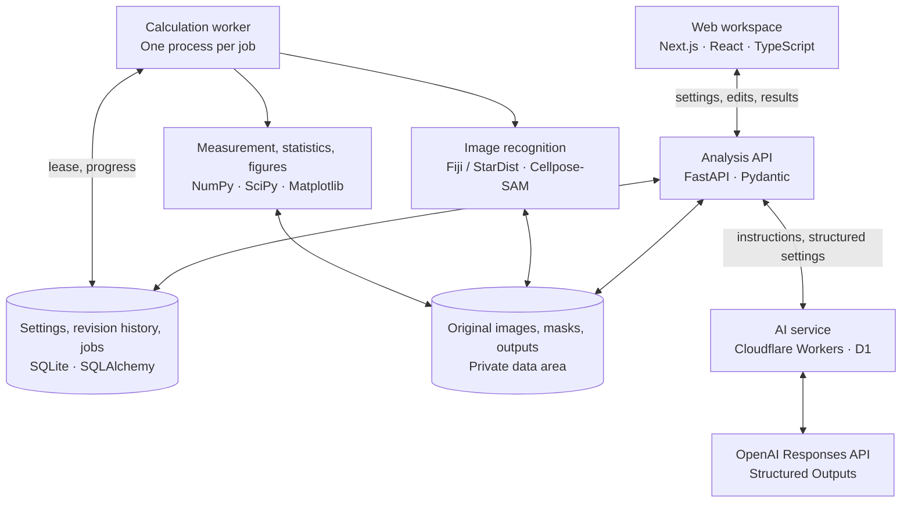

# Cytellect

**Get your microscopy publication-ready.**

[](https://cytellect.vercel.app/)

[日本語](README.md) · [Product site](https://cytellect.vercel.app/) · [Live demo](https://cytellect.vercel.app/demo) · [Windows](https://github.com/genellect/cytellect/releases/tag/v0.1.0-local.19) · [Docker](docs/docker-desktop.md) · [Methods](docs/methods.md) · [Documentation](docs/README.md)

Cytellect is an analysis platform for life-science researchers that takes microscopy images through analysis, statistics and figure output in one place. Image analysis uses the pretrained deep-learning models StarDist and Cellpose-SAM; numerical processing is implemented in Python.

## For contributors

When you join, read these three documents in order, and check the relevant sections for each task. AI agents follow the same documents.

1. [Team development rules](docs/team-development.md#english): workflow, Git and review, research data handling
2. [CONTRIBUTING](CONTRIBUTING.md) (Japanese): setting up and running a development environment, checks before a pull request
3. [Development principles](docs/development-principles.md) (Japanese): principles for calculations, statistics, data, the interface and releases

Other documents are collected in the [documentation index](docs/README.md).

## Architecture

The frontend is built mainly with Next.js and the server side mainly with FastAPI. When the browser requests an analysis, the API stores the settings and job in a database, and a worker runs inference, measurement, statistics and figure generation. The browser retrieves progress and results from the API and handles image and figure editing.

The LLM (currently GPT-6.1 Sol) is called through an AI service on Cloudflare Workers. The API validates the generated analysis settings and passes them to the same job pipeline as manual settings. The Windows and Docker editions use the same API and calculation code.



API data types are defined with Pydantic, and the frontend TypeScript types are generated from OpenAPI. Analysis settings, masks, measurements, statistics and figures are linked by version, so earlier results and their calculation conditions remain available after a model or setting changes.

### Repository layout

| Directory | Contents |
|---|---|
| [`apps/web`](apps/web) | Web workspace and public site (Next.js) |
| [`packages/analysis`](packages/analysis) | Shared detection, measurement, statistics and figure code |
| [`packages/contracts`](packages/contracts) | API type definitions (OpenAPI) |
| [`services`](services) | Analysis API, calculation worker and LLM relay |
| [`engines`](engines) | Fiji and Cellpose-SAM runtimes |
| [`infra`](infra) | Docker configuration |
| [`scripts`](scripts) | Setup and verification |
| [`tests`](tests) | Tests |
| [`docs`](docs) | Specifications and operations |

## Image recognition and measurement

Nuclei are detected with StarDist in Fiji; nucleoli and cell regions with Cellpose-SAM in PyTorch. Cellpose-SAM is built on SAM ViT-L and separates individual objects from a flow field and a foreground probability.

Subcellular structures are detected by hierarchical instance segmentation inside already-detected parent regions. Cellpose-SAM runs on each parent's background-estimated, normalized crop; candidates that capture the parent itself are discarded, and Multi-Otsu, distance transforms and watershed refine the boundaries.

Detection masks are stored as integer labels in the same coordinate system as the original image. Each nucleolus carries its parent nucleus ID, and outline display, manual correction and area/intensity calculations all refer to these labels. Detection and display images are kept separate from the original measurement pixels, so background removal or normalization applied to the detection copy does not change the measurement input.

The Fiji/TensorFlow Java and Cellpose-SAM/PyTorch inference environments are independent. Each pins its dependencies and models and verifies their hashes at run time.

Fine-tuning uses stained images with ground-truth labels and corrected instance masks. Cellpose-SAM is adapted separately for nucleoli and cytoplasm and evaluated for boundary accuracy, over-segmentation and merge errors with specimens and imaging batches kept apart. Training data, weights and inference settings are versioned together.

## Web workspace

Image editing runs on SVG and uses the original image coordinates, including during zoom and pan. Drawn, split and merged outlines and Undo/Redo results are saved to the mask, and selections in the measurement table are linked to regions on the image. Statistics and figures can also open the images and regions used in their calculation.

The graph editor imports Matplotlib SVG and maps axis and series selections to an editing panel. Changing colors or axes only redraws the figure; it does not rerun measurements or tests. Imported SVG is stripped of executable elements and external references, and element IDs are separated so that multiple figures do not collide.

Asynchronous responses are displayed only when their analysis target and settings version match the current screen. A calculation started before a settings change that finishes late does not overwrite the result being edited.

## LLM and analysis settings

The LLM receives the instruction text, the mapping between stains and channels, image dimensions and the current settings. The normal application path does not send original images or measurements.

The response is structured data containing detection conditions, measurement items, GFP-based selection, statistics and figure settings. The API validates types, numeric ranges and correspondence with registered channels, saves the result through the same path as manual settings and runs a preview on the selected image.

External API spending is managed by the relaying Cloudflare Worker and D1. Costs are reserved before each call and settled afterwards, both atomically. Unsettled reservations count toward the usage limit.

## Statistics and output

Measurement and statistics use NumPy, SciPy, pandas and statsmodels. Cells, fields, specimens and independent experimental units are aggregated separately before group comparisons, paired comparisons and correlation analysis. Object selection, exclusions, missing values and comparison conditions are recorded with the results.

Figures are generated with a fixed random seed and fixed output metadata. SVG keeps text editable and PDF embeds fonts. Exports include input hashes, the masks used, settings and environment information, and a recalculation script.

## Jobs and data management

Jobs are persisted in the database, and request IDs prevent duplicate execution. The worker follows dependencies and reuses existing results whose conditions match. Leases are acquired with compare-and-swap and verified again when results are committed, so a stale worker cannot overwrite newer results.

Each run uses its own working directory and child processes. Cancellation or exceeding time or memory limits stops only that run's process group.

Settings updates are checked against the requester's version and return `409` on conflict. Mask corrections are saved as new versions, and the measurements, statistics and figures that depend on that mask are marked for update.

Authentication uses `HttpOnly`, `SameSite=Strict` cookies, and tokens are stored as hashes. The API checks resource ownership and validates the Origin of update requests. See [SECURITY.md](SECURITY.md) for how to report a vulnerability.

Images and results that users load are stored in a data area separate from the application code, and the worker manages their retention and deletion ([data protection and operations](docs/security.md)).

## Distribution

The web UI is hosted on Vercel and the AI service on Cloudflare Workers. The analysis API and calculation environment are deployed separately and distributed with Docker and a Windows launcher.

The Docker edition runs the web UI, API and calculation worker in separate containers, with a non-root user, a read-only root filesystem and reduced privileges. The calculation worker has no network access.

The Windows edition builds a dedicated Python/Fiji environment and verifies signatures and package hashes. The launcher listens on `127.0.0.1` and establishes the owner's session. Updates keep research data in place and retain the previous version until the new version has started successfully.

## Development

### Local development

Use Python 3.12, Node.js 24, pnpm 11.19.0 and uv. To start on Linux:

```bash
python3 scripts/dev.py setup --fiji ~/cytellect-fiji

export CYTELLECT_DATA_DIR=~/cytellect-data CYTELLECT_FIJI_EXECUTABLE=~/cytellect-fiji CYTELLECT_SECURE_COOKIES=false
uv run cytellect invite --hours 24
uv run cytellect serve      # terminal 1
uv run cytellect-worker     # terminal 2 (same environment variables)
pnpm dev                    # terminal 3
```

CI covers types and API contracts, numerical calculations, real Fiji with browser integration, Windows setup and dependency audits. Statistical results are checked against independent closed-form or exhaustive calculations. For the Windows edition, CI also installs the distributed ZIP and verifies browser operation and recalculation.

```bash
python3 scripts/dev.py check
```

### Cloud development

In Claude Code or Codex cloud environments, register the setup script below in the environment settings. Detailed steps, including installing Fiji, are in [CONTRIBUTING](CONTRIBUTING.md) (Japanese).

| Tool | Setup script |
|---|---|
| Claude Code | `bash .claude/cloud-setup.sh` |
| Codex | `bash .codex/setup.sh` |

## License

The code is open source under the Apache License 2.0. Fiji, model weights and datasets are subject to their own licenses.
