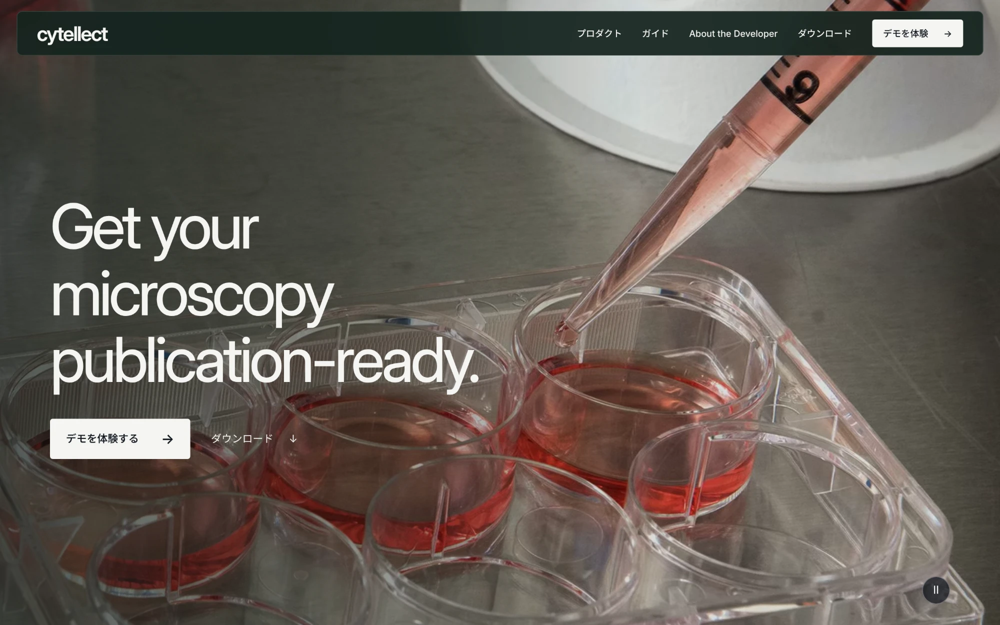
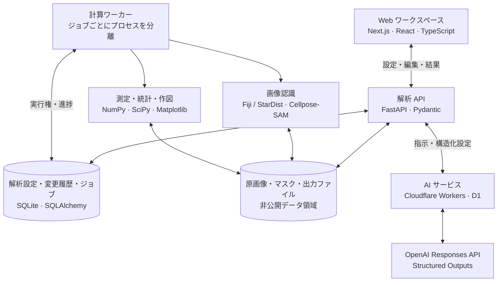

# Cytellect

**Get your microscopy publication-ready.**

[](https://cytellect.vercel.app/)

[プロダクト LP](https://cytellect.vercel.app/) · [公開デモ](https://cytellect.vercel.app/demo) · [Windows](https://github.com/genellect/cytellect/releases/tag/v0.1.0-local.19) · [Docker](docs/docker-desktop.md) · [統計解析手法](docs/implementation-overview.ja.md#統計解析)

Cytellect は、顕微鏡画像の解析から統計処理、グラフ出力までを一貫して引き受ける生命科学研究者のための Web アプリケーションです。画像処理には学習済みの深層学習モデルである StarDist と Cellpose-SAM、数理計算処理には Python を採用しています。※現在は開発中のプロトタイプです。

## アーキテクチャ

フロントエンドは主に Next.js、サーバーサイドは主に FastAPI が担当しています。ブラウザから解析要求を受けると、API が設定とジョブを DB に保存し、ワーカーが推論・測定・統計・作図を実行します。ブラウザは API から進捗と結果を取得し、画像や図の編集を受け持ちます。

LLM（現行採用モデルは GPT-6.1 Sol）は Cloudflare Workers 上の AI サービスから呼び出します。生成した解析設定は API で検証し、手動設定と同じジョブ処理へ渡す構成です。Windows 版と Docker 版にも、共通の API と計算コードを使用しています。



API のデータ型は Pydantic で定義し、OpenAPI からフロントエンドの TypeScript 型を生成しています。解析設定、マスク、測定値、統計結果、図はバージョンで関連付けられ、モデルや設定を変更した後も、以前の結果とその計算条件が残ります。

## 画像認識と測定

核の検出には Fiji 上の StarDist、核小体・細胞領域には PyTorch 上の Cellpose-SAM を使っています。Cellpose-SAM は SAM ViT-L を基盤とし、フロー場と前景確率から個々の対象を分割するモデルです。

NCL 染色画像では、核ごとに背景を推定・正規化した画像を Cellpose-SAM に入力します。推論後に核全体を拾った候補を取り除き、Multi-Otsu、距離変換、Watershed で境界を補正します。

検出マスクの保存形式は、原画像と同じ座標系の整数ラベルです。核小体には親核の ID があり、輪郭表示、手動修正、面積・輝度の計算がこのラベルを参照します。検出用画像と表示用画像は測定用の原画素から分けてあるため、背景除去や正規化を検出用コピーに適用しても、測定の入力は変わりません。

推論環境は Fiji／TensorFlow Java と Cellpose-SAM／PyTorch で独立しています。それぞれ依存パッケージとモデルを固定し、実行時にハッシュを照合する方式です。

追加学習（Fine-tuning）には、正解ラベルを付けた染色画像と修正済みのインスタンスマスクを使用しています。Cellpose-SAM を核小体・細胞質ごとに調整し、試料・撮影バッチを分けて輪郭精度、過分割、結合誤りを評価します。学習データ、重み、推論条件を一組としてバージョン管理する設計です。

## Web ワークスペース

画像編集は SVG 上で行い、ズームやパンを含めて原画像の座標系を使います。輪郭の描画・分割・結合、Undo／Redo の結果はマスクに保存され、測定表の選択と画像上の領域が連動します。統計や図からも、計算に使った画像・領域を開けます。

グラフエディタは Matplotlib の SVG を取り込み、軸や系列の選択を編集パネルに対応付けたものです。色や軸の変更で実行するのは再描画だけで、測定や検定をやり直すことはありません。取り込む SVG は実行可能要素と外部参照を除去し、複数の図で衝突しないよう要素 ID を分けています。

非同期応答は、解析対象と設定バージョンが現在の画面に一致したものだけを表示します。設定変更前の計算が遅れて完了しても、編集中の結果を上書きしません。

## LLM と解析設定

LLM に渡すのは、指示文、染色とチャンネルの対応、画像寸法、現在の設定などです。通常のアプリ経路に原画像と測定値は含まれません。

応答は、検出条件、測定項目、GFP による選別、統計、図の設定を持つ構造化データとして受け取ります。API 側で型・数値範囲・登録チャンネルとの対応を検証した後、手動設定と同じ処理で保存し、選択画像のプレビューを実行します。

外部 API の利用額は、中継する Cloudflare Worker と D1 で管理しています。呼び出し前に費用を予約し、完了後に精算する方式で、どちらの処理も原子的に実行します。未精算の予約も利用上限の計算に含まれます。

## 統計・出力

測定と統計計算は NumPy、SciPy、pandas、statsmodels が担当します。細胞・視野・試料・独立実験単位を区別して集計し、群間比較、対応あり比較、相関解析へ進みます。対象の選別、除外、欠測、比較条件は結果とともに記録されます。

図は乱数シードと出力メタデータを固定して生成します。SVG は文字を編集可能な状態で保存し、PDF はフォントを埋め込みます。書き出しには入力ハッシュ、解析に使ったマスク、設定・環境情報、再計算スクリプトを含めています。

## ジョブとデータ管理

ジョブは DB に永続化し、要求 ID で重複実行を防いでいます。ワーカーは依存関係に沿って処理を進め、条件が一致する既存結果を再利用します。実行権は compare-and-swap で取得し、結果の確定時にも検証するため、古いワーカーの結果で上書きされることはありません。

計算は実行ごとの作業ディレクトリと子プロセスで行います。キャンセルや時間・メモリ上限の超過時に停止するのは、その実行のプロセス群です。

設定更新は要求側のバージョンと照合し、競合時は `409` を返します。マスクの修正も新しいバージョンとして保存され、そのマスクに依存する測定・統計・図が更新対象になります。

認証は `HttpOnly`・`SameSite=Strict` Cookie を使用し、トークンはハッシュで保存しています。API ではリソースの所有権を確認し、更新要求には Origin の検証を行います。

研究データの保存先はコードと別の非公開領域です。既定では最終操作から24時間を保存期限とし、期限切れのデータはワーカーが削除します。停止中に期限を迎えた場合は、次回起動後の削除になります。研究者自身の PC（Windows 版・ループバックの Docker 版）では、削除操作まで保持する方式も選べます。

## 配布

Web UI の公開先は Vercel、AI サービスは Cloudflare Workers です。解析 API と計算環境は別に構築し、Docker と Windows ランチャーで配布しています。

Docker 版は Web、API、計算ワーカーを別コンテナで動かす構成です。非 root ユーザー、読み取り専用のルートファイルシステム、権限の削減を適用し、計算ワーカーにはネットワークを持たせていません。

Windows 版は専用の Python／Fiji 環境を構築し、署名と配布物のハッシュを検証します。ランチャーは `127.0.0.1` で待ち受け、所有者のセッションを確立します。更新時も研究データはそのまま保持し、新版の起動確認が終わるまで旧版を残す方式です。

## 開発・検証

開発の進め方、Git の運用、研究データの扱いは[チーム開発ルール](docs/team-development.md)に従います。

Python 3.12、Node.js 24、pnpm 11.19.0、uv を使用します。Linux での起動手順は次のとおりです。

```bash
uv sync --locked --dev
pnpm install --frozen-lockfile
uv run python scripts/fiji_setup.py ~/cytellect-fiji --platform linux-x64

export CYTELLECT_DATA_DIR=~/cytellect-data CYTELLECT_FIJI_EXECUTABLE=~/cytellect-fiji CYTELLECT_SECURE_COOKIES=false
uv run cytellect invite --hours 24
uv run cytellect serve & uv run cytellect-worker & pnpm dev
```

CI の対象は、型・API 契約、数値計算、実 Fiji とブラウザの連携、Windows のセットアップ、依存パッケージの監査です。統計結果は独立した数式や全列挙による計算と照合しています。Windows 版ではソースのテストに加え、配布 ZIP の導入からブラウザ操作、再計算までを確認します。

```bash
uv run pytest
uv run ruff check .
pnpm check
pnpm test
```

## ライセンス

コードは Apache License 2.0 で OSS として公開しています。Fiji、モデルの重み、データセットには、それぞれのライセンスが適用されます。
