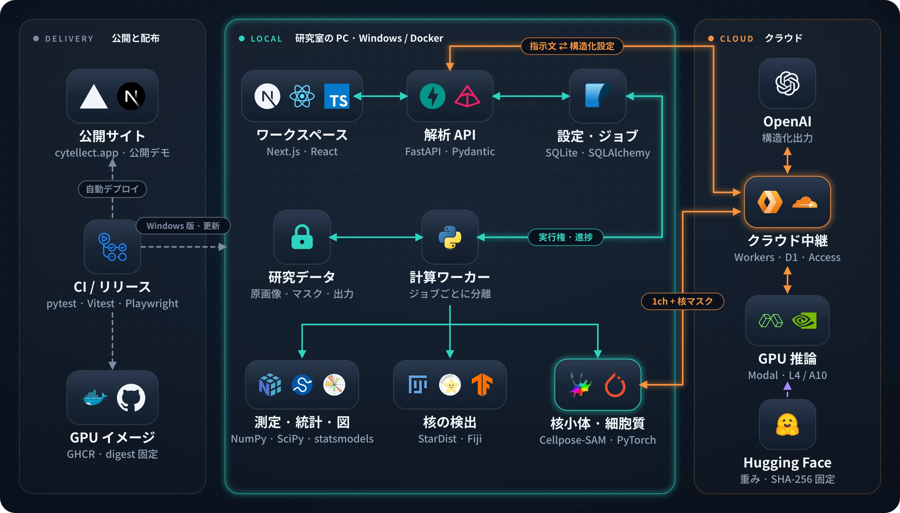
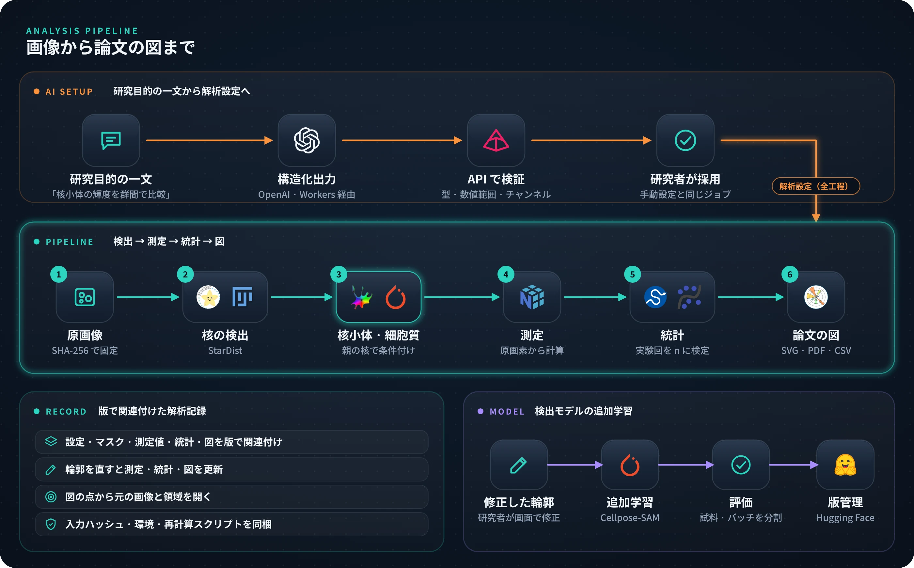

# Cytellect

**Get your microscopy publication-ready.**

[](https://cytellect.vercel.app/)

[プロダクト LP](https://cytellect.vercel.app/) · [公開デモ](https://cytellect.vercel.app/demo) · [Windows](https://github.com/genellect/cytellect/releases/tag/v0.1.0-local.19) · [Docker](docs/docker-desktop.md) · [統計解析手法](docs/implementation-overview.ja.md#統計解析) · [ドキュメント](docs/README.md)

Cytellect は、顕微鏡画像の解析から統計処理、グラフ出力までを一貫して引き受ける生命科学研究者のための解析基盤である。画像処理には学習済みの深層学習モデルである StarDist と Cellpose-SAM、数理計算処理には Python を採用している。

## 開発に参加する方へ

開発に参加するときは次の 3 つを順に読み、作業のたびに関係する節を確認すること。AI エージェントも同じ文書に従う。

1. [チーム開発ルール](docs/team-development.md)：開発の進め方、Git とレビュー、研究データの扱い
2. [CONTRIBUTING](CONTRIBUTING.md)：開発環境の構築と起動、PR を出す前の検査
3. [開発の原則](docs/development-principles.md)：計算・統計・データ・画面・リリースで守る原則

そのほかの文書は[ドキュメント](docs/README.md)にまとめている。

## アーキテクチャ



画像の登録から論文の図までを研究室の PC で完結させ、GPU 推論と LLM だけを外部に切り出す構成。測定値と統計は、どの実行環境でも `packages/analysis` の同じ実装が生成する。

```
解析ジョブ
  apps/web                Next.js。画像・測定表・統計・図を一つの画面で編集
  → services/api          FastAPI。設定を版で保存し、ジョブを SQLite に登録
  → services/worker       実行権を compare-and-swap で取得し、ジョブごとに子プロセスで実行
    → engines/fiji        核の検出（StarDist · TensorFlow Java）
    → engines/cellpose    核小体・細胞質の検出（Cellpose-SAM · PyTorch）。CPU または Modal の GPU
    → packages/analysis   測定・統計・作図（NumPy · SciPy · statsmodels · Matplotlib）

AI による解析設定
  services/api → services/proposal-worker（Cloudflare Workers · D1）→ OpenAI Responses API
  → API で検証 → 研究者が採用 → 手動設定と同じジョブ
```

### 実行環境

| 環境 | 実行場所 | 構成 | 外部に送るデータ |
|---|---|---|---|
| Windows 版 | 研究室の PC | 専用の Python・Fiji 環境。`127.0.0.1` で待ち受け | — |
| Docker 版 | 研究室の PC | Web・API・ワーカーを別コンテナで実行。ワーカーはネットワークなし | — |
| GPU 推論 | Modal（L4 優先、A10 を予備候補） | GHCR の digest 固定イメージ。使用後 20 秒で停止（`infra/modal_cellpose.py`） | 検出用の 1 チャンネルと核マスク |
| LLM の中継 | Cloudflare Workers · D1 | 費用の予約と精算（`services/proposal-worker`） | 指示文・チャンネルの対応・画像寸法・現在の設定 |
| 公開サイト | Vercel | LP と公開デモ。`main` へのマージで自動デプロイ | 研究画像は受け付けない |

### ディレクトリ構成

| ディレクトリ | 内容 |
|---|---|
| [`apps/web`](apps/web) | Web ワークスペース、LP、公開デモ（Next.js） |
| [`packages/analysis`](packages/analysis) | 検出・測定・統計・作図の共通実装。API・ワーカー・公開デモが同じコードを使う |
| [`packages/contracts`](packages/contracts) | API の OpenAPI 定義と既定レシピ。TypeScript 型の生成元 |
| [`services/api`](services/api) | 解析 API（FastAPI） |
| [`services/worker`](services/worker) | 計算ワーカー。ジョブごとに子プロセスで検出・測定・統計を実行 |
| [`services/proposal-worker`](services/proposal-worker) | LLM の中継と費用の管理（Cloudflare Workers · D1） |
| [`services/showcase`](services/showcase) | 公開デモの記録と再生（Pyodide） |
| [`engines/fiji`](engines/fiji) | StarDist による核の検出（Fiji プラグイン） |
| [`engines/cellpose`](engines/cellpose) | Cellpose-SAM の推論 runner と GPU サーバー。依存とモデルを固定 |
| [`engines/python`](engines/python) | Windows 版の Python ランタイムの固定 |
| [`infra`](infra) | Docker（Web・API・ワーカー）、Caddy による TLS、Modal の GPU サーバー |
| [`scripts`](scripts) | 開発の入口 `dev.py`、セットアップ、配布物と公開デモの構築、検証 |
| [`tests`](tests) | 数値計算・API・ブラウザ・Windows 導入の試験 |
| [`fixtures/public`](fixtures/public) | 試験と公開デモに使う公開画像。出典・ライセンス・ハッシュを登録 |
| [`docs`](docs) | 仕様、計算方法、運用の文書 |

## 画像認識



StarDist で検出した核を親として、核小体・細胞質を Cellpose-SAM で検出する階層的なインスタンス分割。

```
1. 原画像        SHA-256 で固定。測定は常に原画素から計算
2. 核の検出      StarDist（Fiji · TensorFlow Java）
3. 背景の正規化  核ごとに推定し、検出用のコピーにだけ適用
4. 推論          Cellpose-SAM（SAM ViT-L）を親の核で条件付けて実行
5. 誤候補の除去  核全体を拾った候補を除外
6. 境界の補正    Multi-Otsu · 距離変換 · Watershed
→ 原画像座標の整数ラベル。核小体は親核の ID を保持
```

- 検出用の画像と測定用の原画素を分ける。背景補正や正規化を測定値に混ぜないため
- 推論を親の核で条件付ける。汎用モデルが核全体や核外の構造を核小体として拾うのを防ぐため
- Fiji／TensorFlow Java と Cellpose-SAM／PyTorch を別の環境で実行し、依存パッケージとモデルの SHA-256 を読み込み前に照合する。実行時のダウンロードと外部通信は禁止
- GPU 推論は PC と同じ `runner.py`・モデル・ライブラリ版を使い、float32・TF32 無効・決定的アルゴリズムで実行する。返った結果は版のハッシュを照合し、一致しなければ採用しない

### 追加学習

```
研究者が修正した輪郭 → 教師データ → 追加学習（Cellpose-SAM）→ 評価 → 版管理（Hugging Face）
```

| 項目 | 内容 |
|---|---|
| 教師データ | 染色画像と、研究者が修正したインスタンスマスク |
| 対象 | 核小体・細胞質ごとに Cellpose-SAM を追加学習 |
| 評価 | 試料・撮影バッチを分け、輪郭精度・過分割・結合誤りを評価 |
| 公開 | 学習データ・重み・推論条件を一組で版管理し、重みを [Hugging Face](https://huggingface.co/Genellect/Cytellect) で公開 |

## AI による解析設定

研究目的の一文を、LLM（GPT-6.1 Sol）が検出・測定・選別・統計・図の構造化設定に変換する。LLM が担うのは設定の提案だけで、数値は検証済みの Python が計算する。

- 送るのは指示文・染色とチャンネルの対応・画像寸法・現在の設定。原画像・測定値・ファイル名は送らない
- 応答は Structured Outputs で受け、API が型・数値範囲・登録チャンネルを検証する。研究者が採用した設定だけを、手動設定と同じジョブで実行
- 利用額は Workers と D1 で管理する。呼び出し前に最大の費用を原子的に予約し、完了後に精算。精算されなかった予約も上限に数え、障害時にも上限を超えない

## 統計と論文の図

- 細胞・視野・試料・独立した実験を区別し、独立した実験を n として検定する。細胞数を n にすると、差のないデータからも誤った有意差が出るため
- 設定・マスク・測定値・統計・図を版で関連付ける。輪郭を直すと依存する測定・統計・図が更新対象になり、古い結果は混ざらない
- 図の点から、その値を計算した画像と領域を開ける
- グラフの色や軸の変更は再描画だけ。測定と検定はやり直さない
- 図は SVG（文字を編集可能）・PDF（フォント埋め込み）・CSV で出力し、入力ハッシュ・マスク・設定・環境・再計算スクリプトを同梱

## 結果の整合性

同じ入力と設定からは同じ結果を出し、古い計算が新しい結果を上書きしない。

| 仕組み | 防ぐこと |
|---|---|
| ジョブを DB に永続化し、要求 ID で重複実行を防ぐ | 二重送信による重複計算 |
| 実行権を compare-and-swap で取得し、確定時にも検証 | 止まった古いワーカーの結果による上書き |
| 設定の更新は版を照合し、競合時は `409` | 複数の画面からの編集による設定の巻き戻し |
| 画面は対象と設定の版が一致する応答だけを表示 | 設定変更前の計算が遅れて届いたときの取り違え |
| 実行ごとの作業ディレクトリと子プロセス | 1 つのジョブの停止・失敗の波及 |

## 研究データの保護

研究画像と測定値は研究室の PC に置き、外部に出すデータを用途ごとに限定する（[実行環境](#実行環境)）。

- 研究データはアプリのコードと別のデータ領域に保存し、保存期限の管理と削除をワーカーが担う
- Docker 版の計算ワーカーはネットワークを持たない。非 root・読み取り専用のルートで実行
- Windows 版は `127.0.0.1` だけで待ち受け、配布物の署名とハッシュを検証してから導入する
- 認証は `HttpOnly`・`SameSite=Strict` の Cookie。トークンはハッシュで保存し、API はリソースの所有権と Origin を検証

脆弱性の報告方法は [SECURITY.md](SECURITY.md) にまとめている。

## 開発

開発環境の構築と起動の手順は [CONTRIBUTING](CONTRIBUTING.md) にまとめている。

| 環境 | 特徴 | セットアップ |
|---|---|---|
| [クラウド開発](CONTRIBUTING.md#クラウド開発) | 固定版の開発ツールと Fiji を備えたクラウド環境。手元への導入は不要 | Claude Code は `bash .claude/cloud-setup.sh`、Codex は `bash .codex/setup.sh` |
| [ローカル開発](CONTRIBUTING.md#ローカル開発) | 手元の PC とブラウザで操作。開発サーバーで Web の変更を即時に反映 | `python3 scripts/dev.py setup --fiji ~/cytellect-fiji` |

どちらの環境も `python3 scripts/dev.py serve` で起動し、PR の前に `python3 scripts/dev.py check` で CI と同じ検査を行う。CI の対象は、型・API 契約、数値計算、実 Fiji とブラウザの連携、Windows 版の導入、依存パッケージの監査である。統計結果は独立した数式や全列挙による計算と照合している。

## ライセンス

コードは [Apache License 2.0](LICENSE) で OSS として公開している。第三者のコンポーネントには、それぞれのライセンスが適用される。

| 対象 | ライセンス | 扱い |
|---|---|---|
| Fiji | GPL-3.0（Bio-Formats は GPL、MorphoLibJ は LGPL-3.0） | リポジトリと Windows 版の配布物には含めない。導入時（Docker 版はイメージのビルド時）に公式の配布元から取得し、別プロセスとして実行する |
| Cellpose の依存（fastremap、fill-voids） | LGPL-3.0 | 改変せずに利用する |
| 学習済みモデル（StarDist、Cellpose-SAM の `cpsam_v2`） | BSD-3-Clause（StarDist はモデルのリポジトリ、`cpsam_v2` はモデルカードで宣言） | 導入時に公式の配布元から取得し、SHA-256 を照合する |
| 追加学習した重み | BSD-3-Clause | Cellpose の著作権表示と改変した旨を添えて、[Hugging Face](https://huggingface.co/Genellect/Cytellect) で公開する |
| 公開画像 | CC0-1.0（BBBC007、BBBC039、JUMP）、CC BY 3.0（BBBC013）、4DN の公開データ利用方針 | 出典を記録する。4DN の原画像は再配布しない |
| LP の写真、図中のロゴ | Pexels・Unsplash の各ライセンス、各社の商標 | ロゴはソフトウェアの識別にだけ使う |

依存パッケージのライセンスは CI が SBOM として記録する。モデルごとのソフトウェア・重み・学習データの記録は[第三者ソフトウェアと重み](docs/oss.md)にある。
