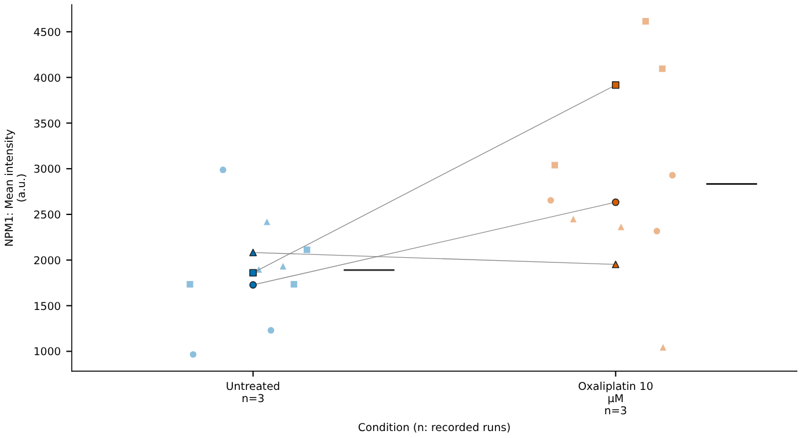

# 論文の図：目的の再検討と実装案（案）

作成：2026-11-19。オーナーの指摘（図が論文の水準に達していない、機械的で UI の完成度が低い、生物学的に必要な情報が揃っていない）と指示（Python の出力で直せるものは Python で直し、難しい部分だけ LLM と組み合わせる。無料で使える手段も検討する。本番だけでなくデモの画面も同じように変える）を受けた案。**オーナーの承認前の下書きで、[§9](#9-オーナーの判断が必要な点) の判断が決まるまで実装を始めない。** 目的と完了要件は genellect/cytellect#244 にもある。この文書と要件が食い違う場合は、承認済みの要件（[要件](../../requirements.md)、[群間比較の要件定義書](../group-comparison/requirements.md)、[結果の表現とデモの素材](../results-and-demo-story/requirements.md)）が正しい。

## 1. 結論

- 課題の大部分は matplotlib のままで解決できる。原因はライブラリではなく、描画器が「統計の記録として正しい図」を目的に作られ、「研究者が論文で 1 つの主張を伝える図」を設計していないことにある。
- 目的を「グラフの見た目の改善」から、**「保存した比較から、代表画像・定量・統計の注釈・凡例がそろった図が、既定のままで論文とラボミーティングに出せる」** に置き直す。
- 本番とデモは同じ部品と同じ描画器で動かす。デモだけの画面や図は作らず、画面が選ばせる図の選択肢をすべて記録し直す。
- LLM は図を描かず、数値も書かない。使うのは、研究の目的から図の構成を提案する部分と、凡例の数値以外の語句（細胞株、処理の説明など）の候補を出す部分だけにする。
- 4 つの段階（PR）に分ける。段階 1（スタイル・定量の図・注釈）だけで、指摘の「見にくい」「何をしたいのか分からない」「機械的」の大半が直る。

現行の図と、同じ保存結果から matplotlib だけで描いた試作を並べる（[§11](#11-根拠) に条件と限界）。

| 現行（公開デモのオキサリプラチンの場面、核の NPM1 平均輝度） | 試作 |
|---|---|
|  |  |

## 2. 目的の再検討

### 2.1 研究者が図に求めること

Wet 研究者にとって、図は統計の出力ではなく、**主張の単位**である。細胞生物学の画像の実験では、1 つの主張は次の 4 つがそろって初めて伝わる。以下は文献（[§11](#11-根拠)）とオーナーの指摘に基づく仮説で、研究者への聞き取りの結果ではない。

| 要素 | 研究者と査読者が確かめること | 今の出力 |
|---|---|---|
| 代表画像 | 現象が画像で見えるか。何を測ったか。条件の間で表示が同じか。縮尺 | ない（[群間比較の要件](../group-comparison/requirements.md) F-06 で第二段階とした） |
| 定量 | 全データ点、実験回ごとの再現性、n が何か | 点はあるが、実験回・視野・要約の区別が図から読めない |
| 統計の注釈 | どちらにどれだけ変わったか。検定と P 値 | 図の中にない（caption と CSV だけ） |
| 凡例 | n の定義、集約の規則、検定、縮尺、表示の条件 | caption は UUID の並ぶ監査記録で、論文に使えない |

研究者が図を使う場面は 3 つある。

1. **ラボミーティング・指導教員への報告**：今日の結果を、スライドに貼れる画像ですぐ出したい。
2. **論文の図**：最終の寸法とフォントで、Illustrator などで組める編集可能なファイルが要る。凡例、元データ、Methods も要る。
3. **査読への対応**：群の順序、軸の範囲、色、条件の追加と削除を、解析をやり直さずに直したい。図の点から元の画像へ戻りたい。

今は、代表画像を別のソフト（Fiji など）で書き出し、スケールバーを付け、作図ソフトで並べ、n と検定を凡例に手で写す作業が残る。[プロダクトの使命](../../development-principles.md#プロダクトの使命)の「統計と編集可能な論文の図まで同じ作業の中で完了できる」は、ここで途切れている。条件ごとに明るさを別々に調整してしまう誤りも、この手作業で起きうる。

### 2.2 目標

**G0：保存した比較から、1 つの主張を伝える図（代表画像・定量・統計の注釈・凡例）が、設定を変えなくても論文とラボミーティングに出せる水準で出る。研究者が決めるのは「何を見せるか」だけで、体裁を整える作業をしない。本番とデモで、同じ画面と同じ図になる。**

| ID | 目標 | 達成した状態 |
|---|---|---|
| G1 | 既定で完成している | 「グラフ」を開いた時点の図を、そのまま保存して使える。寸法・文字・目盛・色・余白を直す必要がない |
| G2 | 図が主張を伝える | 図だけを見て、何を比べ、n が何で、どちらにどれだけ変わったかが分かる。値は画面の結果のまとめと一致する |
| G3 | 何を測ったかが画像で分かる | 各群の代表画像に、測った領域の輪郭、染色の名前、スケールバーが付き、表示の条件が群の間で同じである |
| G4 | 凡例と付随情報がそろう | 論文に貼れる英語の凡例の下書きが出る。足りない情報は、推測で埋めずに入力を促す |
| G5 | 迷わず直せる | 見せるもの・形・大きさを、その結果に合う選択肢から選ぶ。細部は図の部品を選んで直す。変更はすぐ図に反映される |
| G6 | どの環境でも同じ図 | Windows 版・Docker 版・公開デモが、同じ結果から同じフォントと同じ配置の図を出す |
| G7 | デモで品質が伝わる | `/demo` の「統計」「グラフ」を開くと、追加の操作なしに新しい既定の図が出る。選べる図の操作は本番と同じで、すべて記録から答える |

### 2.3 範囲

| 含む | 含まない |
|---|---|
| 群間比較・相関・分布の図の描画（スタイル、形、注釈、図の中の凡例） | 検定・推定・集約の計算の変更 |
| 代表画像のパネル、パネル記号付きの組図、凡例の下書き | 3 次元・タイムラプスの画像パネル、動画 |
| 「グラフ」の画面の設計、統計の画面に出る図 | 画像の画面、統計の設定、結果のまとめの文（[結果の表現](../results-and-demo-story/requirements.md)のまま） |
| 公開デモの記録・実行環境・受入試験 | デモの場面と素材の変更 |
| 図の構成と凡例の語句への LLM の利用（段階 4） | LLM による図の描画、数値の生成、考察を図に入れること |
| README の Hero と LP の図を実際の出力に合わせる判断（[§9](#9-オーナーの判断が必要な点)） | LP の構成と文言の変更 |

**変えない約束**

- 原画像の画素値を変えない。図の画像の明るさは表示だけの線形の変換で、範囲を記録する。
- 測定値と統計は、API と解析パッケージの共通実装だけが作る。図と凡例に入る値は、保存した結果の値だけにする。
- n は独立した実験回の数とし、核や視野の数で n を増やさない。独立性を確認していない比較では、検定と区間を計算せず、図に区間を描かない（NT-07）。
- 体裁の変更で、解析と検定をやり直さない（U04）。保存した過去の図は、元の版の描画器で再生できる（N-07）。
- 図の中の文字と凡例は英語（S06、S-08）。画面の文は日本語で、UC-01〜UC-07 に従う。
- デモだけの画面を作らない。訪問者の端末で解析を起動しない（[公開デモ](../../showcase.md)）。

## 3. 現状

2026-11-19 の `main`（`7ff06b2b`）のコードと、公開デモに記録された図を描画して確かめた事実。行番号は変わるので、ファイルと関数の名前で示す。

| 項目 | 現状 | 根拠 |
|---|---|---|
| 描画器 | 3 系統。群間比較と相関は `common_statistics_figures.py`（版 1.0.1）。数値表・以前の版の領域比較・旧レシピは `figures.py`（1.1.3）。視野ごとの記述は `descriptive_pages.py`（2.0.1） | `services/worker/src/cytellect_worker/figure_render.py` の振り分け |
| 既定の大きさ | 183 × 100 mm。2 群でも 2 段幅になり、群の間が約 8 cm 空く | `ConnectedResults.tsx` の幅と高さの初期値（183、100）、デモの保存結果 |
| 幅の下限 | 76.2 mm（`PlotSpec.width_inches ≥ 3`）。2 群のパネルを論文の実寸（40〜60 mm）で出せない | `contracts.py` の `PlotSpec` |
| フォント | 英語の図は Arial、Liberation Sans、DejaVu Sans の順に、その環境にあるものを使う。Windows は Arial、Docker とデモは DejaVu Sans になり、同じ結果でも図が変わる | `figures.py` の `FONT_FAMILIES`、`infra/Dockerfile.python`、[公開デモ](../../showcase.md)の「英語の図はどちらも DejaVu Sans」 |
| 統計の注釈 | どの描画器も、効果の大きさ・P 値・実験回の揃い方を図に描かない。処理 − 対照の推定値（`estimates`）は保存されているが、図は読まない | 各描画器、`comparison_estimates.py` |
| 図の中の凡例 | 共通統計の実験回ごとの図・箱ひげ・バイオリンにはない。記号の形が実験回、小さい点が視野、横線が平均であることを、図から読めない | `common_statistics_figures.py` の `_hierarchy` |
| 群の要約の位置 | 平均の線が点の右へ 0.32 ずれる。検定なしでは区間がなく、はぐれた線に見える | 同上（`summary_x = i + .32`） |
| 下位の点 | 実験回ごとの図は視野の値まで。核の値は保存結果（`plot_data`）にあるが描かない。配置は乱数（seed 0） | 同上 |
| 形の選択肢 | 7 種類を技術名で並べる。実験回が 3 でも、実験回の値のバイオリン・箱ひげ・ヒストグラムを選べる | `ConnectedResults.tsx` の「図のレイアウト」 |
| 軸とラベル | 縦軸は自動で 0 を含まない。目盛が多い。`textwrap.fill(16)` が「Oxaliplatin 10 / µM」のように数値と単位を分ける。割合の指標で単位が重複する。領域の名前がない | 記録された SVG、`_label` |
| 描画器の中の計算 | 群の平均と 95% 区間を、描画器が実験回の値から計算する（`_unit_interval`）。2 群の比較では、同じ値が保存した `estimates.groups` にもある | `common_statistics_figures.py` |
| 代表画像・組図 | ない | [群間比較の要件](../group-comparison/requirements.md) F-06 |
| 凡例 | `figure-caption.md` は視野の UUID・`status=selected`・警告のコードを並べた記録 | `descriptive_figures.py` の `_caption` ほか |
| 画面 | 設定は「図・横軸・縦軸・系列」の切り替えと mm・pt の数値欄。変更のたびに「図を更新」を押し、描画のジョブを待つ | `ConnectedResults.tsx`、`EditableFigure.tsx` |
| デモ | 本番と同じ部品。記録の手順（`journal.mjs` の `figures()`）が、画面の「図の幅」「図のレイアウト」の選択肢を名前で探し、全部の組み合わせを記録する。寸法・文字・ラベル・色などの自由入力は記録せず、案内を出す | [公開デモ](../../showcase.md)、`services/showcase/src/cytellect_showcase/journal.mjs` |
| デモの容量 | 公開ファイルは 600.9 MiB（上限 700 MiB、DM-10）。図の SVG は 1,927 個で 44.4 MiB | `git ls-files apps/web/public/showcase` の合計 |
| README の Hero の図 | a/b のパネル、`−82%` の注釈、実験回の色の凡例がある。現行の描画器には、これらを描くコードがない | `docs/images/readme-hero.webp`、各描画器 |

## 4. 研究者の体験の設計

### 4.1 原則

1. **既定で完成している。** 設定は、変えたいときだけ開く。
2. **図は 1 つの主張を伝える。** 図の注釈は、画面の結果のまとめ（RS-02・RS-03）と同じ事実を、英語で短く示す。
3. **形は実験の構造から決まる。** グラフの種類の一覧から選ばせない。実験デザイン（対応の有無、実験回の数）、観測値の数、指標の尺度から既定を決め、その結果で妥当な代替だけを出す。
4. **画像と数値を切り離さない。** 定量の横に、測った領域の輪郭を重ねた代表画像を置く。
5. **誠実さを画面の摩擦にしない。** 記述統計であること、表示範囲、代表画像の選び方は、凡例と記録に静かに書く。画面に警告を並べない（NT-01 と同じ考え方）。
6. **仕上げは外でもできる。** 文字が文字のまま編集でき、部品に名前が付いた SVG を出す。
7. **本番とデモは同じ。** 部品、描画器、選択肢を分けない。

### 4.2 「グラフ」の画面の流れ

例：薬剤で核の NPM1 が変わるかを 3 回の実験で確かめた研究者が、今日のラボミーティングで見せ、後で論文の図にする。

| | 今 | 新しい流れ |
|---|---|---|
| 開く | 2 段幅の図と、図・横軸・縦軸・系列の設定が出る | 実寸の比率の完成した図（代表画像と定量）が出る。そのまま「保存」できる |
| 見せるものを決める | 「図のレイアウト」の 7 種類から選ぶ | **構成**（定量のみ／画像＋定量）と**形**（その結果に合う 2〜3 個を見本付きで）を選ぶ |
| 大きさを決める | 幅・高さ・文字を mm と pt で入力する | **大きさ**（パネル／1 段幅／2 段幅）を選ぶ。数値の入力は「カスタム」だけ |
| 細部を直す | 設定の切り替えから欄を探す | 図の部品（軸、点、注釈、画像）を選ぶと、その部品の設定だけが開く |
| 反映 | 「図を更新」を押して待つ | 自動で描き直す。その間は前の図を残し、「更新中」と示す |
| 代表画像 | 別のソフトで作る | 図の中の画像を選び、視野の候補から選び直す。切り出しの位置を動かす |
| 凡例 | n と検定を手で写す | 図の下の凡例の下書きをコピーする。足りない情報は 1 行で示され、「実験」から入力する |
| 保存 | SVG・PDF・PNG と来歴の記録 | 同じ「保存」で、SVG・PDF・PNG・凡例・元データ・Methods。スライド用に PNG をコピーできる |

### 4.3 図の構成

定量の図を、グラフの種類ではなく 4 つの層の組み合わせとして扱う。層ごとに、何を描くかが保存した結果から決まる。

| 層 | 描くもの | 選べる表し方 |
|---|---|---|
| 観測値 | 核・領域・視野の値（指標の観測の単位） | 点（既定）／密度の輪郭（バイオリン）を重ねる／箱ひげを重ねる／描かない |
| 実験回 | 保存した集約による実験回の値。対応のある設計では同じ実験回を線で結ぶ | 常に描く |
| 群の要約 | 実験回の値の平均。計算した場合は 95% 信頼区間 | 線（既定）／棒 |
| 注釈 | 効果の大きさ、実験回の揃い方、P 値 | 表示（既定）／非表示 |

既定は次の規則で決める。研究者は、表の「選べる代替」だけを選べる。しきい値は[§9](#9-オーナーの判断が必要な点) の判断 4 で決める。

| 条件 | 既定 | 選べる代替 |
|---|---|---|
| 2 群以上の比較、観測値が群あたり 30 未満 | 観測値の点 ＋ 実験回 ＋ 平均の線 | 棒（比の尺度で値が 0 以上の指標だけ） |
| 同、観測値が群あたり 30 以上 | 観測値の点と密度の輪郭 ＋ 実験回 ＋ 平均の線 | 輪郭なし、箱ひげ、棒 |
| 観測の単位が視野（核数、陽性率など） | 視野の点 ＋ 実験回 ＋ 平均の線 | 棒 |
| 実験回の値の箱ひげ・バイオリン・ヒストグラム（今の形） | 既定にしない | 群あたりの実験回が 10 以上のときだけ出す |
| 相関 | 実験回ごとの点（今と同じ）。保存した相関係数と P を注釈に出す | — |
| 分布（1 群の記述） | 今の視野ごとの図に、スタイルだけを適用する | — |

### 4.4 デモの訪問者の体験

- `/demo` の「統計」を開くと、結果のまとめの下に新しい既定の図が出る。「グラフ」を開くと、同じ図が実寸の比率で出て、構成・形・大きさを本番と同じ操作で切り替えられる。
- 選択肢として出るものは、すべて記録から待たずに答える。自由入力（軸の範囲、ラベル、色の値、切り出しの位置、代表画像の選び直し）は、今と同じく記録した値に固定し、選ぶと案内を出す。
- デモ用の説明や目印を図に足さない。図そのものの品質で伝える。

## 5. 要件

### A. スタイルと出力（FS）

**FS-01** 図の描画は matplotlib のままとする。スタイル（フォント、線、余白、目盛、色、パネル記号）を 1 つのモジュールに集め、3 系統の描画器が共有する。

**FS-02** フォントは、Arial と字幅が同じで再配布できるもの（候補：Arimo、Apache-2.0。または Liberation Sans、OFL-1.1）の Regular と Bold を、解析パッケージに同梱する。Windows 版・Docker 版・デモのどれも、同梱したフォントで描く。配布元・版・ハッシュ・ライセンスは実装の最初に確認して固定し、[OSS の記録](../../oss.md)と公開ファイルの登録に加える。字形の検査（図の文字をすべて持つ通常の太さのフォントだけを使う）は保つ。利用者が入力した日本語の群名などは、今の代替の規則（Noto Sans）で描く。

**FS-03** SVG の文字は文字のまま出す。フォント名は同梱したフォントを先頭に、Arial と Helvetica を代替として書く。字幅が同じなので代替でも配置が変わらないことを、実装で実測して確かめる。PDF はフォントを埋め込む。画面の図の表示は、同梱したフォントを Web フォントとして読み込み、書き出すファイルと同じ見た目にする。

**FS-04** 大きさは、論文の実寸を既定にする。

- 選択肢は「パネル」（既定。群の数と構成から幅と高さを決める）、「1 段幅 89 mm」、「2 段幅 183 mm」、「カスタム」。
- 幅の下限を 76.2 mm から 30 mm に下げる。
- 文字は 5〜7 pt、パネル記号は 8 pt の太字の小文字（[Nature の図の指針](https://research-figure-guide.nature.com/figures/building-and-exporting-figure-panels/)）。
- PNG は 600 dpi にする。300 dpi では、幅 45 mm のパネルが約 530 画素になり、スライドで粗い。

**FS-05** 軸は次の規則で描く。利用者が範囲と目盛を指定した場合は、それを優先する。

| 指標の尺度（`metric_scale`） | 縦軸 |
|---|---|
| 比（面積、数、密度、補正前の輝度） | 値がすべて 0 以上なら 0 から始める |
| 割合 | 0 から始め、% で表示する（値は変えない） |
| 差（背景補正後の輝度、離心率） | 自動。範囲に 0 が入る場合は、0 に細い基準線 |
| log2 | 自動。0（比が 1）に細い基準線 |

目盛は 4〜6 本にし、桁の多い値は桁区切りを付ける。

**FS-06** 縦軸の名前は、領域・染色・統計量・単位から組み立てる（例：`Nuclear NPM1 mean intensity (a.u.)`）。単位を 2 回書かない。群名は語の境目で折り返し、数値と単位（`10 µM`）を分けない。指標の英語名は解析パッケージの 1 か所に置き、画面の指標の一覧（`metric-catalog.ts`）と同じ指標 ID で対応させる。

**FS-07** 色は、実験回を色で区別する（Okabe–Ito の配色。8 回を超えたら記号を併用する）。群は横軸の位置で示す。「群で色分け」も選べ、その場合は実験回を記号で区別する。顕微鏡画像の合成に、赤と緑の組を使わない（FI-05）。

**FS-08** 文字の重なりと図の外へのはみ出しの検査を、注釈・図の中の凡例・パネル記号にも適用する。検査に通らない図は出さない（今と同じ）。

### B. 定量の図（FQ）

**FQ-01** 定量の図を、観測値・実験回・群の要約・注釈の 4 層で描く（[§4.3](#43-図の構成)）。群の要約は群の中央に置き、点とずらさない。

**FQ-02** 既定の形と選べる代替は、[§4.3](#43-図の構成) の規則で決める。規則は解析パッケージに置き、画面は API が返す選択肢だけを出す。画面とデモで別の規則を持たない。

**FQ-03** 観測値は 1 つも省かない。配置に乱数を使わず、値と順序から決まる配置（beeswarm。数が多いときは密度に比例した幅の中に並べる）にする。同じ結果からは、いつも同じ図になる。

**FQ-04** 実験回の値は、保存した集約の値（視野の中央値 → 試料の平均 → 実験回の平均）を描く。描画器で観測値から計算し直さない。

**FQ-05** 群の平均と区間は、保存した結果の値を描く。2 群の比較では `estimates.groups` を使う。保存した結果に群の区間がない場合（3 群以上の比較、以前の結果）は、今の描画器の計算（実験回の値の平均と t 区間。`graphical-summary.csv` に保存する）を変えずに使う。この計算を共通の解析へ移すことは、統計の版を上げる別の変更とする（T-06）。図のために、これ以外の値を描画器で新しく計算しない。記述統計では区間を描かない（NT-07）。

**FQ-06** 図の中に、実験回の色（または記号）の凡例を置く。群名の下に、実験回の数を `n = 3` と書く。核と視野の数は凡例文に書き、n と書かない（S-03）。

**FQ-07** 相関と分布の図にも、スタイル（FS）を適用する。相関は、保存した相関係数・P・n を注釈に出す。分布の図の構成（視野ごとのページ、空の視野を残す、S13）は変えない。

**FQ-08** 新しい描画は新しい図の版とする。保存した図の再生と書き出しは、保存した版の描画器で行う（N-07）。箱ひげ・バイオリン・ヒストグラム（S18）は API に残す。

### C. 注釈（FA）

**FA-01** 群間比較の図に、既定で効果の注釈を描く。向きは「処理 − 対照」、示す推定値は S-04 のとおり、指標の尺度と手法で決める。

| 場合 | 図の注釈（例） |
|---|---|
| 検定あり、比を示せる指標 | `−80% (95% CI −86 to −71)`、`P = 0.012` |
| 検定あり、差で示す指標 | `Δ = −0.12 (95% CI −0.20 to −0.04)`、`P = 0.012` |
| 検定あり、区間が 0 を含む、または P ≥ 0.05 | 推定値と区間、`P = 0.21`。`n.s.` と書かない（S-07） |
| 順位に基づく検定 | `P = 0.031`（効果量は凡例文） |
| 記述統計、全実験回が同じ向き | `−79 to −84% (3/3 runs)` |
| 記述統計、向きが揃わない | `Lower in 2 of 3 runs` |
| 3 群以上 | 宣言した対比ごとに括弧と Holm 補正後の P。対比が 4 つ以上なら図に描かず、凡例文と表に出す |

例の数値は形を示すためのもので、実際の結果ではない。

**FA-02** 注釈の文字列は、保存した結果（`estimates`、`comparisons`、`associations`）だけから、解析パッケージの 1 つの関数が規則で作る。LLM を使わない。画面の結果のまとめ（`result-summary.ts`）と同じ向きと同じ値になることを、Python と TypeScript が共有する試験データで照合する。

**FA-03** P 値は数値で書く（2 桁の有効数字、0.001 未満は `P < 0.001`）。星印は使わない。補正した P は、補正の方法を凡例文に書く。

**FA-04** 注釈は非表示にできる。非表示にしても、凡例文には同じ内容が残る。

### D. 代表画像（FI）

**FI-01** 構成で「画像＋定量」を選ぶと、各群 1 視野の代表画像を定量の左に並べる。行が群、列が染色（と合成）になる。

**FI-02** 既定の視野は規則で選ぶ：その群の値（実験回の値の平均）に、視野の値が最も近い視野。同じ距離なら視野の順で先のもの。研究者は選び直せる。選び方（規則／研究者が選択）と視野を、凡例文と `figure-data.json` に記録する。

**FI-03** 同じ染色は、すべての群で同じ線形の表示範囲にする。範囲は、図に出す領域の元の画素値を合わせた 0.5〜99.5 パーセンタイル（2 画面の[共有表示範囲](../../display.md)と同じ規則を、元の画素値で計算する）。ガンマ補正と補間をしない。範囲を記録し、凡例文に「同じ表示範囲」と書く。画素値と測定値は変えない。

**FI-04** 群の間で同じ物理的な倍率にし、スケールバーを 1 つ描く。長さは凡例文に書く。画素サイズが確定していない場合は、スケールバーを描かず、画面で画素サイズの入力を促す。

**FI-05** 測った染色はグレースケールで示す。合成は、色覚に配慮した組（緑とマゼンタなど）で描き、染色の名前を列の上に色付きの文字で書く。

**FI-06** 測った領域の輪郭を重ねる（非表示にできる）。輪郭は、図の元の結果が使った解析版のマスクから描き、マスクの同一性を確かめる。

**FI-07** 切り出しは、群の値に最も近い領域を中心とする正方形を既定とし、全群で同じ物理的な大きさにする。研究者は位置を動かせ、視野全体も選べる。

**FI-08** 画像は図のファイルに埋め込む。最終の寸法で 300 dpi に足りない場合も、拡大の補間をしない。視野・解析版・切り出しの座標・染色・表示範囲を `figure-data.json` に記録する。

### E. 組図と凡例（FL）

**FL-01** 構成が複数のパネルを持つ場合、パネル記号（a、b、…）を付けた 1 つの図として出す。第一版の構成は「定量のみ」と「画像＋定量」。同じ集合の保存した比較を横に並べる構成（最大 3 つ）は、段階 2 の後半で加える。

**FL-02** SVG は、パネルと層ごとに名前の付いたグループにする（例：`panel-a-images`、`panel-b-observations`、`panel-b-annotation`）。点の元データへの対応（`data-cytellect-source`）は保つ。

**FL-03** 論文用の凡例の下書き（`figure-legend.md`、英語）を、保存した結果から規則で作る。次を、この順に書く。

1. 題：結果のまとめの見出し（RS-02）に当たる 1 文
2. パネルごとの説明：点・線・棒・輪郭が何を表すか
3. 集約の規則と n（実験回、核、視野のそれぞれの数）
4. 検定、補正、P 値、推定値と区間。記述統計の場合は、その理由
5. スケールバーの長さ、表示範囲が同じであること、代表画像の選び方
6. 除外と欠測

**FL-04** 今の `figure-caption.md`（来歴の記録）は、内容を変えずに残す。

**FL-05** 凡例に要る情報のうち、実験の入力にないもの（細胞株、処理の時間、抗体や色素など）は、推測で埋めない。下書きに `[cell line]` のような穴として残し、画面で入力を促す（FU-07）。

### F. 画面（FU）

**FU-01** 「グラフ」は、開いた時点で既定の図を表示し、設定を変えずに保存できる。

**FU-02** 設定は、構成・形・大きさの順に並べる。それぞれ、その結果で選べるものだけを、小さな見本と短い名前で出す。選べない理由は短い語で示す（NT-04）。

**FU-03** 軸の範囲、ラベル、色、群の順序、注釈、凡例は、図の部品を選ぶと、その部品の設定だけが開く。今の部品の選択（`EditableFigure`）を、注釈・凡例・画像に広げる。

**FU-04** 変更は自動で描き直す。「図を更新」をなくす。描き直しの間は前の図を残して「更新中」と示し、同じ設定の図は再利用する。

**FU-05** 図は実寸の比率で表示する。実寸と拡大を切り替えられる。

**FU-06** 図の中の画像を選ぶと、視野の候補（群と実験回ごと）と、切り出しの位置の操作が開く。

**FU-07** 図の下に凡例の下書きを表示し、コピーできる。足りない情報は 1 行で示し、「実験デザインを編集」を置く。

**FU-08** 「保存」は 1 つにする（SVG・PDF・PNG・凡例・元データ・Methods の ZIP）。スライド用に「PNG をコピー」を置く。

**FU-09** 図の点から元の画像へ戻る導線（F-04）、保存した図の一覧、元画像を含める選択は保つ。文言は UC-01〜UC-07 に従う。390 px の幅ではみ出さない。

### G. デモ（FD）

**FD-01** デモ専用の画面・部品・図を作らない。図は、本番と同じ解析パッケージを Pyodide で動かして記録する。画面の `demo` の分岐は、記録の範囲に入力を固定する今の役割だけにする。

**FD-02** 画面が選択肢として出すもの（構成、形、大きさ、色分け）は、すべて記録する。注釈と凡例の非表示は、最初の比較だけ記録する（今の「凡例を消した図」と同じ扱い）。自由入力と、代表画像の選び直し・切り出しの移動は記録せず、案内を出す。

**FD-03** 記録の手順（`journal.mjs` の `figures()` と `savedFigures()`）と受入試験（`apps/web/tests/showcase.spec.ts`）を、画面の変更と同じ PR で直す。手順は部品を名前で探すので、名前を変えたら必ず合わせる。

**FD-04** 場面の定義と初期状態を、新しい既定の図に合わせる（`scenario.comparison_layouts`、初期状態を作るときの図の設定）。「統計」「グラフ」は、物語の比較の新しい既定の図で開く。

**FD-05** 実行環境（`runtime/` の Cytellect のホイール）を作り直す。フォントはホイールに入るので、同じ PR でデモにも入る。描画のコードは、Pyodide の Matplotlib 3.10 と、ローカルの 3.11 の両方で動かす。

**FD-06** 記録の作り直し（[§7.7](#77-デモへの反映)）は、図の版か画面の選択肢が変わる段階ごとに 1 回行い、同時に 2 つ行わない。

**FD-07** 公開ファイルを 700 MiB 以内に保つ（DM-10）。代表画像を埋め込んだ図は 1 つ数百 KB になる見込みなので、「画像＋定量」は物語の比較（`scenario.statistics` と `scenario.companions`）だけ記録する。作り直しの PR で実測し、収まらなければ記録の範囲を同じ PR で見直す。

**FD-08** デモの図の数値と注釈が、同じ操作のサーバー（CPython）の出力と一致することを、今の照合（`tests/test_showcase_runtime.py`）に加える。

### H. LLM（FM）

**FM-01** LLM は図を描かず、図と凡例の数値を書かない。役割は次の 2 つに限る。採用するのは研究者で、採用したものだけが図に入る。

- **図の構成の提案**：研究の目的と実験の記録から、主役にする比較、代表画像に出す染色、パネルの順、群の表示名を、登録済みの選択肢の構造化した出力で提案する（今の `figure_proposals` の拡張）。
- **凡例の語句の候補**：細胞株、処理の説明、染色の説明など、数値を含まない欄の候補を出す（FL-05 の穴）。

**FM-02** 凡例の数値を含む文は、すべて規則で作る（FL-03）。LLM の出力を数値や言い回しの検査で止める仕組みを足さない（AC-05 の判断と同じ）。出力の構造だけを確かめる。

**FM-03** 同意、送る範囲、費用の上限、失敗しても図を出すことは、解析提案と考察と同じにする（L03〜L06、AC-07）。デモでは LLM を呼ばず、場面ごとに用意した案だけを返す。

**FM-04** 考察の文は図・CSV・Methods に入れない（L08、AC-06）。凡例の語句の候補は考察と別の契約にし、採用した語句の出所（LLM の提案を研究者が採用）を `figure-data.json` に記録する。

### 既存の要件との関係

| 要件 | 扱い |
|---|---|
| S06、S-08（図の文字は英語） | 保つ |
| S15（図の設定を変えると、表示中の結果を古いと示す） | **変える。** 自動で描き直し、その間は「更新中」と示す（FU-04） |
| S18（共通統計の図の種類） | 保つ。画面が出す条件を加える（[§4.3](#43-図の構成)） |
| F-01（2 画面の既定の図） | **変える。** 下位の点を観測値にし、配置・要約の位置・色の意味を変え、注釈を加える（FQ、FA） |
| F-02（実験回の平均の棒） | 保つ。比の尺度で 0 以上の指標に限る |
| F-03（点の意味、n、集約の規則を凡例に） | **変える。** 図の中の凡例と、論文用の凡例文に分ける（FQ-06、FL-03） |
| F-04、F-05（点から画像へ、出力の一致） | 保つ |
| F-06（代表画像は第二段階） | **この計画で実装する**（FI） |
| S-07、NT-07、RS-06 | 保つ |
| U04、N-07 | 保つ |
| DM-10（公開ファイル 700 MiB） | 保つ（FD-07） |
| L01、L08、AC-06 | 保つ。FM は新しい契約 |
| [図の出力の契約](../../figures.md)（幅の下限、PNG の解像度、フォントの優先順） | **変える。** 承認後、実装と同じ PR で改める |

## 6. 科学的な約束

| 約束 | 関係する要件 |
|---|---|
| 図と凡例の値は、API が保存した結果の値だけ。描画器とブラウザに、新しい統計の計算を足さない（今ある群の平均の区間の扱いは FQ-05） | FQ-04、FQ-05、FA-02、FL-03 |
| 観測値を省かず、表示のために間引かない | FQ-03 |
| 独立性を確認していない比較に、区間と P 値を描かない。「有意でない」を「変化がない」と書かない | FQ-05、FA-01 |
| 核や視野の数を n と書かない | FQ-06、FL-03 |
| 代表画像の明るさは、群の間で同じ線形の範囲。範囲と選び方を記録して凡例に書く | FI-02、FI-03 |
| 原画像の画素値を変えない。縮尺が確定していなければスケールバーを描かない | FI-03、FI-04 |
| 細胞株や処理の時間などを、推測で凡例に書かない | FL-05、FM-01 |
| 図の体裁は、論文の採否や生物学的な妥当性を保証しない | [図の出力の契約](../../figures.md) |

## 7. 実装

### 7.1 手段の選定

| 課題 | Python（matplotlib）で解決 | 画面の変更 | LLM |
|---|---|---|---|
| 大きさ、フォント、目盛、ラベル、余白 | ○（FS） | 選択肢の名前 | — |
| 何を言いたいのか分からない | ○（FQ、FA） | — | — |
| 不適切な形を選べる | ○（規則を解析パッケージに置く） | 選択肢を API から受ける | — |
| 代表画像、スケールバー、輪郭 | ○（FI。scikit-image と SciPy は依存に入っている） | 視野の選び直し | — |
| 組図、パネル記号 | ○（FL） | 構成の選択 | — |
| 凡例の数値と定型の文 | ○（FL-03） | 表示とコピー | — |
| 細胞株・処理の説明など、記録にない語句 | ×（入力がない） | 入力を促す | △ 候補を出す（FM） |
| 研究の目的に合う図の構成 | △ 既定の規則まで | 構成の選択 | △ 提案する（FM） |
| 設定のたびに待たされる、設定が探しにくい | — | ○（FU） | — |

Python のライブラリ以外で無料で使える手段は、次のとおり判断した。

| 手段 | 判断 | 理由 |
|---|---|---|
| Arial と字幅が同じフォント（Arimo、Liberation Sans） | **採用** | どの環境でも同じ図になり、Arial で編集しても配置が変わらない |
| Okabe–Ito の配色、緑とマゼンタの合成 | **採用**（配色は使用中） | 色覚に配慮した標準の組 |
| ブラウザの標準機能（Web フォント、クリップボードへの PNG のコピー） | **採用**（段階 3） | 追加の依存がない |
| Inkscape での確認 | **採用**（受入の確認だけ） | 編集できる SVG であることを、無料のソフトで確かめられる |
| seaborn、statannotations、DABEST | 採用しない | 統計を計算し直すか乱数を使う。保存した値だけを描くほうが単純で、点と元データの対応も保てる |
| Vega-Lite、Observable Plot、Plotly（ブラウザでの描画） | 採用しない | 描画器が 2 つになり、画面の図と書き出すファイルが食い違う。デモは同じ Python を Pyodide で動かせる |
| matplotlib-scalebar | 採用しない | スケールバーは数行で描ける |
| Fiji のモンタージュとスケールバー | 採用しない | デモで Fiji を動かさない。同じ処理を Python で行える |
| Figma、Canva、Illustrator の連携 | 採用しない | 研究画像が外部のサービスに出る。有料のものがある |
| SVG の圧縮（scour、SVGO） | 保留 | デモの容量が足りないときだけ検討する。部品の名前と元データの属性を消さないことが条件 |

### 7.2 段階と PR

1 つの PR は 1 つの目的に絞る。デモの記録の作り直しは、段階ごとに 1 回、順に行う。

| 段階 | 内容 | 要件 | 始められる条件 | デモの記録 |
|---|---|---|---|---|
| 1 | スタイル、定量の図、注釈、形の規則、幅の下限 | FS、FQ、FA、FD | 判断 1・2・4 | 作り直す |
| 2 | 代表画像、組図、凡例文 | FI、FL、FD | 判断 3、段階 1 のマージ | 作り直す |
| 3 | 「グラフ」の画面 | FU、FD | 段階 2 のマージ | 作り直す |
| 4 | LLM による構成の提案と凡例の語句 | FM | 判断 5。有料の呼び出しとデプロイは、それぞれ許可の後 | 用意した案を加える |

段階 1 と 2 の画面の変更は、選択肢の追加と名前の変更にとどめる。画面の作り替えは段階 3 にまとめ、段階 1・2 の図を先に研究者が使えるようにする。

### 7.3 段階 1：スタイル、定量の図、注釈

| 場所 | 変える点 |
|---|---|
| `packages/analysis/src/cytellect_analysis/figure_style.py`（新規） | rcParams、同梱フォントの登録と選択、寸法の規則、目盛、ラベルの折り返し、配色、パネル記号 |
| 同 `figure_layout.py`（新規） | 乱数を使わない点の配置（beeswarm、密度に比例した配置）。NumPy だけで書く |
| 同 `figure_annotations.py`（新規） | 保存した結果から注釈の文字列と括弧の位置を作る関数（FA-02） |
| 同 `figure_forms.py`（新規） | 既定の形と選べる代替を返す関数（FQ-02） |
| 同 `common_statistics_figures.py` | 新しい版の描画（4 層）。今の 1.0.0・1.0.1 の経路は再生用に残す |
| 同 `figures.py`、`descriptive_pages.py`、`descriptive_figures.py` | スタイルの共有（FS）。図の構成は変えない。版を上げ、元の版は再生用に残す |
| 同 `contracts.py`、`common_statistics_contracts.py` | 幅の下限。図の表し方の項目（版付き。省略すると今の描画） |
| `services/api/`、`apps/web/src/lib/generated.ts` | OpenAPI と型（`python3 scripts/dev.py contracts`）。結果に、選べる形の一覧を加える |
| `ConnectedResults.tsx`、`connected-results-model.ts`、`figure-controls.ts` | 形と大きさの選択肢、既定の図、幅の入力の下限 |
| `services/showcase/`、`apps/web/public/showcase/` | FD-03〜FD-08 |

図の表し方の契約（案。名前は実装で確定し、OpenAPI と一緒に決める）：

```python
class FigurePresentation(StrictModel):
    """Presentation only; an omitted value keeps the saved renderer's drawing."""
    version: Literal["1.0.0"]
    observations: Literal["points", "violin", "box", "none"] = "points"
    summary: Literal["mean-line", "bar"] = "mean-line"
    color_by: Literal["run", "group"] = "run"
    annotation: Literal["effect", "none"] = "effect"
    size: Literal["panel", "single-column", "double-column", "custom"] = "panel"
```

手順：

1. フォントを確認して同梱し、`figure_style.py` を作る。3 系統の描画器が、今の図をそのまま描けることを既存の試験で確かめる。
2. 配置・注釈・形の規則を、描画から独立した関数として書き、単体試験を先に書く。注釈は、`result-summary.test.ts` と同じ場合分け（検定あり、記述で一致、記述で不一致、違いが不明確、順位に基づく検定）を、共有する試験データで照合する。
3. 共通統計の新しい版の描画を書く。`figure-data.json` に、注釈の文字列と元の値、配置の規則と版を記録する。
4. 契約と画面の選択肢を変える。
5. 過去の版の図が変わらないことを確かめる（保存した版での再生、書き出しの照合）。
6. デモを作り直す（[§7.7](#77-デモへの反映)）。
7. 文書を同じ PR で改める：[図の出力の契約](../../figures.md)、[共通の統計](../../common-statistics.md)、[要件](../../requirements.md)（S15）、[群間比較の要件定義書](../group-comparison/requirements.md)（F-01、F-03）、[公開デモ](../../showcase.md)、[OSS の記録](../../oss.md)、[roadmap](../../roadmap.md)。

### 7.4 段階 2：代表画像、組図、凡例文

| 場所 | 変える点 |
|---|---|
| `figure_images.py`（新規） | 代表の視野の選定、切り出し、表示範囲、合成、輪郭、スケールバー |
| `figure_panels.py`（新規） | 組図、パネル記号、SVG のグループ名 |
| `figure_legend.py`（新規） | 凡例の下書き（FL-03） |
| `services/worker/src/cytellect_worker/figure_render.py` | 図の描画が、原画像と保存した解析版のマスクを読む。統計を呼ばない約束は保つ |
| 契約 | 図の表し方に、画像の項目（群ごとの視野、選び方、切り出し、染色、輪郭、合成）を加える |
| [画像の表示](../../display.md) | 図の画像の表示の規則を、版を付けて加える |
| デモ | 初期状態（`seed.zip`）にある原画像と輪郭から、記録用のブラウザ内の API が同じ図を描く。物語の比較で「画像＋定量」を記録する |

代表画像は研究画像そのものなので、ログ・Issue・PR・試験の出力に出さない。試験は登録済みの公開実画像で行う。

### 7.5 段階 3：「グラフ」の画面

- `ConnectedResults.tsx` の図の部分を、部品に分ける（図の表示、構成・形・大きさの選択、部品ごとの設定、凡例、保存）。今は 1 つの部品に、統計の設定と図の設定が長い行で入っている。
- 自動の描き直し（入力が止まってから描く。途中の要求は捨てる）、実寸の表示、部品の選択、代表画像の選び直し、凡例の表示とコピー、PNG のコピーを加える。
- 画面の設計には、[開発の原則](../../development-principles.md#画面と文章)が勧める frontend-design スキルを使う。
- デモの記録の手順と受入試験を、新しい部品の名前に合わせる。

### 7.6 段階 4：LLM

- 解析提案の出力（`figure_proposals`）に、構成・代表画像の染色・パネルの順・群の表示名を加える。ローカルの検証（`proposal_validation.py`）は、登録済みの選択肢と、その結果で選べる形（FQ-02）に合うかだけを確かめる。
- 凡例の語句の候補は、考察とは別の経路と契約にする。
- 試験は模擬のモデルで行う。Worker のデプロイ、本番での有効化、有料の呼び出しは、それぞれオーナーの許可を得てから行う。

### 7.7 デモへの反映

どの段階でも、次を同じ PR で行う。

1. 画面の部品の名前に合わせて、`journal.mjs` と `showcase.spec.ts` を直す。
2. `uv run python scripts/build_showcase_runtime.py --cache <チェックアウト外>` で実行環境を作り直し、`--check` で照合する。
3. 場面の定義（`services/showcase/datasets/*.json`）の図の指定を、新しい既定に合わせる。比べる指標・条件・視野は変えない。
4. 記録を作り直す（初期状態の図が変わるので `scenario` から。続けて `publish` → `snapshot` → `journal`）。検出は、記録があれば再利用する（`build.py` の `install_recorder(…, reuse=True)`）ので、新しい検出は要らない。ただし、作り直しの手順は Fiji の配置を必須の引数にしている。この開発環境で作り直せるかを、段階 1 の最初に確かめる。
5. 公開ファイルの合計と、図の SVG の合計を PR に書く。700 MiB を超える場合は、FD-02・FD-07 の範囲を見直す。
6. 作り直しで、統計の値が変わっていないことを確かめる（今のビルドの照合：相対誤差 1e-9）。変わるのは図と図の記録だけである。

`main` へのマージは公開サイトの自動デプロイを起動するので、オーナーの許可なく行わない。

### 7.8 検証

| 種類 | 内容 |
|---|---|
| 単体試験（pytest） | 形の規則、注釈の場合分け、配置が同じ入力で同じ結果になること、軸の規則、ラベルの折り返し、同梱フォントの選択、過去の版の再生 |
| 図の検査（pytest） | SVG の寸法・文字・グループ名・元データの属性、PDF のフォントの埋め込み、PNG の解像度、文字の重なりとはみ出し |
| 照合 | 注釈と画面の結果のまとめ（共有する試験データ）。CPython と Pyodide の図の元データと注釈 |
| ブラウザ試験 | 本番の「グラフ」（既定の図、選択肢、保存）。デモの受入（エラー表示 0、外部通信なし） |
| 目視 | 段階ごとに、登録済みの公開実画像の図を [§8](#8-完了の条件) の確認表で確かめ、PR に画像を添える |
| 研究者による評価 | [§8](#8-完了の条件) の PF-21〜PF-23。対象者・課題・合格条件は、実施前にオーナーが承認する |

実行するコマンドは [CONTRIBUTING](../../../CONTRIBUTING.md#pr-を出す前に)のとおり（`python3 scripts/dev.py check`、契約を変えたら `contracts`）。合成データは、式や境界値の照合（開発の原則の条件を満たすもの）に限る。図の見た目の確認には公開実画像を使う。

## 8. 完了の条件

| ID | 条件 | 確認の方法 | 段階 |
|---|---|---|---|
| PF-01 | 宣言した 2 群の比較の既定の図が、設定を変えずに次を満たす：幅が群の数に応じた実寸、文字 5〜7 pt、同梱フォント、目盛 4〜6 本、尺度に応じた縦軸、数値と単位が分かれない群名 | 図の検査、目視 | 1 |
| PF-02 | 図に、観測値・実験回の値・群の要約・実験回の凡例・`n` が描かれ、群の要約が群の中央にある。観測値の数が、保存した結果の数と一致する | 図の検査 | 1 |
| PF-03 | 注釈が FA-01 の各場合の形になり、値が保存した結果と一致する。同じ結果から同じ文字列になる。画面の結果のまとめと向き・値が一致する | 単体試験、照合 | 1 |
| PF-04 | 独立性を確認していない比較の図に、区間と P 値がない | 単体試験（今の試験を保つ） | 1 |
| PF-05 | 画面が出す形が、その結果で妥当なものだけである（実験回が 3 の比較で、実験回の値のバイオリン・箱ひげ・ヒストグラムを選べない） | 単体試験、ブラウザ試験 | 1 |
| PF-06 | Windows 版・Docker 版・デモが、同じフォント（同じ SHA-256）で描き、図の元データと注釈が一致する | 照合、導入後の受入 | 1 |
| PF-07 | 保存した過去の図（1.0.0、1.0.1、1.1.3、記述 1.0.1・2.0.x）が、元の版の描画で再生・書き出しできる | 既存の試験、単体試験 | 1 |
| PF-08 | 「画像＋定量」の図に、各群の代表画像、測った領域の輪郭、染色の名前、スケールバーがあり、同じ染色の表示範囲が群の間で同じである。視野・切り出し・表示範囲・選び方が `figure-data.json` にある | 図の検査、目視 | 2 |
| PF-09 | 代表画像を描いても、原画像のファイルと測定値が変わらない。画素サイズが未確定の場合は、スケールバーが描かれない | 単体試験 | 2 |
| PF-10 | 凡例の下書きが FL-03 の項目を持ち、数値が保存した結果と一致する。記録にない情報は穴として残る | 単体試験 | 2 |
| PF-11 | SVG を Inkscape で開き、文字を文字として編集でき、パネルと層を名前で選べる。PDF にフォントが埋め込まれている | 目視、図の検査 | 1・2 |
| PF-12 | 「グラフ」を開いた図を、設定を変えずに保存できる。構成・形・大きさの変更が、ボタンを押さずに図に反映される | ブラウザ試験 | 3 |
| PF-13 | 図の部品を選ぶと、その部品の設定だけが開く。代表画像を選び直せる。凡例をコピーできる。390 px の幅ではみ出さない | ブラウザ試験 | 3 |
| PF-14 | `/demo` の「統計」「グラフ」が、追加の操作なしに新しい既定の図で開く | デモの受入試験 | 1 |
| PF-15 | デモで、画面が選択肢として出す図の操作が、すべて記録から答える。記録にない操作は案内になる。エラー表示と外部通信が 0 件 | デモの受入試験 | 1・2・3 |
| PF-16 | デモの画面に、デモだけの図の部品や分岐が増えていない（入力の固定を除く） | レビュー | 1・2・3 |
| PF-17 | 公開ファイルが 700 MiB 以内。作り直しの前後の合計を PR に記録している | `scripts/check_public_tree.py` | 1・2・3 |
| PF-18 | デモの作り直しで、統計の値が変わっていない | デモのビルドの照合 | 1・2・3 |
| PF-19 | LLM の提案を採用しない場合も、図と凡例が出る。LLM の出力に数値の欄がない。デモが LLM を呼ばない | API の試験、ブラウザ試験 | 4 |
| PF-20 | 関係する文書（[§7.3](#73-段階-1スタイル定量の図注釈) の 7）が、実装と同じ PR で改められている | レビュー、`scripts/check_docs.py` | 各段階 |
| PF-21 | 初めて見る Wet 研究者が、図だけを見て「何を比べたか」「n は何か」「どちらにどれだけ変わったか」を説明できる | 研究者による評価 | 1 の後 |
| PF-22 | 研究者が、自分の比較の図を、支援なしで保存まで終え、そのままラボミーティングに使えると判断する | 研究者による評価 | 3 の後 |
| PF-23 | 研究者が、書き出した SVG を自分の作図ソフトで開き、文字と配置を直せる | 研究者による評価 | 2 の後 |

PF-21〜PF-23 は人の評価が要る。満たすまで [roadmap](../../roadmap.md) の未完了の受入条件に残す。CI の成功、図の検査、目視、研究者の評価、公開は、それぞれ別の事実として報告する。

目視に使う確認表（文献の指針から作った。[§11](#11-根拠)）：

- 文字が最終の寸法で 5〜7 pt で、重なりとはみ出しがない
- 軸に名前と単位がある。割合は %、比の尺度は 0 から始まる
- すべてのデータ点が見え、実験回を区別できる
- n が何の数かが、図と凡例で分かる
- 効果の大きさと、検定をした場合は検定の名前と P 値がある
- 色だけに頼らずに区別でき、赤と緑の組を使っていない
- 画像にスケールバーと染色の名前があり、群の間で表示範囲が同じである
- 何を測ったか（領域の輪郭）が画像で分かる
- 凡例に、集約の規則、除外と欠測、代表画像の選び方がある

## 9. オーナーの判断が必要な点

| # | 判断すること | 推奨 | 理由 | 決まるまで止まる作業 |
|---|---|---|---|---|
| 1 | 既定の図を変えるか（色の意味を群から実験回へ、パネルの実寸、縦軸の規則、下位の点を観測値に、注釈を既定で表示） | 変える。新しい図の版とし、過去の図は元の版で再生する | 指摘の大半がここで直る。F-01・F-03・S15 を改める | 段階 1 |
| 2 | フォントを同梱するか（Arimo または Liberation Sans） | 同梱する | 今は環境で図が変わる。ライセンスは Apache-2.0 または OFL-1.1 で、再配布できる | 段階 1 |
| 3 | 第二段階とした代表画像のパネル（F-06）を、この計画で始めるか | 始める | 「生物学的に必要な情報」の中心で、研究者の手作業がいちばん多い | 段階 2 |
| 4 | 形を出す条件のしきい値（密度の輪郭：観測値が群あたり 30 以上。実験回の値の箱ひげ・バイオリン・ヒストグラム：実験回が群あたり 10 以上） | 左の値で始め、研究者の評価で見直す | 少ない点から描いた分布の形は誤解を生む。値そのものは統計の判断が要る | 段階 1 の形の規則 |
| 5 | LLM が凡例の語句の候補を出すこと（FM）と、L08（考察を図・CSV・Methods に入れない）の関係 | 考察は入れないまま、数値を含まない語句の候補だけを別の契約で認める | 凡例に要る情報のうち、記録にないものは入力か提案でしか埋まらない | 段階 4 |
| 6 | デモの記録の作り直しとデプロイを、段階ごとに行うか | 段階ごとに行う。マージの前に、プレビューの図を確かめる | 段階 1 の図を早く公開できる。作り直しは同時に 1 つだけ | 各段階のマージ |
| 7 | README の Hero と LP の図を、新しい描画器の実際の出力に差し替えるか | 段階 2 の後に差し替える | Hero の図（a/b のパネル、`−82%` の注釈）を、現行の描画器は出力できない。LP は実際の出力を中心に据える方針である。Hero の図の作り方は、公開ファイルの登録の記録から特定できなかった | LP と README の変更 |
| 8 | 研究者による評価（PF-21〜PF-23）の対象者・人数・課題・合格条件 | 異なる研究室の Wet 研究者 3 名以上（Q14 と同じ） | 図の品質は、研究者が使えるかで決まる | 評価の実施 |

## 10. リスク

| リスク | 対処 |
|---|---|
| 既定の図が変わり、利用者の過去の図と見た目がそろわない | 過去の図は元の版で再生する。新しい版で描き直すのは、利用者が操作したときだけ |
| 観測値の多い図の SVG が大きい（1 点あたり数百バイトの見込みで、核が数千の場面では 1 MB を超えうる。未実測） | デモは記録の範囲を絞る（FD-07）。本番は容量の上限がない |
| 代表画像の規則（群の値に最も近い視野）が、研究者の見せたい現象と合わない | 選び直せる。選び方を記録して凡例に書く。規則は評価で見直す |
| Pyodide の Matplotlib（3.10）とローカル（3.11）で、文字の配置がわずかに違う | 画素の一致は求めない。フォント・図の元データ・注釈の一致を照合する |
| Arial で代替したときに配置がずれる | 実装で実測する。ずれる場合は、SVG のフォント名を同梱フォントだけにし、編集する研究者にフォントを案内する |
| 注釈の規則が、Python と TypeScript で食い違う | 共有する試験データで照合する。食い違いが続く場合は、結果のまとめの事実（向き、揃い方、範囲）を解析パッケージで保存し、両方がそれを読む形に改める |
| 画面の作り替え（段階 3）が大きく、デモの記録の手順が壊れる | 段階 1・2 では選択肢の追加にとどめる。段階 3 で部品に分けてから作り替える |

## 11. 根拠

### 確かめたこと

- 2026-11-19、`main`（`7ff06b2b`）。公開デモに記録された図（共通統計 1.0.1 が 1,047 個、記述 2.0.1 が 880 個）から 10 個を画像にして確かめた。`figures.py`（1.1.3）は、試験の入力で 1 回描いて確かめた。
- [§1](#1-結論) の「現行」は、公開デモのオキサリプラチンの場面で記録された、核の NPM1 平均輝度（全核、選別なし）の実験回ごとの図（`superplot`、183 × 100 mm）。
- 「試作」は、同じ保存結果（核 151 個：未処理 86、オキサリプラチン 65。実験回 3。`unit_summary` と `estimates.runs`）と、同じ場面の公開画像（[Zenodo 6643470](https://zenodo.org/records/6643470)、CC BY 4.0、Schmidt ら 2022。640 × 640 の切り出し）から、matplotlib・scikit-image・SciPy だけで描いた（120 × 58 mm、Liberation Sans）。この比較は実験回の向きが揃わない記述統計なので、注釈は FA-01 の「向きが揃わない」の形になる。輪郭は、保存した結果のマスクのハッシュと一致するラベル画像から描いた。コードは [prototype.py.txt](prototype.py.txt) にある。保守しない。ここに置いた 2 つの図は、出力を画像（WebP、可逆）に変換したもの。
- 試作の限界：代表の視野と切り出しの規則（未処理の画像では隣の核が端で切れている）、点の配置、注釈の文は、この案の初期の形である。試験は書いていない。図の検査（文字の重なりなど）も通していない。製品の品質の確認ではない。
- 研究者への聞き取りと、研究者による図の評価は行っていない。

### 文献

2026-11-19 に、PubMed で DOI が実在することを確かめた。本文の読み直しは、実装の前に行う。

- Lord SJ ら（2020）SuperPlots。実験回ごとの再現性と細胞ごとのばらつきを 1 つの図に示す。[doi:10.1083/jcb.202001064](https://doi.org/10.1083/jcb.202001064)
- Jambor H ら（2021）画像を使う図の作り方の指針（スケールバー、色、染色の表示、合成の色）。[doi:10.1371/journal.pbio.3001161](https://doi.org/10.1371/journal.pbio.3001161)
- Schmied C ら（2023）画像と画像解析を公表するときの確認表。[doi:10.1038/s41592-023-01987-9](https://doi.org/10.1038/s41592-023-01987-9)
- Weissgerber TL ら（2015）棒グラフだけでなく、すべてのデータ点を示す。[doi:10.1371/journal.pbio.1002128](https://doi.org/10.1371/journal.pbio.1002128)
- Ho J ら（2019）P 値だけでなく、効果の大きさと区間を図に示す。[doi:10.1038/s41592-019-0470-3](https://doi.org/10.1038/s41592-019-0470-3)
- Wong B（2011）色覚に配慮した配色。[doi:10.1038/nmeth.1618](https://doi.org/10.1038/nmeth.1618)
- [Nature の図の指針](https://research-figure-guide.nature.com/figures/building-and-exporting-figure-panels/)（[図の出力の契約](../../figures.md)が 2026-10-02 に確認）

## 12. 承認後の移し先

- [要件](../../requirements.md)：S15 を改め、図の表し方・代表画像・凡例の要件を加える。
- [群間比較の要件定義書](../group-comparison/requirements.md)：F-01、F-03、F-06 を、この文書の内容に改める。
- [図の出力の契約](../../figures.md)、[共通の統計](../../common-statistics.md)、[画像の表示](../../display.md)：版と規則。
- [公開デモ](../../showcase.md)：記録する図の操作、容量、場面の定義の項目。
- [解析機能の概要](../../implementation-overview.ja.md)、[roadmap](../../roadmap.md)：状況。
