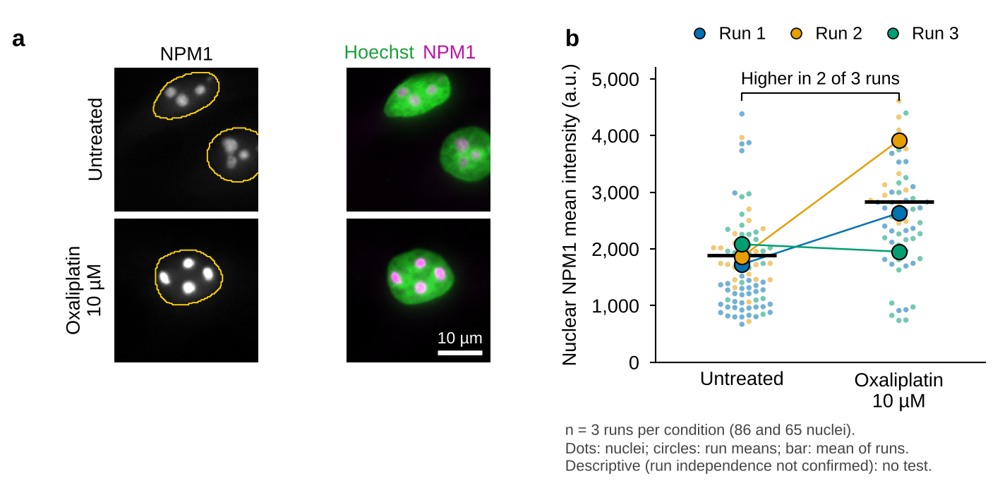

# 論文の図：目的の再検討と実装案

作成：2026-11-19。オーナーの指摘を受けた計画。指摘は、図が論文の水準に達しておらず、機械的で UI の完成度が低く、生物学的に必要な情報が揃っていないこと。指示は、Python の出力で直せるものは Python で直し、難しい部分だけ LLM と組み合わせること。無料で使える手段も検討し、本番だけでなくデモの画面も同じように変える。

**2026-11-19、オーナーが骨格を承認し、推奨のとおりに実装するよう指示した。** 目的は、制約を並べて試験を通すことではなく、genellect/cytellect#244 に定義した最終目標（[§2.2](#22-目標) の G0）を満たすことである。この計画に合わせて、要件 S15 と、群間比較の要件定義書の F-01・F-03・F-06 を同じ変更で改めた。

## 1. 結論

- 課題の大部分は matplotlib のままで解決できる。原因はライブラリではなく、描画器が「統計の記録として正しい図」を目的に作られ、「研究者が論文で 1 つの主張を伝える図」を設計していないことにある。
- 目的を「グラフの見た目の改善」から、**「保存した比較から、代表画像・定量・統計の注釈・凡例がそろった図が、既定のままで論文とラボミーティングに出せる」** に置き直す。
- 本番とデモは同じ部品と同じ描画器で動かす。デモだけの画面や図は作らない。
- LLM は図を描かず、数値も書かない。研究の目的から図の構成を提案する部分と、凡例の数値以外の語句（細胞株、処理の説明など）の候補を出す部分に使う。
- 4 つの段階で進める。段階 1（スタイル・定量の図・注釈）だけで、指摘の「見にくい」「何をしたいのか分からない」「機械的」の大半が直る。

現行の図と、同じ保存結果から matplotlib だけで描いた試作を並べる（[§10](#10-根拠) に条件と限界）。

| 現行（公開デモのオキサリプラチンの場面、核の NPM1 平均輝度） | 試作 |
|---|---|
|  |  |

## 2. 目的の再検討

### 2.1 研究者が図に求めること

Wet 研究者にとって、図は統計の出力ではなく、**主張の単位**である。細胞生物学の画像の実験では、1 つの主張は次の 4 つがそろって初めて伝わる。文献（[§10](#10-根拠)）とオーナーの指摘に基づく仮説で、研究者への聞き取りの結果ではない。

| 要素 | 研究者と査読者が確かめること | 今の出力 |
|---|---|---|
| 代表画像 | 現象が画像で見えるか。何を測ったか。条件の間で表示が同じか。縮尺 | ない |
| 定量 | 全データ点、実験回ごとの再現性、n が何か | 点はあるが、実験回・視野・要約の区別が図から読めない |
| 統計の注釈 | どちらにどれだけ変わったか。検定と P 値 | 図の中にない（caption と CSV だけ） |
| 凡例 | n の定義、集約の規則、検定、縮尺、表示の条件 | caption は UUID の並ぶ監査記録で、論文に使えない |

研究者が図を使う場面は 3 つある。

1. **ラボミーティング・指導教員への報告**：今日の結果を、スライドに貼れる画像ですぐ出したい。
2. **論文の図**：最終の寸法とフォントで、Illustrator などで組める編集可能なファイルが要る。凡例、元データ、Methods も要る。
3. **査読への対応**：群の順序、軸の範囲、色、条件の追加と削除を、解析をやり直さずに直したい。図の点から元の画像へ戻りたい。

今は、代表画像を別のソフト（Fiji など）で書き出し、スケールバーを付け、作図ソフトで並べ、n と検定を凡例に手で写す作業が残る。[プロダクトの使命](../../development-principles.md#プロダクトの使命)の「統計と編集可能な論文の図まで同じ作業の中で完了できる」は、ここで途切れている。

### 2.2 目標

**G0：保存した比較から、1 つの主張を伝える図（代表画像・定量・統計の注釈・凡例）が、設定を変えなくても論文とラボミーティングに出せる水準で出る。研究者が決めるのは「何を見せるか」だけで、体裁を整える作業をしない。本番とデモで、同じ画面と同じ図になる。**

| ID | 目標 | 達成した状態 |
|---|---|---|
| G1 | 既定で完成している | 「グラフ」を開いた時点の図を、そのまま保存して使える。寸法・文字・目盛・色・余白を直す必要がない |
| G2 | 図が主張を伝える | 図だけを見て、何を比べ、n が何で、どちらにどれだけ変わったかが分かる |
| G3 | 何を測ったかが画像で分かる | 各群の代表画像に、測った領域の輪郭、染色の名前、スケールバーが付き、表示の条件が群の間で同じである |
| G4 | 凡例がそろう | 論文に貼れる英語の凡例の下書きが出る。記録にない情報は、推測で埋めずに入力を促す |
| G5 | 迷わず直せる | 見せるもの・形・大きさを、その結果に合う選択肢から選ぶ。細部は図の部品を選んで直す。変更はすぐ図に反映される |
| G6 | どの環境でも同じ図 | Windows 版・Docker 版・公開デモが、同じフォントと同じ配置の図を出す |
| G7 | デモで品質が伝わる | `/demo` の「統計」「グラフ」を開くと、追加の操作なしに新しい既定の図が出る。選べる図の操作は本番と同じ |

### 2.3 範囲

| 含む | 含まない |
|---|---|
| 群間比較・相関・分布の図の描画（スタイル、形、注釈、図の中の凡例） | 検定・推定・集約の計算の変更 |
| 代表画像のパネル、パネル記号付きの組図、凡例の下書き | 3 次元・タイムラプスの画像パネル、動画 |
| 「グラフ」の画面の設計、統計の画面に出る図 | 画像の画面、統計の設定、結果のまとめの文 |
| 公開デモの記録・実行環境・受入試験 | デモの場面と素材の変更 |
| 図の構成と凡例の語句への LLM の利用（段階 4） | LLM による図の描画と数値の生成、考察を図に入れること |
| README の Hero の図を、新しい描画器の実際の出力に差し替える（段階 2） | LP の構成と文言 |

生物学的な妥当性のために守ることは [§6](#6-生物学的な妥当性) にまとめた。測定・統計・原画像の扱いは[開発の原則](../../development-principles.md#計算とデータの整合性)のとおりで、この計画では変えない。

## 3. 現状

2026-11-19 の `main`（`7ff06b2b`）のコードと、公開デモに記録された図を描画して確かめた事実。

| 項目 | 現状 | 根拠 |
|---|---|---|
| 描画器 | 3 系統。群間比較と相関は `common_statistics_figures.py`（版 1.0.1）。数値表・以前の版の領域比較・旧レシピは `figures.py`（1.1.3）。視野ごとの記述は `descriptive_pages.py`（2.0.1） | `services/worker/src/cytellect_worker/figure_render.py` の振り分け |
| 既定の大きさ | 183 × 100 mm。2 群でも 2 段幅になり、群の間が約 8 cm 空く | `ConnectedResults.tsx` の幅と高さの初期値 |
| 幅の下限 | 76.2 mm（`PlotSpec.width_inches ≥ 3`）。2 群のパネルを論文の実寸（40〜60 mm）で出せない | `contracts.py` の `PlotSpec` |
| フォント | 英語の図は Arial、Liberation Sans、DejaVu Sans の順に、その環境にあるものを使う。Windows は Arial、Docker とデモは DejaVu Sans になり、同じ結果でも図が変わる | `figures.py` の `FONT_FAMILIES`、[公開デモ](../../showcase.md) |
| 統計の注釈 | どの描画器も、効果の大きさ・P 値・実験回の揃い方を図に描かない。処理 − 対照の推定値（`estimates`）は保存されているが、図は読まない | 各描画器、`comparison_estimates.py` |
| 図の中の凡例 | 共通統計の実験回ごとの図・箱ひげ・バイオリンにはない。記号の形が実験回、小さい点が視野、横線が平均であることを、図から読めない | `common_statistics_figures.py` の `_hierarchy` |
| 群の要約の位置 | 平均の線が点の右へ 0.32 ずれる。検定なしでは区間がなく、はぐれた線に見える | 同上 |
| 下位の点 | 実験回ごとの図は視野の値まで。核の値は保存結果（`plot_data`）にあるが描かない | 同上 |
| 形の選択肢 | 7 種類を技術名で並べる。実験回が 3 でも、実験回の値のバイオリン・箱ひげ・ヒストグラムを選べる | `ConnectedResults.tsx` の「図のレイアウト」 |
| 軸とラベル | 縦軸は自動で 0 を含まない。目盛が多い。`textwrap.fill(16)` が「Oxaliplatin 10 / µM」のように数値と単位を分ける。割合の指標で単位が重複する | 記録された SVG、`_label` |
| 代表画像・組図 | ない | 群間比較の要件 F-06（2026-11-19 にこの計画で実装すると改めた） |
| 凡例 | `figure-caption.md` は視野の UUID・`status=selected`・警告のコードを並べた記録 | `descriptive_figures.py` の `_caption` ほか |
| 画面 | 設定は「図・横軸・縦軸・系列」の切り替えと mm・pt の数値欄。変更のたびに「図を更新」を押し、描画のジョブを待つ | `ConnectedResults.tsx`、`EditableFigure.tsx` |
| デモ | 本番と同じ部品。記録の手順（`journal.mjs` の `figures()`）が、画面の「図の幅」「図のレイアウト」の選択肢を名前で探し、全部の組み合わせを記録する | [公開デモ](../../showcase.md) |
| デモの容量 | 公開ファイルは 600.9 MiB（上限 700 MiB、DM-10）。図の SVG は 1,927 個で 44.4 MiB | `git ls-files apps/web/public/showcase` の合計 |
| README の Hero の図 | a/b のパネル、`−82%` の注釈、実験回の色の凡例がある。現行の描画器には、これらを描くコードがない | `docs/images/readme-hero.webp`、各描画器 |

## 4. 研究者の体験の設計

### 4.1 原則

1. **既定で完成している。** 設定は、変えたいときだけ開く。
2. **図は 1 つの主張を伝える。** 図の注釈は、画面の結果のまとめと同じ事実を、英語で短く示す。
3. **形は実験の構造から決まる。** グラフの種類の一覧から選ばせない。実験デザイン、観測値の数、指標の尺度から既定を決め、その結果で妥当な代替だけを出す。
4. **画像と数値を切り離さない。** 定量の横に、測った領域の輪郭を重ねた代表画像を置く。
5. **注意を画面の摩擦にしない。** 記述統計であること、表示範囲、代表画像であることは、凡例に静かに書く。画面に警告を並べない。
6. **仕上げは外でもできる。** 文字が文字のまま編集でき、部品に名前が付いた SVG を出す。
7. **本番とデモは同じ。** 部品、描画器、選択肢を分けない。

### 4.2 「グラフ」の画面の流れ

例：薬剤で核の NPM1 が変わるかを 3 回の実験で確かめた研究者が、今日のラボミーティングで見せ、後で論文の図にする。

| | 今 | 新しい流れ |
|---|---|---|
| 開く | 2 段幅の図と、図・横軸・縦軸・系列の設定が出る | 実寸の比率の完成した図（代表画像と定量）が出る。そのまま「保存」できる |
| 見せるものを決める | 「図のレイアウト」の 7 種類から選ぶ | **構成**（定量のみ／画像＋定量）と**形**（その結果に合う 2〜3 個を見本付きで）を選ぶ |
| 大きさを決める | 幅・高さ・文字を mm と pt で入力する | **大きさ**（パネル／1 段幅／2 段幅）を選ぶ。数値の入力は「カスタム」だけ |
| 細部を直す | 設定の切り替えから欄を探す | 図の部品（軸、点、注釈、画像）を選ぶと、その部品の設定だけが開く |
| 反映 | 「図を更新」を押して待つ | 自動で描き直す。その間は前の図を残し、「更新中」と示す |
| 代表画像 | 別のソフトで作る | 図の中の画像を選び、視野の候補から選び直す |
| 凡例 | n と検定を手で写す | 図の下の凡例の下書きをコピーする。足りない情報は 1 行で示され、「実験」から入力する |
| 保存 | SVG・PDF・PNG と来歴の記録 | 同じ「保存」で、SVG・PDF・PNG・凡例・元データ・Methods。スライド用に PNG をコピーできる |

### 4.3 図の構成

定量の図を、グラフの種類ではなく 4 つの層の組み合わせとして扱う。

| 層 | 描くもの | 選べる表し方 |
|---|---|---|
| 観測値 | 核・領域・視野の値（指標の観測の単位） | 点（既定）／密度の輪郭（バイオリン）を重ねる／箱ひげを重ねる／描かない |
| 実験回 | 保存した集約による実験回の値。同じ実験回を線で結ぶ（F-01） | 常に描く |
| 群の要約 | 実験回の値の平均。計算した場合は 95% 信頼区間 | 線（既定）／棒 |
| 注釈 | 効果の大きさ、実験回の揃い方、P 値 | 数値（既定）／星印／非表示 |

既定は次の規則で決める。研究者は、表の「選べる代替」から選べる。しきい値は初めの値で、研究者の評価で見直す。観測値が多い場合も既定は点だけにした（2026-11-19、公開デモの保存結果で描き比べ、輪郭を重ねると点と実験回が読みにくくなったため）。

| 条件 | 既定 | 選べる代替 |
|---|---|---|
| 2 群以上の比較、観測値が群あたり 30 未満 | 観測値の点 ＋ 実験回 ＋ 平均の線 | 棒（比の尺度で値が 0 以上の指標だけ） |
| 同、観測値が群あたり 30 以上 | 観測値の点 ＋ 実験回 ＋ 平均の線 | 密度の輪郭、箱ひげ、棒 |
| 観測の単位が視野（核数、陽性率など） | 視野の点 ＋ 実験回 ＋ 平均の線 | 棒 |
| 実験回の値の箱ひげ・バイオリン・ヒストグラム（今の形） | 既定にしない | 群あたりの実験回が 10 以上のときだけ出す |
| 相関 | 実験回ごとの点（今と同じ）。保存した相関係数と P を注釈に出す | — |
| 分布（1 群の記述） | 今の視野ごとの図に、スタイルだけを適用する | — |

### 4.4 デモの訪問者の体験

- `/demo` の「統計」を開くと、結果のまとめの下に新しい既定の図が出る。「グラフ」を開くと、同じ図が実寸の比率で出て、構成・形・大きさを本番と同じ操作で切り替えられる。
- 選択肢として出るものは、記録から待たずに答える。自由入力（軸の範囲、ラベル、色の値、代表画像の選び直し）は、今と同じく記録した値に固定し、選ぶと案内を出す。
- デモ用の説明や目印を図に足さない。図そのものの品質で伝える。

## 5. 要件

### A. スタイルと出力（FS）

**FS-01** 図の描画は matplotlib のままとする。スタイル（フォント、線、余白、目盛、色、パネル記号）を 1 つのモジュールに集め、3 系統の描画器が共有する。

**FS-02** Liberation Sans 2.1.5（Arial と字幅が同じ。SIL OFL 1.1）の Regular と Bold を解析パッケージに同梱し、Windows 版・Docker 版・デモのどれも、このフォントで描く。出典とライセンスを [OSS の記録](../../oss.md)と公開ファイルの登録に加える。利用者が入力した日本語の群名などは、今の代替の規則（Noto Sans）で描く。

**FS-03** SVG の文字は文字のまま出し、フォント名は Liberation Sans を先頭に Arial と Helvetica を代替として書く。PDF はフォントを埋め込む。画面の図は、同梱したフォントを Web フォントとして読み込み、書き出すファイルと同じ見た目にする。

**FS-04** 大きさは、論文の実寸を既定にする。

- 選択肢は「パネル」（既定。群の数と構成から幅と高さを決める）、「1 段幅 89 mm」、「2 段幅 183 mm」、「カスタム」。
- 幅の下限を 76.2 mm から 30 mm に下げる。代表画像つきの構成で、カスタムの幅が「パネル」の配置（画像の列と定量）の幅に足りないときは、図をその幅まで広げる。
- 分布（記述）の図は、大きさを選ばなければ従来の 183 × 100 mm のまま。カスタムの初期値は 89 × 60 mm。
- 文字は 5〜7 pt、パネル記号は 8 pt の太字の小文字（[Nature の図の指針](https://research-figure-guide.nature.com/figures/building-and-exporting-figure-panels/)）。
- PNG は 600 dpi にする。300 dpi では、幅 45 mm のパネルが約 530 画素になり、スライドで粗い。

**FS-05** 軸は指標の尺度（`metric_scale`）で決める。利用者が範囲と目盛を指定した場合は、それを優先する。

| 尺度 | 縦軸 |
|---|---|
| 比（面積、数、密度、補正前の輝度） | 値がすべて 0 以上なら 0 から始める |
| 割合 | 0 から始め、% で表示する |
| 差（背景補正後の輝度、離心率） | 自動。範囲に 0 が入る場合は、0 に細い基準線 |
| log2 | 自動。0（比が 1）に細い基準線 |

目盛は 4〜6 本にする。実験回ごとの図の縦軸は線形で、すべての観測値と区間を含む目盛で終える（対数表示は出さない）。指定した範囲と目盛間隔は、以前の図と同じ検査を通す。相関の図は、保存した軸の範囲・目盛間隔・対数表示を適用する。

**FS-06** 縦軸の名前は、領域・染色・統計量・単位から組み立てる（例：`Nuclear NPM1 mean intensity (a.u.)`）。単位を 2 回書かない。群名は語の境目で折り返し、数値と単位（`10 µM`）を分けない。

**FS-07** 実験回を色で区別する（Okabe–Ito の配色。8 回を超えたら記号を併用する）。群は横軸の位置で示す。「群で色分け」も選べ、その場合は実験回を記号で区別する。顕微鏡画像の合成に、赤と緑の組を使わない。

**FS-08** 注釈・図の中の凡例・パネル記号が、点や軸と重ならず、図の外にはみ出さない配置にする。

### B. 定量の図（FQ）

**FQ-01** 定量の図を、観測値・実験回・群の要約・注釈の 4 層で描く（[§4.3](#43-図の構成)）。群の要約は群の中央に置き、点とずらさない。

**FQ-02** 既定の形と選べる代替の規則は解析パッケージに置き、画面とデモは API が返す選択肢を出す。

**FQ-03** 観測値をすべて描く。点は値から決まる配置（beeswarm。数が多いときは密度に比例した幅の中に並べる）にし、同じ結果からはいつも同じ図になる。

**FQ-04** 実験回の値、群の要約、注釈の値は、保存した統計の結果を描く。

**FQ-05** 図の中に、実験回の色（または記号）の凡例を置く。群名の下に、実験回の数を `n = 3` と書く。核と視野の数は凡例文に書く。

**FQ-06** 相関と分布の図にも、スタイル（FS）を適用する。相関は、保存した相関係数・P・n を注釈に出す。

**FQ-07** 新しい描画は新しい図の版とする。保存した過去の図は、元の版の描画で再生する（N-07）。

### C. 注釈（FA）

**FA-01** 群間比較の図に、既定で効果の注釈を描く。向きは「処理 − 対照」、示す推定値は S-04 のとおり、指標の尺度と手法で決める。

| 場合 | 図の注釈（例） |
|---|---|
| 検定あり、比を示せる指標 | `−80% (95% CI −86 to −71)`、`P = 0.012` |
| 検定あり、差で示す指標 | `Δ = −0.12 (95% CI −0.20 to −0.04)`、`P = 0.012` |
| 順位に基づく検定 | `P = 0.031`（効果量は凡例文） |
| 記述統計、全実験回が同じ向き | `−79 to −84% (3/3 runs)` |
| 記述統計、向きが揃わない | `Higher in 2 of 3 runs` |
| 3 群以上 | 宣言した対比ごとに括弧と Holm 補正後の P。対比が 4 つ以上なら凡例文と表に出す |

例の数値は形を示すためのもので、実際の結果ではない。

**FA-02** 注釈の文字列は、保存した結果（`estimates`、`comparisons`、`associations`）から、解析パッケージの 1 つの関数が規則で作る。

**FA-03** P 値の表し方は、数値（既定。2 桁の有効数字、0.001 未満は `P < 0.001`）と星印（`*`、`**`、`***`、`n.s.`。定義を凡例文に書く）から選べる。注釈は非表示にもでき、その場合も凡例文には同じ内容が残る。

### D. 代表画像（FI）

**FI-01** 構成で「画像＋定量」を選ぶと、各群 1 視野の代表画像を定量の左に並べる。行が群、列が染色（と合成）になる。

**FI-02** 既定の視野は、その群の値に視野の値が最も近いもの。研究者は選び直せる。凡例文に代表画像であることを書く。

**FI-03** 同じ染色は、すべての群で同じ線形の表示範囲にする。既定は、図に出す領域の元の画素値を合わせた 0.5〜99.5 パーセンタイル（[画像の表示](../../display.md)の共有表示範囲と同じ考え方）。研究者は範囲を変えられ、その変更はすべての群に同じに効く。ガンマ補正をしない。

**FI-04** 群の間で同じ物理的な倍率にし、スケールバーを 1 つ描く。長さは凡例文に書く。画素サイズが確定していない場合は、スケールバーを描かず、画面で画素サイズの入力を促す。

**FI-05** 測った染色はグレースケールで示す。合成は緑とマゼンタなど色覚に配慮した組で描き、染色の名前を列の上に色付きの文字で書く。

**FI-06** 測った領域の輪郭を重ねる（非表示にできる）。輪郭は、図の元の結果が使った解析版のマスクから描く。

**FI-07** 切り出しは、群の値に最も近い領域を中心とする正方形を既定とし、全群で同じ物理的な大きさにする。視野全体も選べる。

**FI-08** 画像は図のファイルに埋め込む。拡大するときは画素をぼかさない（最近傍）。

### E. 組図と凡例（FL）

**FL-01** 構成が複数のパネルを持つ場合、パネル記号（a、b、…）を付けた 1 つの図として出す。構成は「定量のみ」と「画像＋定量」から始める。

**FL-02** SVG は、パネルと層ごとに名前の付いたグループにする（例：`panel-a-images`、`panel-b-observations`、`panel-b-annotation`）。点の元データへの対応（`data-cytellect-source`）は保つ。

**FL-03** 論文用の凡例の下書き（`figure-legend.md`、英語）を、保存した結果から規則で作る。次を、この順に書く。

1. 題：結果のまとめの見出しに当たる 1 文
2. パネルごとの説明：点・線・棒・輪郭が何を表すか
3. 集約の規則と n（実験回、核、視野のそれぞれの数）
4. 検定、補正、P 値、推定値と区間。記述統計の場合は、その旨
5. スケールバーの長さ、表示範囲が群の間で同じであること
6. 除外と欠測

**FL-04** 今の `figure-caption.md`（来歴の記録）は残す。

**FL-05** 凡例に要る情報のうち、実験の入力にないもの（細胞株、処理の時間、抗体や色素など）は、推測で埋めない。下書きに `[cell line]` のような穴として残し、画面で入力を促す（FU-07）。

### F. 画面（FU）

**FU-01** 「グラフ」は、開いた時点で既定の図を表示し、設定を変えずに保存できる。

**FU-02** 設定は、構成・形・大きさの順に並べる。それぞれ、その結果で選べるものだけを、小さな見本と短い名前で出す。

**FU-03** 軸の範囲、ラベル、色、群の順序、注釈、凡例は、図の部品を選ぶと、その部品の設定だけが開く。今の部品の選択（`EditableFigure`）を、注釈・凡例・画像に広げる。

**FU-04** 変更は自動で描き直す。「図を更新」をなくす。描き直しの間は前の図を残して「更新中」と示し、同じ設定の図は再利用する。描き直しに失敗した設定は、設定が変わるまで自動では描き直さない。

**FU-05** 図は実寸の比率で表示する。

**FU-06** 図の中の画像を選ぶと、視野の候補（群と実験回ごと）が開く。

**FU-07** 図の下に凡例の下書きを表示し、コピーできる。足りない情報は 1 行で示し、「実験デザインを編集」を置く。同じ結果の図を描き直しても、研究者が書き込んだ凡例は残す。下書きが変わったことを示し、置き換えるかを研究者が選ぶ。

**FU-08** 「保存」は 1 つにする（SVG・PDF・PNG・凡例・元データ・Methods の ZIP）。スライド用に「PNG をコピー」を置く。

**FU-09** 図の点から元の画像へ戻る導線（F-04）と、保存した図の一覧は保つ。文言は UC-01〜UC-07 に従う。390 px の幅ではみ出さない。

### G. デモ（FD）

**FD-01** デモ専用の画面・部品・図を作らない。図は、記録した結果から本番と同じ API と解析パッケージで描く（`figures` 段階、`snapshot/figures.json`）。図は記録の操作に含めないので、描画器や図の画面を変えても記録を作り直さない（2026-11-19、オーナーの指示：画像・数値・考察の揃ったデモは変えず、図だけを差し替える）。

**FD-02** 画面が選択肢として出すもの（構成、形、大きさ、色分け、P 値の表し方）は記録する。自由入力と、代表画像の選び直しは記録せず、案内を出す。

**FD-03** 図の選択肢と描画器を変えたときは、`figures` 段階（描く図の範囲は `figure_catalog.py` の `variants()`）と受入試験（`apps/web/tests/showcase.spec.ts`）を合わせる。記録の手順（`journal.mjs`）は画面の部品を名前で探すので、名前を変えたら合わせる。

**FD-04** 「統計」「グラフ」は、物語の比較の新しい既定の図で開く。

**FD-05** 公開ファイルを 700 MiB 以内に保つ（DM-10）。代表画像を埋め込んだ図は大きいので、「代表画像と定量」は最初に開く比較（初期状態の保存した比較と、同じ値の結果）だけ描く。画面の選択肢は、最初に開く図から 1 つずつ変えた図を描き、組み合わせは描かない。

### H. LLM（FM）

**FM-01** LLM は図を描かず、図と凡例の数値を書かない。役割は次の 2 つで、採用するのは研究者である。

- **図の構成の提案**：研究の目的と実験の記録から、主役にする比較、代表画像に出す染色、パネルの順、群の表示名を、登録済みの選択肢の構造化した出力で提案する（今の `figure_proposals` の拡張）。
- **凡例の語句の候補**：細胞株、処理の説明、染色の説明など、数値を含まない欄の候補を出す（FL-05 の穴）。

**FM-02** 凡例の数値を含む文は規則で作る（FL-03）。LLM の出力は構造だけを確かめ、数値や言い回しの検査で止めない（AC-05 と同じ）。

**FM-03** 同意、送る範囲、費用の上限、失敗しても図を出すことは、解析提案と考察と同じにする。デモでは LLM を呼ばず、場面ごとに用意した案を返す。

**FM-04** 考察の文は図・CSV・Methods に入れない（L08）。凡例の語句の候補は考察ではなく、考察と別の契約で扱う。

### 既存の要件との関係

| 要件 | 扱い |
|---|---|
| S06、S-08（図の文字は英語） | 保つ |
| S15（図の設定を変えると、表示中の結果を古いと示す） | **改めた。** 自動で描き直し、その間は「更新中」と示す（FU-04） |
| S18（共通統計の図の種類） | 保つ。画面が出す条件を加える（[§4.3](#43-図の構成)） |
| F-01（2 画面の既定の図） | **改めた。** 実験回の色と図の中の凡例、群の中央の要約、効果の注釈を加える（FQ、FA） |
| F-02（実験回の平均の棒） | 保つ。比の尺度で 0 以上の指標に限る |
| F-03（点の意味、n、集約の規則を凡例に） | **改めた。** 図の中の凡例と、論文用の凡例の下書きに分ける（FQ-05、FL-03） |
| F-04、F-05（点から画像へ、出力の一致） | 保つ |
| F-06（代表画像は第二段階） | **改めた。** この計画の段階 2 で実装する（FI） |
| S-07、NT-07、U04、N-07、DM-10、L01、L08 | 保つ |
| [図の出力の契約](../../figures.md)（幅の下限、PNG の解像度、フォント） | 段階 1 の実装と同じ変更で改める |

## 6. 生物学的な妥当性

図の見栄えを整えても、次が崩れると論文の図として誤る。図の設計はこれを満たす範囲で自由にする。

1. **n は独立した実験回。** 核や視野の数を n と書かない。独立性を確認していない比較に、検定と区間を描かない。
2. **全データ点と実験回の再現性を見せる。** 観測値を省かず、実験回ごとの値を区別して描く。
3. **代表画像は条件の間で公平に見せる。** 同じ染色は同じ線形の表示範囲と同じ倍率にし、スケールバーと、測った領域の輪郭を付ける。
4. **軸が効果を誇張しない。** 比の尺度は 0 から始め、割合は % で示す。
5. **記録にない実験の情報を書かない。** 細胞株・処理の時間・抗体などを推測で凡例に入れない。

## 7. 実装

### 7.1 手段の選定

| 課題 | Python（matplotlib）で解決 | 画面の変更 | LLM |
|---|---|---|---|
| 大きさ、フォント、目盛、ラベル、余白 | ○（FS） | 選択肢の名前 | — |
| 何を言いたいのか分からない | ○（FQ、FA） | — | — |
| 不適切な形を選べる | ○（規則を解析パッケージに置く） | 選択肢を API から受ける | — |
| 代表画像、スケールバー、輪郭 | ○（FI。scikit-image と SciPy は依存に入っている） | 視野の選び直し | — |
| 組図、パネル記号 | ○（FL） | 構成の選択 | — |
| 凡例の数値と定型の文 | ○（FL-03） | 表示とコピー | — |
| 細胞株・処理の説明など、記録にない語句 | ×（入力がない） | 入力を促す | △ 候補を出す（FM） |
| 研究の目的に合う図の構成 | △ 既定の規則まで | 構成の選択 | △ 提案する（FM） |
| 設定のたびに待たされる、設定が探しにくい | — | ○（FU） | — |

Python のライブラリ以外で無料で使える手段は、次のとおり判断した。

| 手段 | 判断 | 理由 |
|---|---|---|
| Liberation Sans（Arial と字幅が同じ） | **採用** | どの環境でも同じ図になり、Arial で編集しても配置が変わらない |
| Okabe–Ito の配色、緑とマゼンタの合成 | **採用** | 色覚に配慮した標準の組 |
| ブラウザの標準機能（Web フォント、クリップボードへの PNG のコピー） | **採用**（段階 3） | 追加の依存がない |
| Inkscape | **採用**（確認だけ） | 編集できる SVG であることを、無料のソフトで確かめられる |
| seaborn、statannotations、DABEST | 採用しない | 統計を計算し直すか乱数を使う。保存した値を描くほうが単純で、点と元データの対応も保てる |
| Vega-Lite、Observable Plot、Plotly（ブラウザでの描画） | 採用しない | 描画器が 2 つになり、画面の図と書き出すファイルが食い違う。デモは同じ Python を Pyodide で動かせる |
| matplotlib-scalebar | 採用しない | スケールバーは数行で描ける |
| Fiji のモンタージュとスケールバー | 採用しない | デモで Fiji を動かさない。同じ処理を Python で行える |
| Figma、Canva、Illustrator の連携 | 採用しない | 研究画像が外部のサービスに出る。有料のものがある |

### 7.2 段階

| 段階 | 内容 | 要件 | デモ |
|---|---|---|---|
| 1 | スタイル、定量の図、注釈、形の規則、幅の下限 | FS、FQ、FA | 段階 1〜3 をまとめて 1 回作り直す |
| 2 | 代表画像、組図、凡例の下書き、README の Hero | FI、FL | 同上 |
| 3 | 「グラフ」の画面 | FU | 同上 |
| 4 | LLM による構成の提案と凡例の語句 | FM | 用意した案を加える |

段階 1〜3 は 1 つの PR（genellect/cytellect#245）で順にコミットし、デモの図は段階 3 の後に `figures` 段階で差し替える。記録（画像・数値・考察）は作り直さない（[公開デモ](../../showcase.md)）。

### 7.3 段階 1：スタイル、定量の図、注釈

| 場所 | 変える点 |
|---|---|
| `packages/analysis/src/cytellect_analysis/figure_style.py`（新規） | rcParams、同梱フォントの登録、寸法、目盛、ラベルの折り返し、配色、パネル記号 |
| 同 `figure_layout.py`（新規） | 点の配置（beeswarm、密度に比例した配置） |
| 同 `figure_annotations.py`（新規） | 保存した結果から注釈の文字列を作る関数（FA-02） |
| 同 `figure_forms.py`（新規） | 既定の形と選べる代替を返す関数（FQ-02） |
| 同 `assets/fonts/`（新規） | Liberation Sans の Regular と Bold、ライセンス |
| 同 `common_statistics_figures.py` | 新しい版の描画（4 層）。今の版は再生用に残す |
| 同 `figures.py`、`descriptive_pages.py`、`descriptive_figures.py` | スタイルの共有 |
| 同 `contracts.py`、`common_statistics_contracts.py` | 幅の下限。図の表し方の項目 |
| `services/api/`、`apps/web/src/lib/generated.ts` | OpenAPI と型（`python3 scripts/dev.py contracts`） |
| `ConnectedResults.tsx` ほか | 形と大きさの選択肢、既定の図 |
| `services/showcase/`、`apps/web/public/showcase/` | FD |

図の表し方の契約（案。名前は実装で確定する）：

```python
class FigurePresentation(StrictModel):
    """Presentation only; an omitted value keeps the saved renderer's drawing."""
    version: Literal["1.0.0"]
    observations: Literal["points", "violin", "box", "none"] = "points"
    summary: Literal["mean-line", "bar"] = "mean-line"
    color_by: Literal["run", "group"] = "run"
    annotation: Literal["value", "stars", "none"] = "value"
    size: Literal["panel", "single-column", "double-column", "custom"] = "panel"
```

### 7.4 段階 2：代表画像、組図、凡例の下書き

| 場所 | 変える点 |
|---|---|
| `figure_images.py`（新規） | 代表の視野の選定、切り出し、表示範囲、合成、輪郭、スケールバー |
| `figure_panels.py`（新規） | 組図、パネル記号、SVG のグループ名 |
| `figure_legend.py`（新規） | 凡例の下書き（FL-03） |
| `services/worker/src/cytellect_worker/figure_render.py` | 図の描画が、原画像と保存した解析版のマスクを読む |
| 契約 | 図の表し方に、画像の項目（群ごとの視野、切り出し、染色、輪郭、合成）を加える |
| デモ | 初期状態（`seed.zip`）にある原画像と輪郭から、記録用のブラウザ内の API が同じ図を描く |
| README の Hero | 新しい描画器で公開デモの比較を描いた実際の出力に差し替える（`README.md`、`README.en.md`） |

代表画像は研究画像そのものなので、ログ・Issue・PR に出さない。確認は登録済みの公開実画像で行う。

### 7.5 段階 3：「グラフ」の画面

- `ConnectedResults.tsx` の図の部分を、部品に分ける（図の表示、構成・形・大きさの選択、部品ごとの設定、凡例、保存）。
- 自動の描き直し、実寸の表示、部品の選択、代表画像の選び直し、凡例の表示とコピー、PNG のコピーを加える。
- 画面の設計には frontend-design スキルを使う。

### 7.6 段階 4：LLM

- 解析提案の出力（`figure_proposals`）に、構成・代表画像の染色・パネルの順・群の表示名を加える。ローカルの検証は、登録済みの選択肢に合うかだけを確かめる。
- 凡例の語句の候補は、考察とは別の経路と契約にする。
- Worker のデプロイ、本番での有効化、有料の呼び出しは、オーナーの許可を得てから行う（[開発の原則](../../development-principles.md#モデル依存関係外部サービス)）。

### 7.7 デモへの反映

各段階で、次を同じ変更で行う。

1. 画面の部品の名前に合わせて、`showcase.spec.ts`（と、名前を変えた場合は `journal.mjs`）を直す。
2. `uv run python scripts/build_showcase_runtime.py` で実行環境を作り直す。
3. 初期状態の保存した図は `reseed` → `publish` → `refigure` で描き直す（検出と画像の取得をしない）。
4. 記録した結果の図を `figures` 段階で描き、`snapshot/figures.json` に差し替える。記録（`journal`）は作り直さない。
5. 公開ファイルの合計を PR に書く。

`main` へのマージは公開サイトの自動デプロイを起動するので、オーナーの指示を受けて行う。

### 7.8 確かめ方

図の品質は、試験の数ではなく、出てきた図で確かめる。

- 各段階で、登録済みの公開実画像（公開デモの場面）の図を描き、[§8](#8-完了の条件) の目視の確認表で確かめ、PR に画像を添える。
- 既存の検査（[CONTRIBUTING](../../../CONTRIBUTING.md#pr-を出す前に)の `python3 scripts/dev.py check`、契約を変えたら `contracts`）を通す。新しい規則（形、注釈の文字列、点の配置）には、通常の単体試験を書く。
- 本番の「グラフ」とデモをブラウザで開き、既定の図・選択肢・保存を確かめる。
- 研究者による評価（PF-12〜PF-14）を行う。

## 8. 完了の条件

Issue genellect/cytellect#244 の完了要件と同じ。

| ID | 条件 | 段階 |
|---|---|---|
| PF-01 | 群間比較の既定の図が、設定を変えずに論文の体裁になる：群の数に応じた実寸、文字 5〜7 pt、同梱フォント、尺度に合う縦軸、読みやすい群名と軸名 | 1 |
| PF-02 | 図だけを見て、何を比べ、n が何で、どちらにどれだけ変わったかが分かる：観測値・実験回の値・群の要約・実験回の凡例・`n`・効果の注釈がある | 1 |
| PF-03 | 画面が出す形が、その結果に合うものだけである。P 値の表し方（数値・星印）と注釈の有無を選べる | 1 |
| PF-04 | Windows 版・Docker 版・デモが、同じフォントで同じ見た目の図を出す | 1 |
| PF-05 | 「画像＋定量」の図に、各群の代表画像、測った領域の輪郭、染色の名前、スケールバーがあり、同じ染色の表示が群の間で同じである | 2 |
| PF-06 | 組図にパネル記号が付き、英語の凡例の下書きが出る。記録にない情報は穴として残り、入力を促される | 2 |
| PF-07 | 書き出した SVG を Inkscape で開き、文字と部品を編集できる。PDF にフォントが埋め込まれている | 2 |
| PF-08 | README の Hero の図が、新しい描画器の実際の出力である | 2 |
| PF-09 | 「グラフ」を開いた図を、設定を変えずに保存できる。構成・形・大きさの変更が、ボタンを押さずに図に反映される。部品を選ぶとその設定が開き、代表画像を選び直せ、凡例と PNG をコピーできる。390 px の幅ではみ出さない | 3 |
| PF-10 | `/demo` の「統計」「グラフ」が、追加の操作なしに新しい既定の図で開き、画面が出す図の選択肢に記録から答える。公開ファイルが 700 MiB 以内 | 1・2・3 |
| PF-11 | LLM が図の構成と凡例の語句の候補を提案し、研究者が採用すると図と凡例に入る。LLM を使わなくても図と凡例が出る。デモは用意した案を返す | 4 |
| PF-12 | 初めて見る Wet 研究者が、図だけを見て「何を比べたか」「n は何か」「どちらにどれだけ変わったか」を説明できる | 1 の後 |
| PF-13 | 研究者が、自分の比較の図を支援なしで保存まで終え、そのままラボミーティングに使えると判断する | 3 の後 |
| PF-14 | 研究者が、書き出した SVG を自分の作図ソフトで開き、文字と配置を直せる | 2 の後 |

研究者による評価（PF-12〜PF-14）は、異なる研究室の Wet 研究者 3 名以上で行い、全員が満たしたときに合格とする。満たすまで [roadmap](../../roadmap.md) の未完了の受入条件に残す。

目視の確認表（文献の指針から作った。[§10](#10-根拠)）：

- 文字が最終の寸法で 5〜7 pt で、重なりとはみ出しがない
- 軸に名前と単位がある。割合は %、比の尺度は 0 から始まる
- すべてのデータ点が見え、実験回を区別できる
- n が何の数かが、図と凡例で分かる
- 効果の大きさと、検定をした場合は検定の名前と P 値がある
- 色だけに頼らずに区別でき、赤と緑の組を使っていない
- 画像にスケールバーと染色の名前があり、群の間で表示が同じである
- 何を測ったか（領域の輪郭）が画像で分かる
- 凡例に、集約の規則、除外と欠測がある

## 9. リスク

| リスク | 対処 |
|---|---|
| 既定の図が変わり、利用者の過去の図と見た目がそろわない | 過去の図は元の版で再生する。新しい版で描き直すのは、利用者が操作したときだけ |
| 観測値の多い図の SVG が大きい（核が数千の場面では 1 MB を超えうる。未実測） | デモは記録の範囲を絞る（FD-05） |
| 代表画像の規則（群の値に最も近い視野）が、研究者の見せたい現象と合わない | 選び直せる。規則は研究者の評価で見直す |
| Pyodide の Matplotlib（3.10）とローカル（3.11）で、文字の配置がわずかに違う | 同じフォントで描く。画素の一致は求めない |
| 画面の作り替え（段階 3）が大きく、デモの記録の手順が壊れる | 段階 1・2 では選択肢の追加にとどめる。段階 3 で部品に分けてから作り替える |

## 10. 根拠

### 確かめたこと

- 2026-11-19、`main`（`7ff06b2b`）。公開デモに記録された図（共通統計 1.0.1 が 1,047 個、記述 2.0.1 が 880 個）から 10 個を画像にして確かめた。
- [§1](#1-結論) の「現行」は、公開デモのオキサリプラチンの場面で記録された、核の NPM1 平均輝度（全核、選別なし）の実験回ごとの図（`superplot`、183 × 100 mm）。
- 「試作」は、同じ保存結果（核 151 個：未処理 86、オキサリプラチン 65。実験回 3）と、同じ場面の公開画像（[Zenodo 6643470](https://zenodo.org/records/6643470)、CC BY 4.0、Schmidt ら 2022。640 × 640 の切り出し）から、matplotlib・scikit-image・SciPy だけで描いた（120 × 58 mm、Liberation Sans）。この比較は実験回の向きが揃わない記述統計なので、注釈は FA-01 の「向きが揃わない」の形になる。コードは [prototype.py.txt](prototype.py.txt) にある（保守しない）。
- 試作は案の初期の形で、製品の確認ではない。
- 研究者への聞き取りと、研究者による図の評価は行っていない。

### 文献

2026-11-19 に、PubMed で DOI が実在することを確かめた。

- Lord SJ ら（2020）SuperPlots。実験回ごとの再現性と細胞ごとのばらつきを 1 つの図に示す。[doi:10.1083/jcb.202001064](https://doi.org/10.1083/jcb.202001064)
- Jambor H ら（2021）画像を使う図の作り方の指針（スケールバー、色、染色の表示、合成の色）。[doi:10.1371/journal.pbio.3001161](https://doi.org/10.1371/journal.pbio.3001161)
- Schmied C ら（2023）画像と画像解析を公表するときの確認表。[doi:10.1038/s41592-023-01987-9](https://doi.org/10.1038/s41592-023-01987-9)
- Weissgerber TL ら（2015）棒グラフだけでなく、すべてのデータ点を示す。[doi:10.1371/journal.pbio.1002128](https://doi.org/10.1371/journal.pbio.1002128)
- Ho J ら（2019）P 値だけでなく、効果の大きさと区間を図に示す。[doi:10.1038/s41592-019-0470-3](https://doi.org/10.1038/s41592-019-0470-3)
- Wong B（2011）色覚に配慮した配色。[doi:10.1038/nmeth.1618](https://doi.org/10.1038/nmeth.1618)
- [Nature の図の指針](https://research-figure-guide.nature.com/figures/building-and-exporting-figure-panels/)

## 11. 実装と同時に改める文書

- [図の出力の契約](../../figures.md)、[共通の統計](../../common-statistics.md)、[画像の表示](../../display.md)：版と規則（段階 1・2）。
- [公開デモ](../../showcase.md)：記録する図の操作、容量（各段階）。
- [OSS の記録](../../oss.md)：同梱フォント（段階 1）。
- [解析機能の概要](../../implementation-overview.ja.md)、[roadmap](../../roadmap.md)：状況（各段階）。
