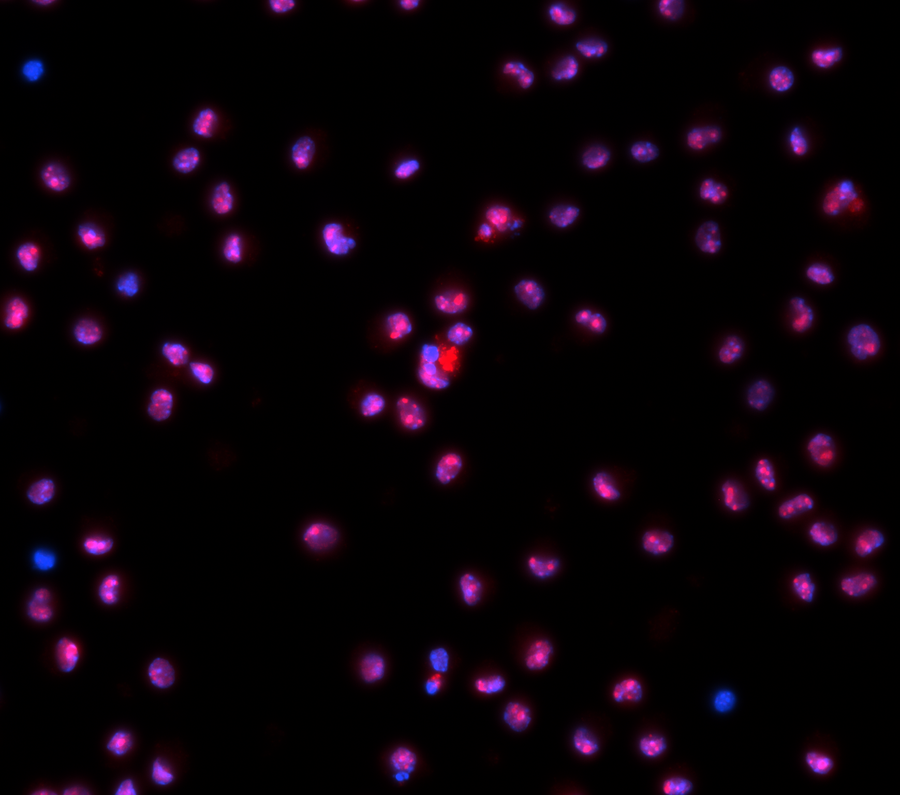
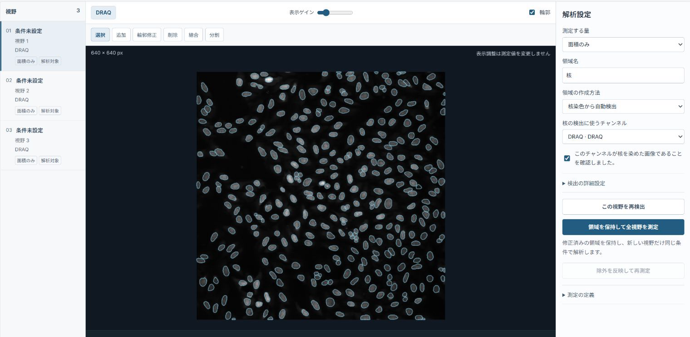
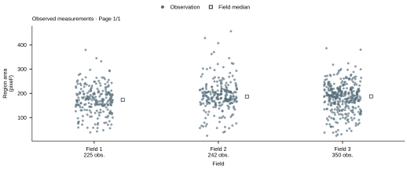

# Cytellect 解析機能

蛍光免疫染色や GFP 発現細胞の 2 次元画像から、核とその内部（核小体・核質）の量を測り、群間比較と作図まで行う。計算の詳細は[解析法](methods.md)、[統計](common-statistics.md)、[作図](figures.md)にある。

## 対応する実験

| 調べたいこと | 必要な画像 | 出す値 |
|---|---|---|
| 処理で核内タンパク質の量が変わるか | 核染色 ＋ 目的タンパク質 | 核ごとの平均・中央値・積分輝度 |
| 核小体ストレスで NCL が核質へ移るか | 核染色 ＋ NCL | 核質と核小体の輝度比（log2） |
| 核小体の数や大きさが変わるか | 核染色（＋ 核小体マーカー） | 核あたりの核小体の数、核に占める面積の割合 |
| 核が大きくなる・小さくなるか | 核染色のみ | 核の面積（µm²） |
| GFP を発現した細胞だけで評価したいか | 核染色 ＋ GFP | GFP 陽性の核に限った各測定値 |
| 2 つの量が連動しているか | 同じ領域の 2 つの測定値 | 相関係数と散布図 |

いずれも、対照と処理など 2 群以上を、独立した実験の繰り返しを単位として比べる。

## 入力から出力まで

**入力**：核染色と NCL の 2 色で染めた核の画像（公開データ 4DN）

画像：4DN Sceptic NPC DAPI/NCL（4DNFI7FAWT6C）。Li G, Kim HJ, Pendyala S, et al. Genome Biology 26, 209 (2025)；Doug Fowler laboratory, University of Washington；4D Nucleome。[4DN の公開データ利用方針](https://registry.opendata.aws/4dnucleome/)に従う表示用の合成画像。出典とハッシュは [4dn-ncl-preview.json](images/4dn-ncl-preview.json) に記録している。

**検出と修正**：検出した輪郭を画像に重ねて表示する。誤りは追加・置き換え・削除・結合・分割で直す。

**出力**：核ごとの値をまとめた図。下の図は、公開画像（BBBC013）3 視野、817 個の核の面積（画素）を視野ごとに示す。図と同時に、全核の値の CSV を書き出す。

## 検出の方法

| 対象 | 方法 | 既定 |
|---|---|---|
| 核 | Fiji の StarDist 2D（蛍光核用の学習済みモデル） | ― |
| 核小体 | 核染色の低輝度領域 | 既定 |
| | 核小体マーカー（UBF・FBL）の陽性領域 | |
| | NCL 陽性領域：Cellpose-SAM を親の核で条件付けて推論し、核全体を拾った候補を除き、Multi-Otsu・Watershed で境界を補正 | NCL を選んだときの既定 |
| | NCL 陽性領域：局所輝度差・形状 | |
| | NCL 陽性領域：核ごとの Otsu 法のしきい値 | |
| 細胞 | 手描き、または Cellpose-SAM | 手描き |

- 核小体は親の核に属し、核質は核から核小体を除いた領域とする。
- 検出用の前処理は画像の複製に行い、測定は元の画素値で行う。

## 画像から得られる値

| 測定値 | 定義 |
|---|---|
| 面積 | 領域の画素数 × 画素の面積（µm²）。画素の大きさが確認できない場合は画素のまま |
| 平均・中央値・積分輝度 | 領域内の元の画素値の平均・中央値・合計 |
| 背景補正輝度 | なし（原値・既定）、自動推定、指定した背景領域の中央値のいずれかを引いた値 |
| 核小体の数・面積割合 | 核ごとの核小体の個数と、核に占める核小体の面積の割合 |
| 核質/核小体比 | 核質の平均輝度 ÷ 核小体の平均輝度（log2 も出す） |
| 視野の集計 | 視野ごとの核の数と、核の密度（/mm²） |
| GFP 陽性・陰性 | 核内の GFP 輝度によるしきい値判定。手動、撮影日ごとの Otsu 法、陰性対照の分布（既定は 99 パーセンタイル）から選ぶ |

**値の扱い**
- 画像の端にかかる領域と、飽和した画素を含む領域には印を付ける。除外は研究者が決める。
- 飽和した領域を含む選択では、輝度の比較と相関を実行しない。
- 背景が確定していない補正値や、核小体がない核の比・数は、0 ではなく欠測として理由を記録する。

## 統計の単位（n）

細胞数ではなく、独立した実験の繰り返し（実験回や個体）を n として検定する。

同じ皿の細胞は、培養・染色・撮影の条件を共有する。ある回だけ染色が明るいといった回ごとの違いが、その回の細胞すべてに一緒に乗るため、細胞数を n にすると、この違いを処理の効果と区別できず、差がなくても有意になりやすい。

差のないデータを計算機上で 400 回作って検定した結果（1 群 3 回 × 3 視野 × 30 細胞、`scripts/exploratory_model_null_simulation.py`）：

| 解析の単位 | p < 0.05 になった割合（本来は 5% 以下） |
|---|---|
| 細胞（視野ごとに誤差をまとめた回帰） | 32% |
| 実験回（Cytellect の方法） | 2.8% |

値は次の順にまとめる。

| 段階 | まとめ方 | 理由 |
|---|---|---|
| 細胞 → 視野 | 中央値 | 外れた細胞や誤検出の影響を抑える |
| 視野 → 試料（カバーガラス・ウェル） | 平均 | 視野数が試料ごとに違っても、各試料を同じ重みにする |
| 試料 → 実験回 | 平均 | 試料数が回ごとに違っても、各回を同じ重みにする |

視野の集計（核の数・密度）は、視野の値をそのまま使う。

次の割り当ては受け付けない。

- 1 つの視野を 2 つの群に入れる
- 対応のない比較で、同じ実験回を両方の群に入れる
- 対応のある比較で、相手が欠けた回を含める

## 統計解析

| 実験デザイン | 検定 | 出す値 |
|---|---|---|
| 2 群・独立 | Welch の t 検定 ／ Mann–Whitney U 検定 | t 検定は差と 95% 信頼区間。U 検定は優越確率 |
| 2 群・対応あり（同じ回の対照と処理など） | 対応のある t 検定 ／ Wilcoxon 符号付き順位検定 | t 検定は差と 95% 信頼区間。Wilcoxon は順位双列相関 |
| 3 群以上・独立 | Welch の分散分析 ／ Kruskal–Wallis 検定。続けて、事前に決めた 2 群間比較を Holm 法で補正 | 全体の p 値と、各比較の p 値・推定値 |
| 2 つの量の関係 | Pearson ／ Spearman の相関（独立した実験回が 3 回以上） | 相関係数と p 値 |
| 独立性が未確認 | 検定しない（記述） | 実験回ごとの値と回ごとの差 |

- t 検定では、処理 − 対照の差と、比率の指標では幾何平均の比を、95% 信頼区間とともに出せる。
- 順位検定と並べ替え検定は、並べ方が 40,320 通り以下なら全数え上げ、超える場合は 9,999 回の乱択で p 値を求める。t 検定・Welch の分散分析・Pearson の相関は理論分布を使う。
- 正規性の検定の結果で手法を切り替えない。
- 比較で 1 群が 5 回未満のときは警告を出す。

## 作図

| 図 | 内容 |
|---|---|
| 視野ごとの分布 | 細胞の値と視野の中央値。撮影のばらつきや外れた視野を見つける（上の出力例） |
| 群の比較（SuperPlot） | 視野と実験回の値を重ね、実験回の平均と 95% 信頼区間を示す |
| 実験回の値 | 点、箱ひげ、バイオリン、ヒストグラム、平均の棒グラフ、対応のある値をつなぐ線 |
| 相関 | 実験回ごとの散布図 |

- 図の点を選ぶと、その値の元になった画像と領域を開く。実験回の点では、その回の観測値の一覧から選ぶ。
- 寸法は Nature の 1 段幅（89 mm）・2 段幅（183 mm）、または任意の値。配色は Okabe–Ito と点の形で色覚の違いに配慮し、系列の色は変更できる。
- 軸は線形のほか、log10・log2 を選べる。
- 書き出せるもの：
  - 図：SVG（Illustrator で文字を編集できる）、フォントを埋め込んだ PDF、PNG（300 dpi）
  - 細胞・視野・試料・実験回ごとの値の CSV
  - 検定の設定を含む Methods の文案
  - ImageJ で開ける領域ファイル

## 精度の検証

| 対象 | 方法 | 結果 |
|---|---|---|
| 測定値の計算 | 公開画像 3 種（BBBC007、BBBC013、4DN）の同じ領域を ImageJ で測り比較 | 面積・平均・中央値が一致 |
| 統計の計算 | 手計算・全組み合わせの数え上げと比較 | 一致 |
| 核の検出 | 正解付き公開画像（BBBC039）5 視野で評価 | F1 = 0.92（視野ごとの平均 0.89）。この画像は検出モデルの学習データと重なる |
| 核小体の検出 | ― | 正解付きの公開データがなく未評価 |
| 再現性 | 書き出した一式から再計算 | 同じ数値と図を再現 |

計算は ImageJ と一致する。核と核小体の検出精度は、使用する画像で確認が必要。詳細は[公開画像での検証](public-validation.md)にある。

## AI による解析設定の提案（任意）

解析の目的を一文で書くと、外部の言語モデルが、検出・測定・選別・検定・図の設定を提案する。初期設定では使わない。

| AI が行う | AI は行わない |
|---|---|
| 検出・測定・選別・検定・図の設定を提案する | 核や核小体を検出する |
| 不足している情報（実験回の割り当てなど）を指摘する | 測定値や p 値を計算する |
| 提案の理由を示す | 結果を解釈する |

- 送るのは、目的の文、チャンネルの記号と染色名、視野・群・実験回の数と対応の有無、画像の寸法と画素の大きさ、現在の背景・GFP・検出の設定。画像と測定値は送らない。
- 確定していない染色を GFP とみなす提案や、実験回が足りないのに検定する提案は、提案全体を受け付けない。
- 受け付けた提案は設定に反映し、選んだ画像で検出を試す。「AI による設定変更を戻す」で元に戻せる。測定と統計は、研究者が実行するまで行わない。

## 未対応

| 分野 | 内容 |
|---|---|
| 画像 | 3 次元（Z スタック）、タイムラプス、斑点（foci）の検出、細胞質の区画 |
| 統計 | 混合効果モデル、3 条件以上の対応のある全体検定（Friedman など）、Tukey などの事後検定、Cohen の d、検出力の計算 |
| 作図 | 複数パネルの組図、顕微鏡画像パネルとスケールバー、SD・SEM のエラーバー |
