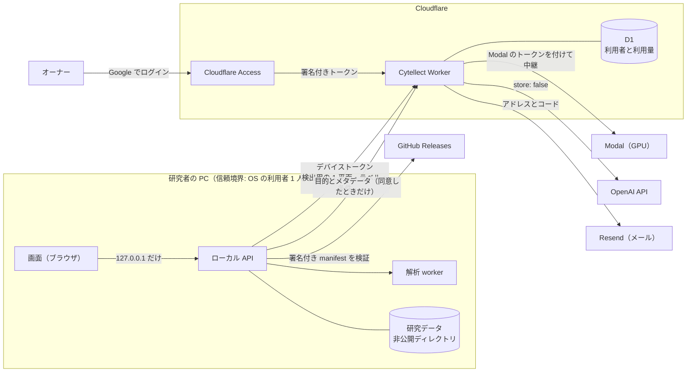

# Cytellect のセキュリティ体制

Cytellect は、研究者の未発表の顕微鏡画像を扱う。この文書は、その画像と利用者を何から、どの仕組みで守り、それをどう確かめているかを示す。利用を検討する研究室、共同研究先、セキュリティの担当者、監査人が、コードを読まずに体制を評価できるように書いている。

Cytellect は ISO/IEC 27001 の認証取得を目標にしており、この文書をその適用宣言書の土台とする。管理策は ISO/IEC 27001:2022 附属書 A と OpenSSF Scorecard に対応づけている（[10 章](#10-規格との対応)）。

| 項目 | 内容 |
|---|---|
| 対象 | リポジトリ `genellect/cytellect`、Windows 版、Docker 版、公開サイト `cytellect.app`、クラウド機能（Cytellect Worker、GPU 推論） |
| 責任者 | オーナー（`@genellect`） |
| 最終確認 | 2026-10-30、コミット `39005ce` |
| 脆弱性の報告 | [SECURITY.md](../SECURITY.md) の非公開の報告フォーム。合理的な報告には 3 日以内に返信する |

## 目次

1. [概要](#1-概要)
2. [脅威モデル](#2-脅威モデル)
3. [認証と認可](#3-認証と認可)
4. [暗号と鍵の管理](#4-暗号と鍵の管理)
5. [データの保護](#5-データの保護)
6. [ソフトウェアサプライチェーン](#6-ソフトウェアサプライチェーン)
7. [脆弱性とインシデントへの対応](#7-脆弱性とインシデントへの対応)
8. [ガバナンス](#8-ガバナンス)
9. [リスク登録簿](#9-リスク登録簿)
10. [規格との対応](#10-規格との対応)
11. [付録: 運用の詳細](#11-付録-運用の詳細)
12. [改訂履歴](#12-改訂履歴)

## 1. 概要

### 1.1 設計の原則

| # | 原則 | 実装 |
|---|---|---|
| P1 | 研究データは研究者の手元に置く | 解析は研究者の PC で行う。外に送る機能は利用者が有効にしたときだけ動き、送る内容を機能ごとに限る |
| P2 | 研究の完全性を守る | 原画像の画素値を変えない。測定値と統計は、API と解析パッケージの共通実装だけが生成する |
| P3 | 鍵は使う場所にだけ置く | PC はデバイストークン 1 つだけを持ち、OpenAI と Modal の鍵は Worker が持つ。CI の秘密は、それを使うジョブにだけ渡す |
| P4 | 秘密はハッシュで持ち、記録しない | トークンとコードはハッシュで保存する。リクエストの本文、ファイル名、トークン、IP アドレスをログに残さない |
| P5 | 受け取る側が検証する | Cloudflare Access やプロキシが手前にあっても、各層が自分で認証と入力を確かめる |
| P6 | 判断できないときは止まる | 設定の不備、データベースの障害、検証の失敗では、処理を許可せずに止める |
| P7 | 信頼の起点を鍵に置く | 配布物は署名で信頼する。同じ場所に置かれたハッシュは、食い違いの検知にだけ使う |
| P8 | ツールと依存を固定して照合する | スキャナーを含む外部のツールは、版とハッシュを固定し、照合してから実行する |
| P9 | 主張を試験で裏付ける | 下の保証はすべて、自動試験か CI のジョブで確かめている |

### 1.2 セキュリティの保証と証拠

Cytellect が守る性質と、それを強制する仕組み、確かめている試験の対応を示す。試験は、関係するファイルを変えた PR と `main` への取り込みのたびに CI で実行する。

| # | 保証 | 強制する仕組み | 証拠 |
|---|---|---|---|
| S1 | PC は外部サービスの鍵を持たず、デバイストークンは発行元にだけ送る | Worker が Modal の鍵を付けて中継する。ローカル API はリダイレクトを追わず、トークンを画面に返さない | `cloud.test.ts`「streams the body to Modal with the Worker's key」、`tests/test_cloud_account.py` の `test_a_redirect_never_receives_the_device_token_or_the_image`、`test_sign_in_stores_the_token_user_only_and_never_returns_it` |
| S2 | サーバーは資格情報を平文で持たず、記録しない | コードは鍵付き HMAC、トークンは SHA-256 で保存する。メールの失敗も決まったエラーコードにする | `cloud.test.ts`「issues a hashed 6-digit code…」「fails closed without a mail sender…, and never logs codes」 |
| S3 | 管理操作は、Worker が検証したオーナーのトークンでだけ行える | RS256 の署名、発行者、対象、期限、アドレスを Worker が検証し、`ADMIN_ORIGIN` 以外の入口を閉じる | `access.test.ts`「refuses wrong audience, issuer, period, signature, algorithm and identity…」「refuses the workers.dev host even with the owner's valid token…」 |
| S4 | 他人のワークスペースは、存在も含めて読めない | 読み出しのたびにセッションとワークスペースの所有者を照合する。変更には Origin と CSRF のヘッダーを求める | `tests/test_api_worker.py` の `test_ownership_is_enforced_without_leaking_existence`、`test_mutation_requires_origin_and_csrf`、`tests/test_local.py` の `test_local_bootstrap_rejects_cross_origin_dns_rebinding_and_forms` |
| S5 | オーナーの鍵で署名されていない更新は実行されない | 組み込んだ Ed25519 の公開鍵で manifest を検証し、インストーラーの SHA-256 とサイズを照合してから実行する | `tests/test_update_signature.py` の `test_signature_details_are_all_checked`、`test_no_built_in_key_means_nothing_is_trusted`、`tests/test_app_update.py` の `test_unverified_download_never_runs_the_installer` |
| S6 | 判断できないときは止まる | 監視、鍵の取得、メールの送信に失敗したら、処理や要求を拒否する | `tests/test_supervision.py` の `test_child_watchdog_fails_closed_on_unverifiable_lease`、`access.test.ts`「fails closed when the keys cannot be fetched…」 |
| S7 | 解析 worker（Docker 版）は外部と通信できない | `network_mode: none`、読み取り専用のルート、Linux の権限なし | CI の container ジョブが実際のイメージで外向きのソケットの拒否を確かめる |
| S8 | クラウドの費用は利用者ごとと全体の上限を超えない | 利用者ごとに GPU の枠を 1 つにし、切断しても推論 1 回を 300 秒として数える | `cloud.test.ts`「lets one inference per user run and refuses the rest…」「on client disconnect aborts the upstream call, counts the full hold…」「stops at the user's monthly limit and at the global monthly cap」 |
| S9 | 共有の開発環境は、登録済みの公開画像しか受け付けない | アップロードの SHA-256 を公開ファイルの一覧と照合し、一致しなければ削除する | `tests/test_public_uploads.py` の `test_only_listed_public_images_are_accepted_and_refused_files_are_not_kept` |
| S10 | 秘密がリポジトリの履歴に入らない | 固定した gitleaks が Git の全履歴を走査する | `tests/test_scan_secrets.py` の `test_real_gitleaks_detects_deleted_history_and_tracked_changes_only` |

### 1.3 領域ごとの状態

| 領域 | 状態 | 次の一手 |
|---|---|---|
| データの最小化と隔離 | 有効 | 研究室のサーバーでの受入確認（R10） |
| 利用者と管理者の認証 | 有効 | PC からのログインを次の Windows 版で配布する |
| 暗号と鍵の管理 | 有効 | Modal のデプロイトークンを承認つきの environment に移す（R13） |
| 配布物の完全性 | 署名の仕組みは実装済み。公開鍵を組み込んだ Windows 版から有効 | インストーラーのコード署名（R3） |
| サプライチェーン | 依存の固定、秘密の走査、最小権限は有効 | Actions の SHA での固定、Dependabot の警告の解消、CodeQL、来歴の証明（R16〜R19） |
| 監視と記録 | 記録の最小化は有効 | 管理操作と費用の急増の通知（R14） |
| 脆弱性とインシデントへの対応 | 受付と返信の目標は有効 | サポートする版、修正の目標日数、通知の期限（R20、R21） |
| ISMS | 方針、資産、リスクの記録を整備 | リスク評価の手順、内部監査、マネジメントレビュー（R22） |

状態の語は次の意味で使う。**有効**は本番、配布物、リポジトリの設定で働いていること、**実装済み**はコードと試験があり本番で有効にする前の段階、**受容**はリスクを把握してオーナーが受け入れたこと、**計画**は [9 章](#9-リスク登録簿)に載せた次の対応、**要確認**は GitHub や外部サービスの設定でオーナーが確認して記入するもの。

## 2. 脅威モデル

### 2.1 守るもの

| 資産 | 例 | 置き場所 | 失われるもの |
|---|---|---|---|
| 研究データ | 原画像、マスク、測定表、図、ファイル名、実験条件 | 研究者の PC、研究室のサーバーの非公開ディレクトリ | 機密性（未発表の成果）、完全性（研究の結論） |
| 利用者の情報 | メールアドレス、承認の状態、月ごとの利用量 | Cloudflare D1 | 機密性 |
| 資格情報 | デバイストークン、Worker の秘密、GitHub の secret | PC の設定ファイル、Worker の secret、GitHub の secret | なりすまし、費用の濫用 |
| 署名鍵 | アプリ内更新の Ed25519 鍵 | オーナーの PC、GitHub の `release` 環境 | 導入済みのすべての PC でのコードの実行 |
| 配布物 | Windows のインストーラー、更新の manifest、コンテナイメージ、公開サイト | GitHub Releases、GHCR、Vercel | 完全性 |
| ソースと CI | コード、ワークフロー、ロックファイル | GitHub | 完全性、CI の秘密 |

### 2.2 想定する攻撃者

| # | 攻撃者 | 狙い | 主な対策 |
|---|---|---|---|
| T1 | インターネット上の第三者 | 管理画面や API への侵入、クラウド機能のただ乗り | Access と Worker による二重の検証、許可したアドレスだけへのコードの送信（[3 章](#3-認証と認可)） |
| T2 | 利用者のアドレスを知る第三者 | ログインコードの総当たり、メール爆撃、アカウントの妨害 | アドレス単位の回数の制限とロック（[3.2](#32-攻撃への耐性)） |
| T3 | 正規の利用者 | 上限を超える GPU や解析提案の利用 | 利用者ごとの枠、月の上限、全体の上限（S8） |
| T4 | 資格情報を盗んだ者 | デバイストークンや CI の秘密を使ったなりすまし | ハッシュでの保存、オーナーによる失効、ジョブ単位の秘密（[4 章](#4-暗号と鍵の管理)） |
| T5 | 依存、ツール、配布経路を侵害した者 | 悪意のあるコードを CI や利用者の PC で実行させる | ロックファイルとハッシュの固定、署名による更新の検証（[6 章](#6-ソフトウェアサプライチェーン)） |
| T6 | ブラウザ上の悪意のあるページ | ローカル API への CSRF、DNS リバインディング | Host、Origin、Fetch Metadata、CSRF のヘッダーの照合（S4） |
| T7 | 開発者やエージェントの過失 | 研究データや秘密のリポジトリへの混入 | 情報の区分、秘密の走査、公開画像だけを受け付ける開発環境（S9、S10） |

### 2.3 前提と範囲外

- 研究者の PC の OS アカウントと、そのアカウントで動くプロセスは信頼する。Windows 版は 1 人の利用者のためのアプリで、LAN や公開のサーバーとしては動かさない。
- GitHub、Cloudflare、Modal、OpenAI、Resend、Vercel の基盤は、各社の管理策を前提にする。Cytellect は自分のアカウントの保護と、渡すデータの最小化を受け持つ（[8.4](#84-外部サービス)）。
- 研究室のサーバーの物理的な保護と OS の管理は、研究室が受け持つ。

### 2.4 信頼境界とデータの流れ

| 境界 | 越えるもの | 境界での検証 |
|---|---|---|
| ブラウザ → ローカル API | 画面の操作 | `127.0.0.1` での待ち受け、Host、Origin、Fetch Metadata、CSRF のヘッダー、SameSite=Strict の cookie |
| PC → Cytellect Worker | 推論と解析提案の要求 | デバイストークン、利用者の状態、月の上限、本文の大きさ |
| Worker → 外部サービス | 推論の本文、提案の要求、メール | Worker だけが持つ鍵。リダイレクトを追わない |
| オーナー → 管理の入口 | 承認、失効、上限の変更 | Access のログインと、Worker によるトークンの検証 |
| GitHub Releases → PC | 更新のインストーラー | オーナーの Ed25519 鍵の署名と、インストーラーのハッシュ |

Docker 版と研究室のサーバーでは、解析 worker をネットワークのないコンテナで動かす（S7）。

## 3. 認証と認可

### 3.1 主体ごとの方式

トークンはすべて 32 バイトの暗号論的乱数で作り、SHA-256 のハッシュだけを保存する。署名は定数時間で比較する。

| 主体 | 方式 | 資格情報と保存の形式 | 期限と失効 | 状態 |
|---|---|---|---|---|
| 研究者の PC（クラウド機能） | メールに届く 6 桁のコードでログインし、デバイストークンを受け取る | コードは `ADMIN_SIGNING_KEY` を鍵とする HMAC、トークンは SHA-256 で保存する。PC はトークンを、OS の利用者だけが読める設定ファイルに置く | コードは 10 分。トークンは 90 日使わないと失効し、ログアウトで削除する。オーナーがアドレスを失効させると、その全端末を次の要求から拒否する | 有効（Worker）。PC からのログインは次の Windows 版から |
| 新しい利用者 | 許可したアドレスにだけコードを送る。それ以外のアドレスはアクセスの要求になり、オーナーに承認の連絡が届く | 要求の状態を確かめるトークンを SHA-256 で保存する。アドレスは URL に載せず、他人の状態は読めない | 要求のトークンは 14 日 | 有効 |
| オーナー（管理画面） | Cloudflare Access の Google ログイン。Worker が `Cf-Access-Jwt-Assertion` を自分で検証する | RS256 の署名、発行者、対象（AUD）、有効期限、オーナーのアドレスを確かめる | Access のセッションは 24 時間で、許可するのはオーナーのアドレスだけ。`ADMIN_ORIGIN` 以外の入口では、管理の経路は 404 を返す | 有効（2026-10-30） |
| オーナー（Access を使わない構成） | `OWNER_EMAIL` に届くコードでログインする | セッションを SHA-256 で保存する。cookie は HttpOnly、Secure、SameSite=Strict | 12 時間 | 本番では Access を使うため無効 |
| 承認リンク | HMAC で署名した 1 回限りのリンク。開くとボタンだけが表示され、押したときに承認する | ハッシュと使用の時刻を保存する | 7 日 | 有効 |
| GPU の中継 | Worker が Modal の proxy-auth トークンを付けて転送する | PC は Modal のトークンを持たない | Worker の secret の交換で失効 | 有効。研究者のログインを通した推論は、次の Windows 版で確かめる |
| ローカル API（Windows 版） | `127.0.0.1` だけで待ち受け、Host、Origin、`Sec-Fetch-Site`、CSRF のヘッダーを確かめる | cookie は HttpOnly、SameSite=Strict。トークンを URL、ブラウザの保存領域、ログに置かない | ランチャーを閉じるとセッションを失効させる | 有効 |
| Docker Desktop の所有者 | ループバックに公開した API への同一 origin の要求だけで、招待なしにセッションを作る | cookie は HttpOnly、SameSite=Strict | 7 日 | 有効 |
| 研究室のサーバー（招待） | オーナーが CLI で発行する 1 回限りの招待 | 招待とセッションを SHA-256 で保存する。cookie は HttpOnly、SameSite=Strict | 招待は発行時に指定する（例: 24 時間）。ログアウトでセッションを失効させる | 実装済み |
| 旧招待トークン（解析提案） | `LEGACY_INVITATIONS` が `"false"` でない間だけ受け付ける | SHA-256 | 利用者に結び付かないため、利用者の失効は届かない（R9） | 実装済み |

### 3.2 攻撃への耐性

| 攻撃 | 対策 | 残るリスク |
|---|---|---|
| コードの総当たり | 5 回間違えるとコードを無効にする。1 つのアドレスで 1 日に 20 回間違えると、24 時間ロックする | 1 日に当てられる確率は、1 アドレスあたり 5 万分の 1 |
| IP アドレスを変えての総当たり | 間違いはアドレス単位で数えるので、IP を変えても回数は増えない。IPv6 は /64 単位で数える | — |
| D1 の漏えいからのコードの復元 | コードを鍵付きの HMAC で保存するので、D1 だけでは 6 桁を総当たりできない | `ADMIN_SIGNING_KEY` も同時に漏れた場合 |
| コードの大量送信（メール爆撃、費用） | 送信の間隔は 60 秒。アドレスごとに 1 時間 6 回・1 日 10 回、IP ごとに 1 時間 20 回まで | — |
| アドレスの状態の列挙 | IP ごとに 1 時間 20 アドレスまで | 許可、承認待ち、失効の別は分かる（R1） |
| 他人のアドレスを使えなくする | `ADMIN_SIGNING_KEY` を交換すると、すべてのロックと回数がその場で消える | 最長で約 1 日、その人にコードが届かない（R2） |
| 管理トークンの偽造、アルゴリズムのすり替え | RS256 だけを受け付け、`none` や HMAC を名乗るトークンを拒否する。鍵 ID を必須にし、大きすぎるトークンは解析する前に拒否する | — |
| 偽の鍵 ID で鍵の取得を繰り返させる | 未知の鍵 ID での再取得は 30 秒に 1 回まで | — |
| Access を通らない経路（`workers.dev` など） | Worker が自分でトークンを検証し、`ADMIN_ORIGIN` 以外の入口では管理の経路を 404 にする | — |
| 承認リンクの自動クリック（メールのスキャナー） | 開いただけでは承認せず、ボタンを押したときだけ承認する。リンクは 1 回限り | — |
| CSRF、DNS リバインディング（ローカル） | Host と Origin を文字どおりに照合し、`Sec-Fetch-Site`、CSRF のヘッダー、転送のヘッダーを確かめる | 同じ OS の利用者のプロセスは信頼境界の内側（R6） |
| 資格情報の送り先の誤り | デバイストークンは発行元の URL にだけ送り、リダイレクトを追わない | — |
| GPU の使い逃げ（途中で切断） | 1 人 1 枠。切断しても推論 1 回を 300 秒として数える | — |

## 4. 暗号と鍵の管理

| 鍵・秘密 | 用途 | 保管場所 | 漏えい・紛失のとき |
|---|---|---|---|
| 更新の署名鍵（Ed25519） | アプリ内更新の manifest の署名 | オーナーの PC と、GitHub の `release` 環境の secret `UPDATE_SIGNING_KEY`（2026-10-30 に登録）。公開鍵はアプリのソースに組み込む | [リリースの署名 §6](release-signing.md#6-鍵が漏れたまたは失ったとき失効)の手順で失効させ、交換する |
| `ADMIN_SIGNING_KEY` | ログインコードと回数の記録のハッシュの鍵、承認リンクの署名 | Worker の secret | 交換すると、未使用のコード、承認リンク、ロックがすべて無効になる |
| `OPENAI_API_KEY`、`RESEND_API_KEY`、`MODAL_URL`、`MODAL_PROXY_TOKEN` | 外部サービスの利用 | Worker の secret | 各サービスで失効させ、`pnpm cf secret put` で入れ直す |
| `MODAL_TOKEN_ID`、`MODAL_TOKEN_SECRET` | Modal へのデプロイ | GitHub のリポジトリの secret | Modal で失効させる。承認つきの environment に移す（R13） |
| デバイストークン | PC からクラウド機能を使う | PC の `settings/cloud-account.json`。研究データの外にあり、OS の利用者だけが読める | オーナーがそのアドレスを失効させる |
| Cloudflare Access の署名鍵 | 管理トークンの署名 | Cloudflare が管理する。Worker は公開鍵を 10 分間キャッシュする | Cloudflare の鍵の交換に従う |
| `GITHUB_TOKEN` | CI のジョブ | GitHub がジョブごとに発行する。既定の権限は `contents: read` | ジョブの終了で失効する |

| 用途 | 方式 |
|---|---|
| 更新の署名 | Ed25519（OpenSSH の `ssh-keygen -Y sign`、名前空間 `cytellect-update`、SHA-512） |
| 管理トークンの検証 | RS256（RSASSA-PKCS1-v1_5、SHA-256）だけを受け付ける |
| コードの保存、承認リンク、回数の記録 | HMAC-SHA256。用途ごとに異なる領域の文字列を前置する |
| トークンの保存、成果物とインストーラーの照合 | SHA-256 |
| 通信 | HTTPS。HTTP はテストのループバックでだけ使う |

秘密は各サービスの secret の管理にだけ置き、CLI の保護された入力で登録する。コマンドの引数や追跡されるファイルには書かない。

## 5. データの保護

### 5.1 外部へ送るデータ

| 送り先 | 送る条件 | 送るもの | 送らないもの | 送り先での保存 |
|---|---|---|---|---|
| 解析提案（Worker 経由で OpenAI） | 利用者が機能を有効にしたとき。要求ごとに送信の同意（`transmission_confirmed`）を確かめる | 研究の目的、正規化したメタデータ（チャネル名、型、寸法、視野と群の数、既知の対応）。縮小したプレビュー（6 枚まで）は、画像の送信を別に有効にしたときだけ | 絶対パス、不要なファイル名、文書、マスク、測定表 | Worker は本文を保存しない。OpenAI は `store: false` の要求も、不正利用の監視のために保持する場合がある（R7） |
| クラウド GPU（Worker 経由で Modal） | ログインしてクラウドの Cellpose を使うとき | 検出に使う 1 平面、核小体のプロトコルでは採用した核のラベル、検出の条件 | ファイル名、ワークスペース名、実験条件、パス、他のチャネル | Worker は本文を読まずに流し、保存しない。Modal Server も保存しない |
| Resend | ログインのとき | メールアドレスと 6 桁のコード | — | Resend の規約による |
| GitHub | 更新の有無を確かめるとき（6 時間に 1 回まで） | なし。GitHub からは PC の IP アドレスと固定の User-Agent が見える | 研究データ、ファイル名、ワークスペースの識別子、アカウントの情報 | GitHub の規約による |
| Google Analytics | 公開サイトの 3 ページ（`/`、`/demo`、`/plan`）を開いたとき | 固定の URL とタイトル、参照元の origin、決めた操作の名前 | 研究データ、入力した文字、URL のクエリ、アプリの状態 | Google の規約による |

詳細は[解析提案](#analysis-proposal-service)、[クラウド GPU](#112-クラウド-gpu-での推論)、[公開ページの計測](#public-landing-page-analytics)にある。

### 5.2 実行環境の隔離

| 対象 | 管理策 | 状態 |
|---|---|---|
| Docker 版の解析 worker | `network_mode: none`、UID 10001、読み取り専用のルートファイルシステム、Linux の権限なし、メモリとプロセス数の上限（S7） | 有効 |
| 処理の監視 | 親と子の両方が有効なリースを持つ間だけ処理を続け、確かめられなくなったら処理を止めて結果を公開しない（S6） | 有効 |
| Windows 版 | `127.0.0.1` だけで待ち受け、実行中に何もダウンロードしない。外向きの通信は OS のファイアウォールでは制限しない（R5） | 有効 |
| クラウド GPU（Modal） | コンテナは 1 つで、Volume とメモリのスナップショットを使わず、proxy-auth を必須にする。支出上限は Modal の管理画面で設定し、デプロイでは変えられない | 有効 |

### 5.3 Web とブラウザ

- 画面と API は、`Content-Security-Policy`（`frame-ancestors 'none'`、`object-src 'none'` など）、`X-Frame-Options: DENY`、`X-Content-Type-Options: nosniff`、`Referrer-Policy: no-referrer`、カメラ・マイク・位置情報を禁じる `Permissions-Policy` を返す。
- API の応答は `no-store` にする。研究データには、画像の最適化、計測、セッションの記録、Service Worker、CDN のキャッシュを使わない。
- 公開サイトの計測タグは分離した文書でだけ読み込み、解析の画面には入れない（[11.8](#public-landing-page-analytics)）。

### 5.4 記録と監視

- **記録しないもの**：リクエストの本文、ファイル名、プロンプト、画像、ログインコード、トークン、IP アドレス。回数の制限には、アドレスと IP の鍵付きハッシュを使う。
- **記録するもの**：利用の権利と利用量（アドレス、要求・承認・失効の時刻、月ごとの GPU の秒数と解析提案の費用）。処理の失敗は決まったエラーコードで記録し、解析エンジンの出力は残さない。
- **CI に残すもの**：秘密の走査は件数と規則 ID だけ。SBOM と依存の一覧は 7 日間保存する。
- **監視**：管理操作、ログインの失敗の急増、費用の急増を通知する仕組みを整える（R14）。

### 5.5 保存と削除

- 作業データは、利用者が最後に操作してから 24 時間で失効する。画面の自動更新では延びない。失効や削除の後は、すぐに読めなくなる。研究者自身の PC では、利用者が手動の保持を選べる（[11.9](#manual-retention)）。
- 研究データのバックアップは研究室が管理し、Cytellect は取らない。
- 利用者の情報（アドレスと利用量）の保存期間と削除の手順を定める（R15）。

## 6. ソフトウェアサプライチェーン

### 6.1 Trivy の教訓

2026 年 3 月、脆弱性スキャナーの Trivy で、盗まれた認証情報を使って悪意のある版が配布され、GitHub Action のバージョンタグが書き換えられた（CVE-2026-33634）。タグで Action を参照していた CI は、書き換えられたコードをそのまま実行した。脆弱性を検出するツールも、サプライチェーンの攻撃の入口になる。

Cytellect はこの教訓を次の 3 つで扱う。

- **固定し、照合してから実行する。** 秘密の走査に使う gitleaks は、版とアーカイブの SHA-256 を `scripts/security-tools.lock.json` に固定し、一致を確かめてから実行する。図のフォントも、apt の署名済みの索引にある SHA-256 と一致したファイルだけを導入する。
- **タグに頼らない。** GitHub Actions もコミットの SHA で固定し、更新は差分を読んでから取り込む（R16）。
- **CI の秘密を最小にする。** PR の CI には秘密を渡さない。署名鍵は、オーナーが承認する `release` 環境のジョブにだけ渡す。

### 6.2 リポジトリと CI の管理策

OpenSSF Scorecard の項目に沿って現状を示す。

| 観点（Scorecard の項目） | 現状 | 根拠 | 状態 |
|---|---|---|---|
| Actions の最小権限（Token-Permissions） | ワークフローの既定は `contents: read`。書き込みはジョブ単位で与える（リリースの作成に `contents: write`、GPU のイメージに `packages: write`） | `.github/workflows/*.yml` | 有効 |
| 危険なワークフロー（Dangerous-Workflow） | `pull_request_target` を使わない | 同上 | 有効 |
| Actions の固定（Pinned-Dependencies） | 現在はタグで参照している（`actions/checkout@v4` など） | 同上 | 計画（R16） |
| 依存とコンテナの固定（Pinned-Dependencies） | Python は `uv.lock`、Node は `pnpm-lock.yaml` で固定し、Fiji と Cellpose の成果物は SHA-256 で固定する。実行中には何もダウンロードしない。コンテナのベースイメージは版のタグで固定している | ロックファイル、`engines/` の固定の記録、`infra/Dockerfile.*` | 有効。ベースイメージの digest での固定は計画（R16） |
| 依存の監視（Dependency-Update-Tool、Vulnerabilities） | GitHub の Dependabot alerts が既知の脆弱性を知らせる。Python の依存は、変更した PR で `pip-audit` も監査する | `ci.yml`、GitHub の設定 | 有効。警告の解消、自動更新の PR、Node の監査は計画（R17） |
| 静的解析（SAST） | — | — | 計画（R18） |
| 秘密の走査 | 版とハッシュを固定した gitleaks が、Git の全履歴と追跡中のファイルを調べ、件数と規則 ID だけを残す（S10） | `scripts/scan_secrets.py`、[CI の構成](ci.md) | 有効。GitHub の secret scanning と push protection は要確認 |
| ブランチ保護（Branch-Protection） | `main` はルールセットで保護し、PR を必須にして直接の push と force push を禁じる。必須のチェック、最新の `main` の取り込み、会話の解決を求める。マージはバイパス権限を持つオーナーが行う | [チーム開発ルール §2・§3](team-development.md#2-開発の流れ) | 有効。ルールセットの一覧は要確認 |
| レビュー（Code-Review） | オーナー以外の PR には、別のメンバー 1 名以上の承認が要る。オーナー自身の PR はレビューを省略できる | [チーム開発ルール §4](team-development.md#4-レビュー) | 有効（オーナーの PR は R12） |
| 自動のレビュー | PR ごとに、Codex のコードレビューとセキュリティレビューが走る。指摘はマージを止めない | GitHub の PR | 有効 |
| CI の必須化（CI-Tests） | 最新の `main` を取り込んだ head で必須 CI が成功してからマージする。ルールのバイパスは必須 CI も飛ばすので、オーナーは成功を確かめてからバイパスする | [CI の構成](ci.md)、[AGENTS.md](../AGENTS.md) | 有効（手順で担保。技術的な強制は R12） |
| 署名済みのリリース（Signed-Releases） | アプリ内更新の manifest に Ed25519 で署名し、アプリに組み込んだ公開鍵で検証する（S5）。署名するのは、オーナーが承認する `release` 環境のジョブだけ。インストーラーへのコード署名は段階 0 では行わない | [リリースの署名](release-signing.md)、[11.5](#115-windows-版) | 実装済み。公開鍵を組み込んだ版から有効。コード署名は受容（R3） |
| SBOM | CI が Python の依存を CycloneDX 形式で出力し、7 日間保存する | [OSS とライセンス](oss.md) | 有効。リリースへの添付は計画（R19） |
| ビルドの来歴（SLSA の provenance） | — | — | 計画（R19） |
| GPL などのソースの提供 | 同梱した版のソースを、固定した SHA-256 で照合してからリリースに添付する | [GPL などの対応するソース](oss.md#gpl-などの対応するソース) | 有効 |
| セキュリティポリシー（Security-Policy） | [SECURITY.md](../SECURITY.md) と非公開の報告フォーム | — | 有効 |

## 7. 脆弱性とインシデントへの対応

### 7.1 脆弱性への対応

| 段階 | 内容 |
|---|---|
| 受付 | GitHub の非公開の報告機能で受け付ける（[SECURITY.md](../SECURITY.md)） |
| 返信 | 合理的な報告には 3 日以内に返信する |
| 評価 | 影響する版、研究データと資格情報への影響、悪用の条件を評価する |
| 修正 | GitHub Security Advisory の非公開のフォークで修正し、通常の PR と同じ検証を行う |
| 配布 | 公開サイトは `main` へのマージで、Worker はオーナーのデプロイで、Windows 版は署名した更新で届ける |
| 公表 | 修正版を配布した後に GitHub Security Advisory で公表し、必要に応じて CVE を取得する。報告者が望めば謝辞を載せる |

依存の脆弱性も、Dependabot alerts と `pip-audit` の結果をもとに同じ流れで扱う。サポートする版と、修正版を配布するまでの目標日数は、オーナーが定めて追記する（R20）。

### 7.2 インシデントへの対応

| 段階 | 内容 |
|---|---|
| 報告 | 非公開データや認証情報をコミット・送信してしまった人は、すぐにオーナーへ連絡する。履歴の書き換えは、オーナーと相談してから行う（[チーム開発ルール §6](team-development.md#6-研究データの扱い)） |
| 封じ込め | 漏れた認証情報を無効にして再発行する。状況に応じて、利用者の失効、`ADMIN_SIGNING_KEY` の交換、`LEGACY_INVITATIONS="false"`、GPU の中継の停止（`GPU_MONTHLY_SECONDS` を 0）、更新の署名鍵の失効を行う |
| 影響の評価 | 影響した期間、データ、利用者を特定する。依存やツールの侵害では、影響した版を実行した CI を特定し、そのジョブが触れた秘密をすべて交換する |
| 復旧 | 通常の検証を経て修正を配布する |
| 通知 | 影響を受けた利用者に知らせ、法令と契約にもとづく通知の義務を果たす |
| 再発の防止 | 原因を構造で直し、この文書と関連する文書を同じ PR で更新する |

インシデントの記録の様式と、利用者に知らせるまでの期限は、オーナーが定めて追記する（R21）。

## 8. ガバナンス

### 8.1 役割と責任

役割の正本は[チーム開発ルール §1](team-development.md#1-役割)にある。

| 役割 | セキュリティ上の責任 |
|---|---|
| オーナー（`@genellect`） | セキュリティの責任者。`main` へのマージ、本番へのデプロイ、Windows 版の配布、外部サービスの採用、鍵の保管と交換、インシデントの判断、リスクの受容 |
| 開発メンバー | 担当する変更の安全性と、他のメンバーの PR のレビュー |
| AI エージェント | 依頼者の指示の範囲で実装と検証を行う。マージ、本番公開、配布は、オーナーが対象を明示して指示したときだけ行う。成果物の責任は依頼者が持つ |

本番の操作と鍵の保管は、現在オーナー 1 人が担っている。職務の分離（附属書 A 5.3）は、2 人目のレビュアーと鍵の保管者を置いて実現する（R12）。

### 8.2 情報の区分

研究データは「非公開データ」「公開データ」「合成データ」「認証情報」の 4 つに分け、区分ごとの保存場所と、Git・CI・開発用 AI での扱いを[チーム開発ルール §6](team-development.md#6-研究データの扱い)に定めている。非公開データと認証情報は、コード、ログ、Issue、PR、スクリーンショット、CI、開発用 AI に入れない。

### 8.3 変更の管理

変更はすべて PR で行い、1 つの PR では 1 つの目的だけを扱う。仕様、テスト、文書はコードと同じ PR で更新する。本番へのデプロイ、配布、外部サービスの採用はオーナーが判断する（[チーム開発ルール §7](team-development.md#7-本番公開と配布)）。開発環境は本番と分け、他の人が使う開発環境では登録済みの公開画像だけを受け付ける（S9、[11.4](#shared-development-environments)）。この文書は、認証、データの送り先、配布の仕組みを変える PR で同時に更新する。

### 8.4 外部サービス

| サービス | 用途 | 渡るデータ |
|---|---|---|
| GitHub | ソース、CI、リリース、脆弱性の受付 | ソースコード（研究データは置かない） |
| Cloudflare | Cytellect Worker、D1、Access | 利用者の情報。中継する推論のデータは保存しない |
| Modal | クラウド GPU での推論 | 検出用の平面とラベル。保存しない |
| OpenAI | 解析提案 | 目的とメタデータ、画像の送信に同意したときのプレビュー |
| Resend | ログインコードのメール | アドレスとコード。送信ドメインは SPF・DKIM で検証している |
| Vercel | 公開サイト | 研究データは受け付けない |
| Google Analytics | 公開サイトの 3 ページの計測 | [5.1](#51-外部へ送るデータ)のとおり |
| Hugging Face Inference Endpoints | 運用者が選んだ場合の推論 | クラウド GPU と同じ |

外部サービスの追加と、費用が発生する設定はオーナーが判断する。Modal のアカウントは GitHub のログインと 2 要素認証で守り、他のメンバーを置いていない。他のサービスのアカウントの保護（2 要素認証、メンバー）は、オーナーが確認して一覧にする（R23）。

## 9. リスク登録簿

影響と可能性は「高・中・低」の 3 段階で評価する。影響は研究データの機密性と完全性、利用者の PC でのコードの実行を高とする。

### 9.1 受け入れたリスク

| # | リスク | 影響 | 可能性 | 受け入れた理由と緩和 | 判断 |
|---|---|---|---|---|---|
| R1 | ログインの要求に、アドレスの状態（許可、承認待ち、失効）を返す | 低 | 中 | PC が状態に合った画面を出すため。IP ごとの回数の制限で大量の列挙を防ぐ | オーナー |
| R2 | 他人のアドレスを、最長で約 1 日ロックできる | 低 | 低 | 総当たりを防ぐ制限と表裏の関係にある。鍵の交換ですぐに解除できる | オーナー |
| R3 | Windows のインストーラーにコード署名がない | 高 | 低 | 段階 0 は署名なしで配布し、Smart App Control で止められた場合は Microsoft Store での配布を先に試す（D4） | オーナー、2026-10-30 |
| R4 | 初回の導入は、更新の署名の確認を通らない。リリースの資産を差し替えられる人は、インストーラーとハッシュを同時に差し替えられる | 高 | 低 | R3 と同じ。署名付きの manifest で確かめる手順を案内する（[ダウンロードと確認](install-windows.ja.md#2-ダウンロードと確認)） | オーナー、2026-10-30 |
| R5 | Windows 版の外向きの通信を OS で制限していない | 中 | 低 | 1 人の利用者のためのアプリとして割り切る。実行中に何もダウンロードしない作りで守る | オーナー |
| R6 | 同じ OS の利用者のプロセスは信頼境界の内側にある | 高 | 低 | R5 と同じ | オーナー |
| R7 | OpenAI は `store: false` の要求も、不正利用の監視のために保持する場合がある | 低 | 中 | 送るのは目的とメタデータで、画像は別の同意が要る | オーナー |
| R8 | Modal のアカウントかデプロイトークンを乗っ取られると、入力を記録するサーバーに差し替えられる | 高 | 低 | アカウントを 2 要素認証で守り、メンバーを置かない | オーナー |
| R9 | 旧招待トークンには、利用者の失効が届かない | 低 | 低 | ログインへの移行期間のため。`LEGACY_INVITATIONS="false"` ですぐに止められる | オーナー |

### 9.2 低減に取り組むリスク

| # | リスク | 影響 | 可能性 | 次の対応 |
|---|---|---|---|---|
| R10 | 研究室のサーバー（公開ホスト）での受入確認が済んでいない | 高 | 中 | 非公開の研究データを受け取る前に、実際のホストで Origin と cookie、全成果物の所有者の確認、取消、再起動、削除、容量、worker の外部通信の拒否を確かめる |
| R11 | 外部の監査と侵入試験を受けていない | 中 | 中 | 監査の範囲と時期を決める |
| R12 | 職務の分離。オーナー自身の PR はレビューを省略でき、本番の操作と鍵の保管が 1 人に集中する | 中 | 低 | 2 人目のレビュアーと鍵の保管者を置き、必須 CI をバイパスなしで強制する |
| R13 | Modal のデプロイトークンがリポジトリの secret にある | 高 | 低 | `release` と同じく、承認つきの environment に移す |
| R14 | セキュリティの事象を通知する仕組みがない | 中 | 中 | 管理操作、ログインの失敗の急増、費用の急増を通知する |
| R15 | 利用者の情報の保存期間を定めていない | 低 | 中 | 期間と削除の手順を定める |
| R16 | GitHub Actions とコンテナのベースイメージを、書き換えられるタグで参照している | 高 | 中 | コミットの SHA と digest で固定する |
| R17 | Dependabot alerts に未解消の警告がある。自動更新と Node の依存の監査がない | 中 | 中 | 警告を解消し、自動更新の PR と Node の依存の監査を導入する |
| R18 | 静的解析（SAST）を行っていない | 中 | 中 | CodeQL を導入する |
| R19 | リリースに SBOM と来歴の証明を付けていない | 中 | 低 | SBOM と build provenance の attestation をリリースに付ける |

### 9.3 体制の整備

| # | 項目 | 次の対応 |
|---|---|---|
| R20 | サポートする版と、修正版を配布するまでの目標 | オーナーが定める |
| R21 | インシデントの記録の様式と通知の期限 | オーナーが定める |
| R22 | ISMS の文書（適用範囲、リスク評価の手順、目標、教育、内部監査、マネジメントレビュー） | [10.2](#102-isms-の準備状況)の順に整える |
| R23 | 外部サービスのアカウントの保護の一覧 | 2 要素認証とメンバーを確認して [8.4](#84-外部サービス)に記す |

## 10. 規格との対応

### 10.1 ISO/IEC 27001:2022 附属書 A

主な管理策と、対応する節、現在の状態を示す。人的な管理策（6 章）と物理的な管理策（7 章）は、ISMS の文書と合わせて整える（R22）。

| 管理策 | 対応する節 | 状態 |
|---|---|---|
| 5.1 情報セキュリティのための方針群 | [1.1](#11-設計の原則) | 有効 |
| 5.2 情報セキュリティの役割と責任 | [8.1](#81-役割と責任) | 有効 |
| 5.3 職務の分離 | [8.1](#81-役割と責任) | 計画（R12） |
| 5.7 脅威インテリジェンス | [2.2](#22-想定する攻撃者)、[6.1](#61-trivy-の教訓) | 有効 |
| 5.9 情報と関連資産の目録 | [2.1](#21-守るもの) | 有効 |
| 5.12 情報の分類 | [8.2](#82-情報の区分) | 有効 |
| 5.14 情報の転送 | [5.1](#51-外部へ送るデータ) | 有効 |
| 5.15–5.18 アクセス制御、識別、認証情報、アクセス権 | [3 章](#3-認証と認可) | 有効 |
| 5.19–5.23 供給者関係、ICT サプライチェーン、クラウドサービス | [6.2](#62-リポジトリと-ci-の管理策)、[8.4](#84-外部サービス) | 有効（R16、R23 を計画） |
| 5.24–5.28 インシデント管理 | [7.2](#72-インシデントへの対応) | 有効（R21 を計画） |
| 5.34 プライバシーと個人を特定できる情報の保護 | [5.1](#51-外部へ送るデータ)、[5.4](#54-記録と監視)、[5.5](#55-保存と削除) | 有効（R15 を計画） |
| 5.35 情報セキュリティの独立したレビュー | — | 計画（R11） |
| 5.37 操作手順書 | [11 章](#11-付録-運用の詳細) | 有効 |
| 8.2 特権的アクセス権 | [3.1](#31-主体ごとの方式)（管理画面） | 有効 |
| 8.4 ソースコードへのアクセス | [6.2](#62-リポジトリと-ci-の管理策) | 有効 |
| 8.5 セキュリティを保った認証 | [3 章](#3-認証と認可) | 有効 |
| 8.8 技術的ぜい弱性の管理 | [6.2](#62-リポジトリと-ci-の管理策)、[7.1](#71-脆弱性への対応) | 有効（R17、R18 を計画） |
| 8.10 情報の削除 | [5.5](#55-保存と削除) | 有効 |
| 8.12 データ漏えいの防止 | [5.1](#51-外部へ送るデータ)、[11.4](#shared-development-environments) | 有効 |
| 8.13 情報のバックアップ | [5.5](#55-保存と削除) | 研究データは研究室が管理する |
| 8.15–8.16 ログ取得、監視活動 | [5.4](#54-記録と監視) | 有効（R14 を計画） |
| 8.20–8.22 ネットワークのセキュリティと分離 | [5.2](#52-実行環境の隔離) | 有効 |
| 8.24 暗号の利用 | [4 章](#4-暗号と鍵の管理) | 有効 |
| 8.25–8.29 セキュリティに配慮した開発、コーディング、試験 | [1.2](#12-セキュリティの保証と証拠)、[6 章](#6-ソフトウェアサプライチェーン) | 有効（R16〜R19 を計画） |
| 8.31 開発・試験・本番の環境の分離 | [8.3](#83-変更の管理) | 有効 |
| 8.32 変更管理 | [8.3](#83-変更の管理) | 有効 |

### 10.2 ISMS の準備状況

認証には、附属書 A の管理策に加えて、本文の箇条 4〜10 を満たす ISMS が要る。

| 箇条 | 現状と次の対応 |
|---|---|
| 4 組織の状況（適用範囲） | 冒頭の「対象」を適用範囲の案とし、正式な文書にする |
| 5 リーダーシップ | [1.1](#11-設計の原則)の原則と [8.1](#81-役割と責任)の役割を、オーナーがこの文書のマージで承認する |
| 6 計画（リスクの評価と対応、目標） | [2 章](#2-脅威モデル)と [9 章](#9-リスク登録簿)を土台に、リスク評価の手順と基準、情報セキュリティの目標を定める |
| 7 支援（資源、力量、認識、文書） | 文書は Git で版を管理している。教育と力量の記録を始める |
| 8 運用 | [11 章](#11-付録-運用の詳細)と関連する文書に従って運用している |
| 9 パフォーマンス評価 | 内部監査とマネジメントレビューの計画を立てる |
| 10 改善 | 不具合は[問題への対処](development-principles.md#問題への対処)に従って原因から直している。不適合と是正処置の記録の様式を作る |

## 11. 付録: 運用の詳細

### 11.1 解析提案

解析提案は既定で無効にしている（[設計](workspace-redesign.md#analysis-proposal-service-llm)）。利用者が有効にすると、ローカル API は研究の目的と正規化したメタデータ（チャネル名、型、寸法、視野と群の数、既知の対応）を Cytellect の解析提案サービスに送り、サービスは `store: false` で OpenAI API を呼ぶ。要求ごとに `transmission_confirmed: true` が要り、ない要求は拒否する。縮小した代表的なプレビュー（6 枚まで）は、利用者が画像の送信を別に有効にしたときだけ送る。絶対パス、不要なファイル名、文書、マスク、測定表は送らない。OpenAI は API のデータ方針にもとづき、`store: false` の要求も不正利用の監視のために保持する場合がある。

サービスが保存するのは、利用の権利と利用量だけである。招待とデバイストークンのハッシュに加え、メールでのログインでは、アドレス、ログインコードとトークンのハッシュ、要求・承認・失効の時刻、回数の制限に使う鍵付きハッシュ（IP アドレスは保存しない）、利用者ごとの月の GPU の秒数と解析提案の費用を保存する（[クラウドへのアクセス](proposal-service.md#cloud-access-e-mail-login-approval-and-gpu-gateway)）。プロンプトの本文、画像、コード、トークンは記録しない。ログインコードは Resend でメールを送るので、Resend はアドレスとコードを受け取る。

ログインの要求には、アドレスの状態（許可、承認待ち、失効）を返す。PC がそれに合った画面を出すためで、知っているアドレスの状態は誰でも確かめられる。このリスクは受け入れ、IP（/64）ごととアドレスごとの回数の制限で大量の列挙を防いでいる（R1、[ログインの制限](proposal-service.md#login-limits)）。運用者の鍵はサービスの secret にだけ置く。開発用のツール、CI、公開のリポジトリには、非公開の研究データを入れない。

### 11.2 クラウド GPU での推論

運用者は、Cytellect にリモートの GPU 推論サービスを指定できる。Windows では `settings/cellpose-remote.json` に置き、クライアントは `CYTELLECT_CELLPOSE_REMOTE_URL` と `CYTELLECT_CELLPOSE_REMOTE_TOKEN` を読む（[クラウド GPU](cloud-gpu.ja.md)）。Docker 版の worker は `network_mode: none` のままにし、ネットワークを使う worker の構成を審査してからリモートの推論を使う。送るのは Cellpose の検出に必要なものだけで、検出に使う 1 平面、核小体のプロトコルでは採用した核のラベル、検出の条件である。ファイル名、ワークスペース名、実験条件、パス、他のチャネルは送らない。核への結び付け、補正、測定、統計は PC で行う。

クラウドにログインした Windows 版は、デバイストークンを `settings/cloud-account.json` に 1 つ保存する。`settings/cellpose-remote.json` と同じく研究の `data` ディレクトリの外にあり、OS の利用者だけが読める。ローカル API はトークンを画面に返さず、記録せず、発行元の URL にだけ送り、リダイレクトを追わない。ログアウトすると削除する。`CYTELLECT_CELLPOSE_REMOTE_*` を明示した設定は、ログインしたサービスより優先する。

PoC のデプロイ（`infra/modal_cellpose.py`）は Modal Server を使う。Modal によると、Server の要求と応答はコンテナに中継されるだけで保存されない（Web Functions の入力は最大 7 日保存される）。Volume とメモリのスナップショットを使わず、Modal の proxy-auth トークンを必須にし、単一 GPU のコンテナを最大 1 つ動かす（L4 を優先し、空きがなければ A10）。GPU を選び替えても、エンドポイントとトークンの範囲は変わらない。デプロイは、リポジトリの secret にあるデプロイトークンを使うワークフローで、`main` からだけ行う。ワークスペースの支出上限は Modal の管理画面でゼロにしてあり、デプロイでは変えられない。主な残るリスクは、Modal のアカウントかデプロイトークンを乗っ取られ、入力を記録するサーバーに差し替えられることである（R8）。アカウントは GitHub のログインと 2 要素認証で守り、他のメンバーはいない。

メールでのログインを使う PC は、Modal のトークンを持たない。PC はデバイストークンを付けて Cytellect Worker（`/v1/cellpose/*`）に要求を送り、Worker が Modal の proxy-auth トークンを付けて転送する。検出の平面、ラベル、条件は途中で Cloudflare を通るが、Worker は要求と応答の本文を読まず、保存も記録もせずに流す。Workers の observability は無効にし、記録するのは利用者のアドレス、処理中の要求の開始時刻、経過秒数だけである。

URL は https に限り（テストではループバックの http も使える）、認証情報、クエリ、フラグメントを含めない。アクセストークンは Authorization ヘッダーで送り、エラーには出さない。推論サービス（`engines/cellpose/server.py`）は要求の内容を処理の間だけメモリに置き、ファイルを書かず、要求の内容、パス、クライアントのアドレスを記録しない。Hugging Face Inference Endpoints では、提供元は本文を保存せず、自社のログを 30 日間保持する。クライアントは、サービスが報告するランナー、モデル、パッケージのロックのハッシュがリリースと一致したときだけ結果を受け取り、一致しなければ `cellpose_remote_version_mismatch` で止まる。

### 11.3 導入と招待

ローカルで開発するときは、`CYTELLECT_DATA_DIR` を checkout の外の非公開のディレクトリにし、`CYTELLECT_APP_ORIGIN=http://localhost:3000` と `CYTELLECT_SECURE_COOKIES=false` を設定する。`uv run cytellect serve`、`uv run cytellect-worker`、`pnpm dev` は別々の端末で動かす。

Linux のコンテナでは、UID 10001 が所有するモード 0700 の専用ディレクトリを作り、その絶対パスを `CYTELLECT_RUNTIME_DIR` に設定してから `docker compose up --build -d` を実行する。worker は `network_mode: none` で動き、非公開のローカルのボリュームだけを共有する。SQLite はネットワーク共有に置かない。Fiji とモデルはビルドのときに取得し、処理の途中では取得しない。

招待は、運用者が自分だけの端末で `uv run cytellect invite --hours 24`（または `docker compose exec api cytellect invite --hours 24`）を実行して発行する。CLI は 1 回限りの招待を 1 度だけ表示するので、共有のログには流さない。トークンはハッシュで保存し、セッションには HttpOnly の cookie を使う。ログアウトするとセッションを失効させる。

### 11.4 共有の開発環境

他の人が使う開発環境では `CYTELLECT_UPLOAD_ALLOWLIST=fixtures/public/uploads.json` を設定する。API はアップロードされた画像や表を非公開のボリュームに書き込んでからハッシュを計算し、SHA-256 が登録済みの公開ファイルの一覧になければ削除して `403 unregistered_upload` を返す。「登録済みの公開画像だけを使う」という約束を、技術で守る仕組みである（S9）。一覧が空か壊れていれば起動時にエラーにし、すべてを許可することはない。研究者が導入した Cytellect では、この変数を設定しない。CI の `fiji-browser` ジョブは、用意した公開の入力が一覧とバイト単位で一致することを確かめる（`scripts/check_public_uploads.py`）。

### 11.5 Windows 版

ランチャーは `127.0.0.1` だけで待ち受け、Host、Origin、CSRF を厳しく確かめる。Python と Fiji の worker の通信は OS のファイアウォールでは制限せず、固定したレシピ、導入した成果物のハッシュ、実行中にダウンロードしない作りで守る（R5）。1 人の利用者を前提にした信頼境界と、PC の電源が切れている間の削除の扱いは[ローカル配布](local.md)にある。

導入した Windows 版は、ワークスペースが更新の状態を求めたとき（6 時間に 1 回まで）、`genellect/cytellect` の公開リリースの一覧に新しい版があるかを問い合わせる。問い合わせには研究データ、ファイル名、ワークスペースの識別子、アカウントの情報を含めない。GitHub からは PC のアドレスと固定の User-Agent が見える。利用者が更新を選ぶと、まずその版の署名付きの更新の manifest を GitHub のリリースから取得して署名を確かめ、manifest に書かれた SHA-256 とサイズのインストーラーだけを取得して実行する。インストーラーは実行に必要なものをすべて同梱し、何もダウンロードしない。

リリースのビルドは、同梱した GPL・LGPL などの部品のソースを、公開の Maven リポジトリ、PyPI、JDK の提供元から取得し、リポジトリに固定した SHA-256 で照合してからリリースに添付する。このソースは PC には導入されず、研究データも含まない。インストーラーには Modal と OpenAI の認証情報が入っておらず、新しく導入しても認証情報は書き込まれない。保存されるのは、管理者が入力したクラウド GPU のアクセスキーだけで、`settings/cellpose-remote.json` に置く。ビルドと CI の導入の確認では認証情報のパターンを走査し、規則ごとの件数だけを報告する。

**更新の信頼。** 信頼の起点は、リリースではなくオーナーの Ed25519 の署名鍵にある（S5）。各リリースには `Cytellect-update-<版>.json`（版、インストーラーのファイル名、SHA-256、サイズ、ソースのコミット、発行時刻）と、その OpenSSH の署名 `.sig` を付ける。PC が持つのは、ソースに組み込んだ公開鍵（`update_signature.py`）だけで、公開鍵を組み込んだ版から、この確認によるアプリ内の更新が働く。PC はインストーラーを取得する前にその鍵で署名を検証し、manifest の版が提示された版と同じであることを確かめ、インストーラーの SHA-256 とサイズが manifest と一致したときだけ実行する。リリースの `.sha256` ファイルと GitHub の資産の digest は、食い違いを見つけて更新を止めるためにだけ使う。署名がない、改ざんされている、別の鍵で署名されている、名前空間や版が違う、インストーラーが違う、のどれでも、何かを実行する前に更新を止める（`failed`、`update_signature_*`、`update_manifest_*`、`update_installer_hash_mismatch`）。秘密鍵はオーナーの PC と、オーナーがジョブを承認する `release` 環境の `UPDATE_SIGNING_KEY` にだけあるので、リポジトリへの書き込み権限だけでは、リリースを通して PC でコードを実行できない。公開鍵を組み込んでいない版はアプリ内で更新せず、新しいインストーラーの導入を案内する。鍵の作成、登録、失効、交換は[リリースの署名](release-signing.md)にある。

段階 0 では、インストーラーにコード署名をしない（[ローカル配布](local.md#real-machine-checklist-stage-0-acceptance-e1)のオーナーの判断 D4）。初回の導入と、公開鍵のない版からの手動の導入は、更新の署名の確認を通らない。リリースの資産を差し替えられる人は、インストーラーと `.sha256` を一緒に差し替えられ、Windows はそれを利用者の権限で実行する（R4）。そこで利用者向けの手引きは、署名付きの manifest と `main` にある公開鍵を使い、Windows の `ssh-keygen` でダウンロードを確かめる手順を案内している（[ダウンロードと確認](install-windows.ja.md#2-ダウンロードと確認)）。インストーラーに Authenticode の署名を付けた後は、決まった発行元の有効な署名も確かめる。

### 11.6 公開ホスト

API のホスト名は、Vercel の画面と同じ登録可能ドメインの下に置く。`CYTELLECT_APP_ORIGIN` を正確に設定し、HTTPS と `CYTELLECT_SECURE_COOKIES=true` を使う。cookie は厳格な same-site にしているので、無関係な別のドメインに置いた API は使えない。解析用のドメインを用意するまでは、Vercel の既定のドメインで公開のサンプルを表示できる。

`docker compose -f compose.yaml -f infra/compose.tls.yaml up -d` で Caddy の TLS プロキシを加え、`CYTELLECT_API_HOST` を設定する。インターネットに面するのはプロキシだけにし、ホストのファイアウォール、容量の警告、OS の更新を設定する。Compose のメモリの上限が worker 全体を、supervisor が子プロセスを制限する。Caddy は上限を超える本文を multipart の解析の前に拒否し、一時的なアップロードは `/data/tmp` に置く。

本番の前に、実際のホストで、ブラウザの Origin と cookie の挙動、全種類の成果物でのセッションをまたいだ読み出しの拒否、取消、サーバーの再起動、削除、容量の扱い、worker の外部通信の拒否を確かめる（R10）。公開の画面のデプロイとは別の確認として行う。

### 11.7 保持と復旧

ワークスペースは、利用者が最後に操作してから 24 時間で失効する。画面の自動更新やプレビューの読み出しでは延びない。失効と DELETE は、すぐに読み出しを止める。処理中の作業はプロセスツリーが止まるまで物理的な削除から守り、その後に入力、配列、マスク、図、書き出し、試行のディレクトリを削除する。ファイルは PoC の通常のバックアップに含めない。

ワークスペースが失効すると、親のハートビート、独立した子の watchdog、最終結果の公開も無効になる。処理中のタスクがリースを更新して、ワークスペースの期限を越えて動き続けることはない。supervisor はプロセスツリーを止めて回収してからリースを手放し、削除はそれまで処理中のファイルを残す。運用者が保持期間を短く設定した場合も同じように動く。

worker が止まっていた場合は、`cytellect cleanup` を手動で実行する。中断した処理は永続的なリースで回復し、自動の再試行は 2 回までで、古い worker は結果を確定できない。再試行は新しい試行として始め、前の結果を上書きしない。調査には、エンジンの生の stderr ではなく、整理したエラーコードを使う。

Alembic の移行は、起動時に SQLite の書き込みロックの下で実行する。版のない最初の状態の取り込みも同じように行う。コードとスキーマの変更は、API と worker を同時に止めてからデプロイする。自動のダウングレードや、使用中の WAL ファイルのコピーはしない。オーナーが認めたスキーマの復旧の前には、オフラインで非公開の、短期間だけ保持するメタデータのスナップショットを取り、ワークスペースの保持の方針に従う。研究ファイルのバックアップは、この PoC の範囲に含めない。

**watchdog とコンテナの確認。** 親と子は、どちらも有効なリースを持つ間だけ動く。データベースや監視でエラーが起きたら停止の側に倒し、supervisor は科学計算のプロセスツリーを止め、結果を公開せず、非公開の起動記述を削除する。子の watchdog も、データベースや親の同一性を確かめられなければ計算を止める。プロセスの起動に失敗したときは、決まったエラーコードだけを記録してリースを手放す。データベースが使えないままなら、子が止まった後に、期限付きのリースの回復が取り残された処理を引き取る。Linux の試行は専用のプロセスグループで動くので、直接の Python の子が先に終わっても、Fiji の子孫まで止められる。サブプロセスの生の出力は残さない。確定しなかった試行の成果物は非公開のボリュームに残り、ワークスペースの保持の削除で消える。

コンテナの CI は、実際の worker のイメージを、UID 10001、読み取り専用のルートファイルシステム、書き込める非公開の `/data` ボリューム、`network none`、Linux の権限なし、メモリとプロセス数の上限という条件で動かす。ループバックだけのインターフェースと外向きのソケットの拒否を確かめてから、固定した Fiji の検出器を既知の合成の画素で実際に動かす。この試験はコンテナの隔離を確かめるもので、利用者の画像での科学的な性能と、インターネットに面した本番ホストの受入（R10）は別に確かめる。

### 11.8 公開ページの計測

本番のサイト `https://cytellect.app` の 3 つの公開ページは、既存の COMPASS 公式の GA4 の送信先 `G-EHKJ8B8N0Y` を使う。新しいタグやプロパティは作っていない。対象は LP の `/`、公開デモの `/demo`（登録済みの公開画像で動くワークスペース、[公開デモ](showcase.md)）、解析計画の手引きの `/plan` で、どれも研究画像を受け付けない。各ページは `data-cytellect-public-page` で自身を示し、Google のタグを持つ別の文書 `/lp-metrics.html` を読み込む。この文書は親のパスを決まった一覧と照合し、ページを離れると破棄される。研究者が導入した Cytellect のワークスペース（`/workspace`。公開のビルドでは `/demo` へ転送する）、`/legacy`、`/product` の転送、API を有効にしたビルド、ローカルの導入、プレビュー、開発のホストはタグを読み込まない。`/product` は `/` へ恒久的に転送する。ローカルのパッケージは、ワークスペースを自身のルートに置く。主文書の CSP は Google を許可せず、計測の文書だけが、必要な Google のスクリプトと収集のホストを許可する。

各ページが送るのは、固定の正規の URL とタイトル（`/` は Cytellect、`/demo` は Cytellect — Example analysis、`/plan` は Cytellect — Analysis planning）、参照元の HTTPS の origin（パスとクエリを除く）、決めた操作の名前である。URL のクエリとハッシュ、リンクの URL、利用者が入力した文字、ファイル名、研究のメタデータ、画像、測定値、アプリの状態は送らない。同じ origin の iframe で分けているのは読み込みと破棄の時期で、権限は分けていないため、第三者のスクリプトが侵害された場合の隔離にはならない。Google は訪問者とセッションの計測に解析用の cookie を使う。広告の同意は拒否し、Google シグナルとパーソナライズは無効にしている。ブラウザで Do Not Track か Global Privacy Control を有効にしている訪問者には、タグを読み込まない。タグを止めても製品へのリンクは使える。セッションの記録はしない。

イベントは次のとおり。

- `page_view`
- `download_click`：公開の Windows 版のパッケージへのリンク。導入の成功は表さない
- `download_section_click`、`example_click`、`planning_click`、`launch_help_click`
- `workspace_click`：LP から解析の画面へのリンク。非公開のワークスペースは計測しない
- `demo_step_click`：デモのタブのボタン。固定の `content_id` は demo_experiment、demo_image、demo_statistics、demo_figure
- `demo_download_click`：デモのダウンロードのリンク
- `demo_guide_click`：デモの手引きのボタン（ヘッダーとスマートフォンのメニュー）
- `guide_click`：固定の `content_id` は guide、quickstart、methods、setup、figures

分離した公開の文書の中では、GA4 の通常のセッションとエンゲージメントのイベントも記録される。COMPASS の結果と分けるには、ホスト名を `cytellect.app` で絞り込む。独自ドメインに移した 2026-10-29 より前を含む期間では、`cytellect.vercel.app` も含める。ドメインをまたいだ利用者の結び付けや、共有のストリームの管理の変更はしていない。

自動のブラウザの確認では Google のスクリプトを差し止めるので、本番のレポートには入らない。本番の確認では、実際のタグと収集の要求が出ることと、ページを離れた後にタグが消えることを確かめる。GA4 のレポートでイベントが処理されたかは、その GA4 のプロパティのリアルタイムか DebugView で確かめる。

### 11.9 Docker Desktop の所有者のアクセスと手動の保持

Desktop 用の追加の設定は、ループバックに公開した API（127.0.0.1:8001）と画面（127.0.0.1:3087）で `CYTELLECT_DESKTOP_OWNER` を有効にする。非公開のボリュームには `local-owner` という識別子を保存し、サービスの再起動やブラウザのセッションの失効をまたいで同じ所有者として扱う。画面は招待なしに、7 日間有効な HttpOnly、SameSite=Strict のセッションを得る。失効した後に画面を開くと、同じ所有者としてアクセスが戻る。

この入口は、Origin と Host が違うか欠けている要求、CSRF のヘッダー、Fetch Metadata、転送のヘッダーが合わない要求を拒否する。Docker のポートをループバックにだけ公開していることも、この境界の一部である。公開のプロキシの後ろでこの仕組みを有効にしたり、公開先を 0.0.0.0 に変えたりしない。Windows のランチャーと同じく、ローカルの OS の利用者とプロセスは信頼する。研究室のサーバーの招待による認証は変わらず、この入口は既定では無効になっている。以前に招待で作ったワークスペースの所有者は付け替えない。研究データは引き続き、最後の操作から 24 時間で失効する。非公開のボリュームを削除すると、ローカルの所有者も消える。

**手動の保持。** 研究者が自分で導入した Cytellect では、ワークスペースを手動で保持する方式を選べる。Docker Desktop では `CYTELLECT_WORKSPACE_RETENTION_MODE=manual` を設定し、Windows のランチャーではセットアップでの選択を `settings/retention.json` に保存する。この方式はアプリの origin がループバックのときだけ選べるので、研究室のサーバーやホスト型のサービスは、必ず 24 時間の失効で削除する。手動の保持で変わるのは 24 時間の失効だけで、セッションと招待の失効、所有者の確認、リースの区切り、取消、削除はそのまま働く。読み出し、待ち行列の処理、ハートビートと watchdog、最終結果の公開では、ワークスペースの経過時間を見ない。DELETE はすぐにアクセスを止め、処理中のリースは物理的な削除を遅らせる。

データベースは方式を記録し（`retention_policy`、移行 0010）、非公開のボリュームに置いた空の目印のファイルも同じ方式を示す。どちらかが手動の保持を示していれば、24 時間の失効の方式では起動できない。また、失効の処理はトランザクションのたびに記録された方式を確かめ直すので、目印を失っても、古いプロセスが保持中の作業を失効させることはない。初めて手動の保持を有効にしたとき、すでに失効の期限を過ぎていたワークスペースは削除済みとして扱い、削除の処理で消す。手動の保持に切り替えても、それらは戻らない。データベース、目印、成果物はまとめて保存する。方式を変える前には、書き込むプロセスをすべて止める。動作中に方式を混在させることや、手動の保持から 24 時間の失効への自動の切り替えには対応していない。時刻の書き換えもしない。非公開のバックアップ、容量の監視、手動の削除は研究室が担い、経過時間による自動の削除を容量不足への備えには使わない。

## 12. 改訂履歴

| 日付 | 内容 |
|---|---|
| 2026-10-30 | 脅威モデル、保証と証拠、管理策、リスク登録簿、規格との対応をまとめた体制の文書として再構成した。運用の詳細は付録に移した |
