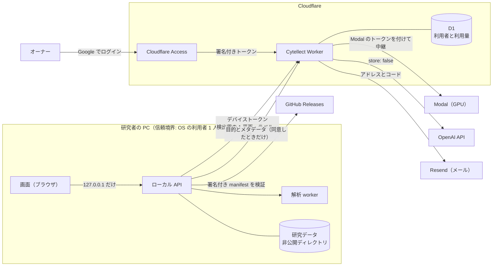

# Cytellect のセキュリティ体制

この文書は、Cytellect の情報セキュリティの方針、現在の管理策とその根拠、残るリスクをまとめたもの。利用を検討する研究室、共同研究先、セキュリティの担当者、監査人が、コードを読まずに体制を把握できるように書く。各管理策には、ISO/IEC 27001:2022 附属書 A と OpenSSF Scorecard の対応を付ける（[10 章](#10-規格との対応)）。

Cytellect は ISO/IEC 27001 の認証を取得していない。この文書は、将来の認証に向けた適用宣言書の土台として、現状を事実どおりに記録する。

| 項目 | 内容 |
|---|---|
| 対象 | リポジトリ `genellect/cytellect`、Windows 版、Docker 版、公開サイト `cytellect.app`、クラウド機能（Cytellect Worker、GPU 推論） |
| 責任者 | オーナー（`@genellect`） |
| 最終確認 | 2026-10-30、コミット `39005ce` |
| 脆弱性の報告 | [SECURITY.md](../SECURITY.md)（非公開の報告フォーム。合理的な報告には 3 日以内に返信する） |

**状態の表記**

| 表記 | 意味 |
|---|---|
| 有効 | 配布物・本番・リポジトリの設定で、現に働いている |
| 実装済み | コードと自動試験はあるが、本番では有効にしていないか、有効であることを確認していない |
| 受容 | リスクを認識したうえで、オーナーが受け入れている |
| 計画 | 未対応。[9 章](#9-受け入れたリスクと未対応の項目)に次の対応として挙げる |
| 要確認 | リポジトリからは確かめられない設定。オーナーの確認を待つ |

## 目次

1. [要約](#1-要約)
2. [方針と責任](#2-方針と責任)
3. [対象範囲と信頼境界](#3-対象範囲と信頼境界)
4. [技術的な管理策](#4-技術的な管理策)
5. [開発とサプライチェーン](#5-開発とサプライチェーン)
6. [脆弱性への対応](#6-脆弱性への対応)
7. [インシデントへの対応](#7-インシデントへの対応)
8. [外部サービス](#8-外部サービス)
9. [受け入れたリスクと未対応の項目](#9-受け入れたリスクと未対応の項目)
10. [規格との対応](#10-規格との対応)
11. [運用の詳細](#11-運用の詳細)
12. [改訂履歴](#12-改訂履歴)

## 1. 要約

- **研究画像は研究者の PC の中で解析する。** 外に出るのは、利用者が有効にした機能が必要とする最小限のデータだけで、送り先と内容を[一覧](#33-外部へ送るデータ)で定めている。
- **PC が持つクラウドの資格情報は、デバイストークン 1 つだけ。** OpenAI と Modal の鍵は Cytellect Worker だけが持つ。サーバーはトークンとログインコードを平文で保存せず、ハッシュだけを持つ。
- **管理者の操作は二重に確かめる。** オーナーは Cloudflare Access（Google のログイン）で入り、Worker は Access の前段に頼らず、受け取ったトークンの署名・発行者・対象・期限を自分で検証する。
- **配布物の信頼の起点は、オーナーの署名鍵。** アプリ内の更新は、Ed25519 で署名された manifest と一致するインストーラーだけを実行する。リポジトリへの書き込み権限だけでは、導入済みの PC でコードを実行できない。署名鍵は登録済みで、公開鍵をアプリに組み込むのは次の Windows 版から。
- **判断できないときは拒否する。** 設定の不備、データベースの障害、検証の失敗は、許可ではなく停止として扱う。
- **未対応の項目も公開する。** GitHub Actions の SHA での固定、依存の自動更新、SAST、ビルドの来歴の証明、インストーラーのコード署名は未対応で、[9 章](#9-受け入れたリスクと未対応の項目)に挙げる。

## 2. 方針と責任

### 2.1 原則

| # | 原則 | 具体例 |
|---|---|---|
| P1 | 研究データは研究者の管理下に置く | 既定では外部に送らない。送る機能は利用者が有効にした場合だけ動き、送る内容を最小にする |
| P2 | 研究の完全性を守る | 原画像の画素値を変えない。測定値と統計は、API と解析パッケージの共通実装だけが生成する |
| P3 | 最小権限 | 人、CI のジョブ、サービスに、必要な権限だけを与える。PC は外部サービスの鍵を持たない |
| P4 | 秘密を平文で保存せず、記録しない | トークンとコードはハッシュで保存する。リクエストの本文、ファイル名、トークンをログに残さない |
| P5 | 各層が自分で検証する | 前段の防御（Cloudflare Access、プロキシ）が働いている前提に頼らず、受け取る側が検証する |
| P6 | 判断できないときは拒否する | 設定の不備や障害は、許可ではなく 503 や処理の停止にする |
| P7 | 信頼の起点を鍵に置く | 配布物は署名で信頼する。同じ場所に置かれたハッシュの一致だけでは信頼しない |
| P8 | 検出ツールや依存も攻撃の対象とみなす | スキャナーを含む外部のツールは、版とハッシュを固定し、検証してから実行する（[5.2](#52-ツールと依存の固定trivy-の教訓)） |
| P9 | 事実どおりに記録する | 未実施の検証を合格としない。残るリスクと未対応の項目を公開する |

### 2.2 役割と責任

役割の正本は[チーム開発ルール §1](team-development.md#1-役割)にある。

| 役割 | セキュリティ上の責任 |
|---|---|
| オーナー（`@genellect`） | セキュリティの責任者。`main` へのマージ、本番へのデプロイ、Windows 版の配布、外部サービスの採用、鍵の保管と交換、インシデントの判断、リスクの受容 |
| 開発メンバー | 担当する変更の安全性。他のメンバーの PR のレビュー。非公開データと認証情報を扱わない |
| AI エージェント | 依頼者の指示の範囲での実装と検証。マージ、本番公開、配布は、オーナーが対象を明示して指示した場合だけ行う。成果物の責任は依頼者が持つ |

現在、本番の操作と鍵の保管はオーナー 1 人に集中しており、職務の分離（ISO/IEC 27001 A.5.3）は満たしていない（[9 章](#9-受け入れたリスクと未対応の項目)、R12）。

### 2.3 情報の区分

研究データは「非公開データ」「公開データ」「合成データ」「認証情報」に分けて扱う。区分ごとの保存場所と、Git・CI・開発用 AI での扱いは[チーム開発ルール §6](team-development.md#6-研究データの扱い)で定める。非公開データと認証情報は、コード、ログ、Issue、PR、スクリーンショット、CI、開発用 AI に含めない。

## 3. 対象範囲と信頼境界

### 3.1 守るもの

| 資産 | 例 | 置き場所 | 主な脅威 |
|---|---|---|---|
| 研究データ | 原画像、マスク、測定表、図、ファイル名、実験条件 | 研究者の PC、または研究室のサーバーの非公開ディレクトリ | 外部への送信、他者による閲覧、改ざん |
| 利用者の情報 | メールアドレス、承認の状態、月ごとの利用量 | Cloudflare D1 | 漏えい、列挙 |
| 資格情報 | デバイストークン、Worker の秘密、GitHub の secret | PC の設定ファイル、Worker の secret、GitHub の secret | 盗用、なりすまし |
| 署名鍵 | アプリ内更新の Ed25519 鍵 | オーナーの PC、GitHub の `release` 環境の secret | 盗用による偽の更新の配布 |
| 配布物 | Windows のインストーラー、更新の manifest、コンテナイメージ、公開サイト | GitHub Releases、GHCR、Vercel | 差し替え、サプライチェーンの侵害 |
| ソースと CI | コード、ワークフロー、ロックファイル | GitHub | 悪意のある変更、CI の秘密の窃取 |

### 3.2 構成と信頼境界

信頼境界は次の 4 つ。

- **研究者の PC。** 1 人の OS の利用者のための単一利用者のアプリで、同じ OS アカウントの他のプロセスは境界の内側にある。LAN や公開のサーバーとしては動かさない（[11.5](#115-windows-版)）。
- **Cytellect Worker。** PC からの要求を、デバイストークンで認証し、利用者ごとの上限を確かめてから外部サービスへ中継する。外部サービスの鍵はここにだけある。
- **管理の入口。** 管理画面と管理 API は、決められた origin でだけ答え、オーナーのトークンを Worker が検証する。
- **配布の経路。** GitHub Releases は信頼しない。信頼するのは、アプリに組み込んだ公開鍵で検証できる署名だけ。

Docker 版と研究室のサーバーでは、解析 worker をネットワークなしのコンテナで動かす（[4.3](#43-実行環境の隔離)）。

### 3.3 外部へ送るデータ

| 送り先 | 送る条件 | 送るもの | 送らないもの | 送り先での保存 |
|---|---|---|---|---|
| 解析提案（Worker 経由で OpenAI） | 利用者が機能を有効にしたとき。要求ごとに送信の同意（`transmission_confirmed`）を確かめる | 研究の目的、正規化したメタデータ（チャネル名、型、寸法、視野と群の数、既知の対応）。縮小したプレビュー（6 枚まで）は、画像の送信を別に有効にしたときだけ | 絶対パス、不要なファイル名、文書、マスク、測定表 | Worker は本文を保存しない。OpenAI は `store: false` でも、不正利用の監視のために保持することがある |
| クラウド GPU（Worker 経由で Modal） | ログインしてクラウドの Cellpose を使うとき | 検出に使う 1 平面、核小体のプロトコルでは採用した核のラベル、検出の条件 | ファイル名、ワークスペース名、実験条件、パス、他のチャネル | Worker は本文を読まず、保存しない。Modal Server は本文を保存しない |
| Resend | ログインのとき | メールアドレスと 6 桁のコード | — | Resend の規約による |
| GitHub | 更新の有無を確かめるとき（6 時間に 1 回まで） | なし（GitHub には PC の IP アドレスと固定の User-Agent が見える） | 研究データ、ファイル名、ワークスペースの識別子、アカウントの情報 | GitHub の規約による |
| Google Analytics | 公開サイトの 3 ページ（`/`、`/demo`、`/plan`）を開いたとき | 固定の URL とタイトル、参照元の origin、許可した操作の名前 | 研究データ、入力した文字、URL のクエリ、アプリの状態 | Google の規約による |

詳細は[解析提案](#analysis-proposal-service)、[クラウド GPU](#112-クラウド-gpu-での推論)、[公開ページの計測](#public-landing-page-analytics)にある。

## 4. 技術的な管理策

### 4.1 認証と認可

主体ごとの方式は次のとおり。トークンはすべて 32 バイトの暗号論的乱数で作り、保存するのは SHA-256 のハッシュだけ。署名の比較は定数時間で行う。

| 主体 | 方式 | 資格情報と保存の形式 | 期限と失効 | 状態 |
|---|---|---|---|---|
| 研究者の PC（クラウド機能） | メールに届く 6 桁のコードでログインし、デバイストークンを受け取る | コードは `ADMIN_SIGNING_KEY` を鍵とする HMAC で保存。トークンは SHA-256。PC ではトークンを OS の利用者だけが読める設定ファイルに置く | コードは 10 分。トークンは 90 日使わないと失効し、ログアウトで削除する。オーナーが失効させると、そのアドレスのすべての端末で次の要求から拒否する | 有効（Worker）。PC からのログインは次の Windows 版から |
| 新しい利用者 | オーナーが許可したアドレスにだけコードを送る。それ以外はアクセスの要求になり、オーナーに承認の連絡が届く | 要求の状態を確かめるトークンは SHA-256 で保存。アドレスを URL に載せず、他のアドレスの状態は読めない | 要求のトークンは 14 日 | 有効 |
| オーナー（管理画面） | Cloudflare Access の Google ログイン。Worker が `Cf-Access-Jwt-Assertion` を自分で検証する | RS256 の署名、発行者、対象（AUD）、有効期限、オーナーのアドレスを確かめる | Access のセッションは 24 時間で、許可するのはオーナーのアドレスだけ。`ADMIN_ORIGIN` 以外の入口では管理の経路が 404 を返す | 有効（2026-10-30） |
| オーナー（Access を設定しない場合） | `OWNER_EMAIL` に届くコードでログインする | セッションは SHA-256 で保存。HttpOnly、Secure、SameSite=Strict の cookie | 12 時間 | 本番では無効（Access を設定したため） |
| 承認リンク | HMAC で署名した 1 回限りのリンク。開くとボタンだけを表示し、押したときに承認する | ハッシュで保存し、使用の時刻を記録する | 7 日 | 有効 |
| GPU の中継 | Worker が Modal の proxy-auth トークンを付けて転送する | PC は Modal のトークンを持たない | Worker の secret の交換で失効 | 有効（研究者のログインを通した実際の推論は未確認） |
| ローカル API（Windows 版） | `127.0.0.1` だけで待ち受け、Host、Origin、`Sec-Fetch-Site`、CSRF のヘッダーを確かめる | HttpOnly、SameSite=Strict の cookie。トークンを URL、ブラウザの保存領域、ログに置かない | ランチャーを閉じるとセッションを失効させる | 有効 |
| Docker Desktop の所有者 | ループバックに公開した API への同一 origin の要求だけで、招待なしにセッションを作る | HttpOnly、SameSite=Strict の cookie | 7 日 | 有効 |
| 研究室のサーバー（招待） | オーナーが CLI で発行する 1 回限りの招待 | 招待とセッションは SHA-256 で保存。HttpOnly、SameSite=Strict の cookie | 招待は発行時に指定（例: 24 時間）。ログアウトでセッションを失効させる | 実装済み |
| 旧招待トークン（解析提案） | `LEGACY_INVITATIONS` が `"false"` でない間だけ受け付ける | SHA-256 | 利用者に結び付かないため、利用者の失効が届かない（R9） | 実装済み |

**攻撃への耐性**

| 攻撃 | 対策 | 残るリスク |
|---|---|---|
| コードの総当たり | 5 回間違えるとコードを無効にする。アドレスごとに 1 日 20 回間違えると 24 時間ロックする | 1 アドレスあたり 1 日に当たる確率は 5 万分の 1 |
| IP アドレスを変えての総当たり | 間違いの上限をアドレス単位で数えるため、IP を変えても回数は増えない。IPv6 は /64 単位で数える | — |
| D1 の漏えいからのコードの復元 | コードは鍵付きの HMAC で保存するため、D1 だけでは 6 桁を総当たりできない | `ADMIN_SIGNING_KEY` も漏れた場合を除く |
| コードの大量送信（メール爆撃、費用） | 送信の間隔は 60 秒。アドレスごとに 1 時間 6 回・1 日 10 回、IP ごとに 1 時間 20 回 | — |
| アドレスの状態の列挙 | IP ごとに 1 時間 20 アドレスまで | 許可・承認待ち・失効の状態はわかる（R1、受容） |
| 他人のアドレスを使えなくする | `ADMIN_SIGNING_KEY` を交換すると、すべてのロックと回数がその場で消える | 最長で約 1 日、その人にコードが届かなくなる（R2、受容） |
| 管理トークンの偽造、アルゴリズムのすり替え | RS256 だけを受け付け、`none` や HMAC を名乗るトークンを拒否する。鍵 ID を必須にし、大きすぎるトークンは解析の前に拒否する | — |
| 偽の鍵 ID による鍵の取得の増幅 | 未知の鍵 ID での鍵の再取得は 30 秒に 1 回まで | — |
| Access を通らない経路（`workers.dev` など） | Worker が自分でトークンを検証する。`ADMIN_ORIGIN` 以外の入口では管理の経路を 404 にする | — |
| 承認リンクの自動クリック（メールのスキャナー） | リンクを開いても承認されず、ボタンを押したときだけ承認する。リンクは 1 回限り | — |
| CSRF、DNS リバインディング（ローカル） | Host と Origin を文字どおりに照合し、`Sec-Fetch-Site`、CSRF のヘッダー、転送のヘッダーを確かめる | 同じ OS の利用者のプロセスは信頼境界の内側（R6） |
| 資格情報の送り先の誤り | デバイストークンは発行した URL にだけ送り、リダイレクトを追わない | — |
| GPU の使い逃げ（切断） | 1 人 1 枠。切断しても推論 1 回を 300 秒として数える | — |

### 4.2 暗号と鍵の管理

| 鍵・秘密 | 用途 | 保管場所 | 漏えい・紛失のとき |
|---|---|---|---|
| 更新の署名鍵（Ed25519） | アプリ内更新の manifest の署名 | オーナーの PC と、GitHub の `release` 環境の secret `UPDATE_SIGNING_KEY`。公開鍵はアプリのソースに組み込む | 失効と交換の手順に従う（[リリースの署名 §6](release-signing.md#6-鍵が漏れたまたは失ったとき失効)） |
| `ADMIN_SIGNING_KEY` | ログインコードと回数の記録のハッシュの鍵、承認リンクの署名 | Worker の secret | 交換すると、未使用のコード、承認リンク、ロックがすべて無効になる |
| `OPENAI_API_KEY`、`RESEND_API_KEY`、`MODAL_URL`、`MODAL_PROXY_TOKEN` | 外部サービスの利用 | Worker の secret | 各サービスで失効させ、`pnpm cf secret put` で入れ直す |
| `MODAL_TOKEN_ID`、`MODAL_TOKEN_SECRET` | Modal へのデプロイ | GitHub のリポジトリの secret | Modal で失効させる。environment での保護は計画（R14） |
| デバイストークン | PC からクラウド機能を使う | PC の `settings/cloud-account.json`（研究データの外、OS の利用者だけが読める） | オーナーがそのアドレスを失効させる |
| Cloudflare Access の署名鍵 | 管理トークンの署名 | Cloudflare が管理する。Worker は公開鍵を 10 分間キャッシュする | Cloudflare の鍵の交換に従う |
| `GITHUB_TOKEN` | CI のジョブ | GitHub が発行する。既定の権限は `contents: read` | ジョブの終了で失効 |

秘密は、各サービスの secret の管理にだけ置く。入力は CLI の保護された入力で行い、コマンドの引数や追跡されるファイルに書かない。通信はすべて HTTPS で、HTTP はテストのループバックだけで許す。

### 4.3 実行環境の隔離

| 対象 | 管理策 | 根拠 | 状態 |
|---|---|---|---|
| Docker 版の解析 worker | `network_mode: none`、UID 10001、ルートファイルシステムは読み取り専用、Linux の権限なし、メモリとプロセス数の上限 | CI の container ジョブが実際のイメージで、ループバックだけのインターフェースと外向きの通信の拒否を確かめる | 有効 |
| 処理の監視 | 親と子の両方が有効なリースを必要とし、確かめられないときは処理を止めて結果を公開しない | 自動試験 | 有効 |
| Windows 版 | `127.0.0.1` だけで待ち受ける。実行時にダウンロードしない | Windows の CI での導入試験 | 有効 |
| Windows 版の外向きの通信 | OS のファイアウォールでは制限していない | — | 受容（R5） |
| クラウド GPU（Modal） | コンテナは 1 つ、Volume とメモリのスナップショットを使わない、proxy-auth を必須にする。Modal の支出上限は管理画面で設定し、デプロイからは変えられない | `infra/modal_cellpose.py` | 有効 |

### 4.4 Web とブラウザ

- 画面と API は、`Content-Security-Policy`（`frame-ancestors 'none'`、`object-src 'none'` など）、`X-Frame-Options: DENY`、`X-Content-Type-Options: nosniff`、`Referrer-Policy: no-referrer`、カメラ・マイク・位置情報を禁じる `Permissions-Policy` を返す。
- API の応答は `no-store` にする。研究データには、画像の最適化、解析の計測、セッションの記録、Service Worker、CDN のキャッシュを使わない。
- 読み出しのたびに、要求したセッションとワークスペースの所有者を確かめる。ID を知っているだけでは読めない。
- 公開サイトの計測タグは、分離した文書でだけ読み込み、解析の画面には入れない（[11.8](#public-landing-page-analytics)）。

### 4.5 記録と監視

- **記録しないもの。** リクエストの本文、ファイル名、プロンプト、画像、ログインコード、トークン、IP アドレス。回数の制限には、アドレスと IP の鍵付きハッシュだけを使う。
- **記録するもの。** 利用の権利と利用量（アドレス、要求・承認・失効の時刻、月ごとの GPU の秒数と解析提案の費用）。処理の失敗は、決まったエラーコードだけを記録し、解析エンジンの出力をそのまま残さない。
- **CI に残すもの。** シークレットの走査は件数と規則 ID だけ。SBOM と依存の一覧は 7 日間。
- **監視。** セキュリティの事象を検知して通知する仕組みはない（計画、R15）。

### 4.6 保存と削除

- 作業データは、利用者の明示的な操作から 24 時間で失効する。画面の自動更新では延びない。失効と削除の後は、ただちに読めなくする。研究者自身の PC に限り、利用者が手動の保持を選べる（[11.9](#119-手動の保持)）。
- 研究データのバックアップは取らない。必要なバックアップは研究室の責任とする。
- 利用者の情報（アドレスと利用量）の保存期間は定めていない（計画、R16）。

## 5. 開発とサプライチェーン

### 5.1 リポジトリと CI の管理策

参考資料に挙げられる観点と OpenSSF Scorecard の項目に沿って、現状を示す。

| 観点（Scorecard の項目） | 現状 | 根拠 | 状態 |
|---|---|---|---|
| Actions の最小権限（Token-Permissions） | ワークフローの既定は `contents: read`。書き込みはジョブ単位でだけ与える（リリースの作成は `contents: write`、GPU のイメージは `packages: write`） | `.github/workflows/*.yml` | 有効 |
| 危険なワークフロー（Dangerous-Workflow） | `pull_request_target` を使わない | 同上 | 有効 |
| Actions の SHA での固定（Pinned-Dependencies） | すべてタグで参照している（`actions/checkout@v4` など）。タグは書き換えられる | 同上 | 計画（R17） |
| 依存とコンテナの固定（Pinned-Dependencies） | Python は `uv.lock`、Node は `pnpm-lock.yaml`、Fiji と Cellpose の成果物は SHA-256 で固定。実行時にダウンロードしない。コンテナのベースイメージは版のタグで固定し、digest では固定していない | ロックファイル、`engines/` の固定の記録、`infra/Dockerfile.*` | 有効（ベースイメージは計画） |
| 依存の継続的な監視（Dependency-Update-Tool、Vulnerabilities） | GitHub の Dependabot alerts が既知の脆弱性を警告する。Python の依存は、変更した PR で `pip-audit` も監査する。警告の対応の期限、Node の依存の CI での監査、自動更新の PR はない | `ci.yml`、GitHub の設定 | 一部（R18） |
| SAST（SAST） | CodeQL などの静的解析はない | — | 計画（R19） |
| シークレットの走査 | 版とハッシュを固定した gitleaks が、Git の全履歴と追跡中のファイルを調べる。走査の結果は件数と規則 ID だけを残す。GitHub の secret scanning と push protection の設定は未確認 | `scripts/scan_secrets.py`、`scripts/security-tools.lock.json`、[CI の構成](ci.md) | 有効（GitHub 側は要確認） |
| ブランチ保護（Branch-Protection） | `main` はルールセットで更新を制限し、PR をマージできるのはバイパス権限を持つオーナーだけ。PR を必須にし、直接の push と force push を禁じる。必須のチェック、最新の `main` の取り込み、会話の解決を求める | [チーム開発ルール §2・§3](team-development.md#2-開発の流れ) | 有効（ルールセットの正式な一覧は要確認） |
| レビュー（Code-Review） | オーナー以外の PR には、別のメンバー 1 名以上の承認が要る。オーナー自身の PR はレビューを省略できる | [チーム開発ルール §4](team-development.md#4-レビュー) | 有効（オーナーの PR は R12） |
| 自動のレビュー | PR ごとに、AI（Codex）のコードレビューとセキュリティレビューが自動で走る。指摘はマージを止めない | GitHub の PR | 有効 |
| CI の必須化（CI-Tests） | 最新の `main` を取り込んだ head で必須 CI が成功してからマージする。ルールのバイパスは必須 CI も飛ばすため、成功を確かめてから実行する手順にしている | [CI の構成](ci.md)、AGENTS.md | 有効（手順による。技術的な強制は計画） |
| 署名済みのリリース（Signed-Releases） | アプリ内更新の manifest に Ed25519 で署名し、アプリに組み込んだ公開鍵で検証する。署名は、オーナーが承認する `release` 環境のジョブだけが行う。署名鍵は 2026-10-30 に `release` 環境へ登録した。公開鍵を組み込んだ版はまだ配布していない。インストーラー自体にはコード署名がない | [リリースの署名](release-signing.md)、[11.5](#115-windows-版) | 実装済み（公開鍵の組み込みは次の版。コード署名は受容、R3） |
| SBOM | CI が Python の依存を CycloneDX 形式で出力し、7 日間保存する。リリースには添付していない | [OSS とライセンス](oss.md) | 実装済み（リリースへの添付は計画、R20） |
| ビルドの来歴（SLSA の provenance） | 来歴の証明（attestation）はない | — | 計画（R20） |
| GPL などのソースの提供 | 同梱した版ちょうどのソースを、固定した SHA-256 で検証してからリリースに添付する | [GPL などの対応するソース](oss.md#gpl-などの対応するソース) | 有効 |
| セキュリティポリシー（Security-Policy） | [SECURITY.md](../SECURITY.md) と非公開の報告フォーム | — | 有効 |

### 5.2 ツールと依存の固定（Trivy の教訓）

2026 年 3 月、脆弱性スキャナーの Trivy で、盗まれた認証情報による配布物の差し替えと、GitHub Action のバージョンタグの書き換えが起きた（CVE-2026-33634）。タグで Action を参照していた CI は、書き換えられたコードをそのまま実行した。脆弱性を検出する側のツールも、サプライチェーンの攻撃の対象になる。

Cytellect はこの教訓を次のように扱う。

- **固定して検証してから実行する。** シークレットの走査に使う gitleaks は、版とアーカイブの SHA-256 を `scripts/security-tools.lock.json` に固定し、一致を確かめてから実行する。図のフォントの導入も、apt の署名済みの索引にある SHA-256 と一致したファイルだけを使う。
- **タグを信頼しない。** GitHub Actions もコミットの SHA で固定し、更新は差分を確かめてから取り込む（計画、R17）。
- **CI の秘密を最小にする。** PR の CI には秘密を渡さない。署名鍵は、オーナーが承認する `release` 環境のジョブにだけ渡す。

### 5.3 変更の管理

すべての変更は PR で行い、1 つの PR では 1 つの目的だけを扱う。仕様、テスト、文書はコードと同じ PR で更新する。本番へのデプロイ、配布、外部サービスの採用はオーナーだけが判断する（[チーム開発ルール §7](team-development.md#7-本番公開と配布)）。開発環境と本番は分け、他の人が使える開発環境は登録済みの公開画像だけを受け付ける（[11.4](#shared-development-environments)）。

## 6. 脆弱性への対応

| 段階 | 内容 |
|---|---|
| 受付 | GitHub の非公開の報告機能で受け付ける（[SECURITY.md](../SECURITY.md)）。Issue や PR など公開の場では受け付けない |
| 返信 | 合理的な報告には、3 日以内に返信する |
| 評価 | 影響する版、研究データと資格情報への影響、悪用の条件を評価する |
| 修正 | 非公開の場（GitHub の Security Advisory の非公開フォーク）で修正し、通常の PR と同じ検証を行う |
| 配布 | 公開サイトは `main` へのマージで、Worker はオーナーのデプロイで、Windows 版は署名した更新で配布する |
| 公表 | 修正版の配布の後に GitHub Security Advisory で公表し、必要に応じて CVE を取得する。報告者の希望に応じて謝辞を載せる |

対象とする版と、修正版を配布するまでの目標日数は定めていない（計画、R21）。依存の脆弱性は、`pip-audit` の結果と公開された勧告をもとに同じ流れで扱う。

## 7. インシデントへの対応

| 段階 | 内容 |
|---|---|
| 報告 | 非公開データや認証情報を誤ってコミット・送信した人は、すぐにオーナーへ連絡する。単独で履歴を書き換えない（[チーム開発ルール §6](team-development.md#6-研究データの扱い)） |
| 封じ込め | 漏れた認証情報を無効にして再発行する。必要に応じて、利用者の失効、`ADMIN_SIGNING_KEY` の交換、`LEGACY_INVITATIONS="false"`、GPU の中継の停止（`GPU_MONTHLY_SECONDS` を 0）、更新の署名鍵の失効を行う |
| 影響の評価 | 影響した期間、データ、利用者を特定する。依存やツールの侵害では、影響した版を実行した CI の実行を特定し、そのジョブが触れた秘密をすべて交換する |
| 復旧 | 修正を通常の検証を経て配布する |
| 通知 | 影響を受けた利用者に知らせる。法令と契約上の通知の義務を確かめる |
| 再発の防止 | 原因を構造で直し、この文書と関連する文書を同じ PR で更新する |

インシデントの記録の様式と、利用者に知らせるまでの期限は定めていない（計画、R22）。

## 8. 外部サービス

| サービス | 用途 | 渡るデータ | アカウントの保護 |
|---|---|---|---|
| GitHub | ソース、CI、リリース、脆弱性の受付 | ソースコード（研究データは置かない） | 要確認 |
| Cloudflare | Cytellect Worker、D1、Access | 利用者の情報、中継する推論のデータ（保存しない） | 要確認 |
| Modal | クラウド GPU での推論 | 検出用の平面とラベル（保存しない） | GitHub のログインと 2 要素認証。他のメンバーはいない |
| OpenAI | 解析提案 | 目的とメタデータ、同意したときのプレビュー | 要確認 |
| Resend | ログインコードのメール | アドレスとコード | 送信ドメインを SPF・DKIM で検証済み。アカウントの保護は要確認 |
| Vercel | 公開サイト | 研究データは受け付けない | 要確認 |
| Google Analytics | 公開サイトの 3 ページの計測 | [3.3](#33-外部へ送るデータ)のとおり | 要確認 |
| Hugging Face Inference Endpoints | 運用者が選んだ場合の推論 | クラウド GPU と同じ | 運用者による |

外部サービスの追加と、費用が発生する設定はオーナーが判断する。

## 9. 受け入れたリスクと未対応の項目

### 9.1 受け入れたリスク

| ID | リスク | 理由 | 判断 |
|---|---|---|---|
| R1 | ログインの要求に、アドレスの状態（許可・承認待ち・失効）を返す | PC が状態に合った画面を出すため。回数の制限で大規模な列挙を防ぐ | オーナー |
| R2 | 誰でも、他人のアドレスを最長で約 1 日ロックできる | 総当たりを防ぐ制限の裏返し。鍵の交換ですぐに解除できる | オーナー |
| R3 | Windows のインストーラーにコード署名がない | 段階 0 は未署名で配布する（D4） | オーナー、2026-10-30 |
| R4 | 初回の導入は署名の検証を通らない。リリースの資産を差し替えられる人は、インストーラーとハッシュを同時に差し替えられる | R3 と同じ。手動の確認手順を案内する（[ダウンロードと確認](install-windows.ja.md#2-ダウンロードと確認)） | オーナー |
| R5 | Windows 版の外向きの通信を OS で制限していない | 単一利用者のアプリとしての割り切り | オーナー |
| R6 | 同じ OS の利用者のプロセスは信頼境界の内側 | 単一利用者のアプリとしての割り切り | オーナー |
| R7 | OpenAI は `store: false` でも、不正利用の監視のために要求を保持することがある | 提供元の API のデータ方針による | オーナー |
| R8 | Modal のアカウントかデプロイトークンを乗っ取られると、入力を記録するサーバーに差し替えられる | アカウントは 2 要素認証で保護し、メンバーを置かない | オーナー |
| R9 | 旧招待トークンは利用者に結び付かず、利用者の失効が届かない | ログインへの移行期間のため。`LEGACY_INVITATIONS="false"` で止められる | オーナー |

### 9.2 未対応の項目

| ID | 項目 | 次の対応 |
|---|---|---|
| R10 | 研究室のサーバー（公開ホスト）での受入確認 | 実際のホストで、Origin と cookie、全成果物の所有者の確認、取消、再起動、削除、容量、worker の外部通信の拒否を確かめる |
| R11 | 外部の監査と侵入試験 | 未実施 |
| R12 | 職務の分離。オーナー自身の PR はレビューを省略でき、本番の操作と鍵の保管が 1 人に集中する | 2 人目のレビュアーと鍵の保管者を置く |
| R13 | Docker 版でのクラウド GPU | ネットワークを使う worker の構成を審査してから有効にする |
| R14 | Modal のデプロイトークンを environment で保護していない | `release` と同じく、承認の要る environment に移す |
| R15 | セキュリティの事象の監視と通知 | 管理操作、ログインの失敗の急増、費用の急増の通知 |
| R16 | 利用者の情報の保存期間 | 期間と削除の手順を定める |
| R17 | GitHub Actions をタグで参照している | コミットの SHA で固定する |
| R18 | Dependabot alerts の対応の期限、依存の自動更新、Node の依存の CI での監査 | 未対応の警告を解消し、自動更新の PR と監査を導入する |
| R19 | 静的解析（SAST） | CodeQL などを導入する |
| R20 | リリースの SBOM と来歴の証明 | SBOM と build provenance の attestation をリリースに付ける |
| R21 | 対象とする版と、修正版を配布するまでの目標 | オーナーが定める |
| R22 | インシデントの記録の様式と通知の期限 | オーナーが定める |
| R23 | ISMS の文書（適用範囲、リスク評価の手順、目標、教育、内部監査、マネジメントレビュー） | [10.2](#102-isms-の準備状況) |

自動試験は、招待の再利用と失効、Origin と CSRF、セッションをまたいだ所有者の確認、版の不変性、古いリースの拒否、処理の時間切れと再試行、失効と削除を確かめている。これらはホスト型の運用を保証するものではない。非公開の研究データを受け取る前に、実際の解析ホストで受入確認を行う（R10）。

## 10. 規格との対応

### 10.1 ISO/IEC 27001:2022 附属書 A

主な管理策と、この文書の対応する節、現在の状態を示す。物理的な管理策（7 章）と人的な管理策（6 章）は、現在の体制では対象外か未整備のため省く。

| 管理策 | 対応する節 | 状態 |
|---|---|---|
| 5.1 情報セキュリティのための方針群 | [2.1](#21-原則) | 有効 |
| 5.2 情報セキュリティの役割と責任 | [2.2](#22-役割と責任) | 有効 |
| 5.3 職務の分離 | [2.2](#22-役割と責任) | 計画（R12） |
| 5.7 脅威インテリジェンス | [5.2](#52-ツールと依存の固定trivy-の教訓) | 一部 |
| 5.9 情報と関連資産の目録 | [3.1](#31-守るもの) | 有効 |
| 5.12 情報の分類 | [2.3](#23-情報の区分) | 有効 |
| 5.14 情報の転送 | [3.3](#33-外部へ送るデータ) | 有効 |
| 5.15–5.18 アクセス制御、識別情報、認証情報、アクセス権 | [4.1](#41-認証と認可) | 有効 |
| 5.19–5.23 供給者関係、ICT サプライチェーン、クラウドサービス | [5.1](#51-リポジトリと-ci-の管理策)、[8](#8-外部サービス) | 一部 |
| 5.24–5.28 インシデント管理 | [7](#7-インシデントへの対応) | 一部（R22） |
| 5.34 プライバシーと個人を特定できる情報の保護 | [3.3](#33-外部へ送るデータ)、[4.5](#45-記録と監視)、[4.6](#46-保存と削除) | 一部（R16） |
| 5.35 情報セキュリティの独立したレビュー | — | 計画（R11） |
| 5.37 操作手順書 | [11](#11-運用の詳細) | 有効 |
| 8.2 特権的アクセス権 | [4.1](#41-認証と認可)（管理画面） | 有効 |
| 8.4 ソースコードへのアクセス | [5.1](#51-リポジトリと-ci-の管理策) | 有効 |
| 8.5 セキュリティを保った認証 | [4.1](#41-認証と認可) | 有効 |
| 8.8 技術的ぜい弱性の管理 | [5.1](#51-リポジトリと-ci-の管理策)、[6](#6-脆弱性への対応) | 一部（R18、R19） |
| 8.10 情報の削除 | [4.6](#46-保存と削除) | 有効 |
| 8.12 データ漏えいの防止 | [3.3](#33-外部へ送るデータ)、[11.4](#shared-development-environments) | 有効 |
| 8.13 情報のバックアップ | [4.6](#46-保存と削除) | 対象外（研究室の責任） |
| 8.15–8.16 ログ取得、監視活動 | [4.5](#45-記録と監視) | 一部（R15） |
| 8.20–8.22 ネットワークのセキュリティ、分離 | [4.3](#43-実行環境の隔離) | 有効 |
| 8.24 暗号の利用 | [4.2](#42-暗号と鍵の管理) | 有効 |
| 8.25–8.29 セキュリティに配慮した開発、コーディング、試験 | [5](#5-開発とサプライチェーン) | 一部（R17–R20） |
| 8.31 開発・試験・本番の環境の分離 | [5.3](#53-変更の管理) | 有効 |
| 8.32 変更管理 | [5.3](#53-変更の管理) | 有効 |

### 10.2 ISMS の準備状況

認証には、附属書 A の管理策に加えて、本文の箇条 4〜10 の要求事項を満たす必要がある。

| 要求事項 | 現状 |
|---|---|
| 4 組織の状況（適用範囲） | この文書の冒頭の「対象」が案。正式な適用範囲の文書はない |
| 5 リーダーシップ（方針、役割） | [2 章](#2-方針と責任)。方針のオーナーによる承認は、この文書のマージで行う |
| 6 計画（リスクの評価と対応、目標） | [3 章](#3-対象範囲と信頼境界)と [9 章](#9-受け入れたリスクと未対応の項目)が土台。リスク評価の手順と基準、情報セキュリティの目標はない |
| 7 支援（資源、力量、認識、文書化した情報） | 文書は Git で管理する。教育と力量の記録はない |
| 8 運用 | [11 章](#11-運用の詳細)と関連する文書 |
| 9 パフォーマンス評価（監視、内部監査、マネジメントレビュー） | ない |
| 10 改善（不適合と是正処置） | 不具合への対処は[問題への対処](development-principles.md#問題への対処)に従う。不適合の記録の様式はない |

## 11. 運用の詳細

### 11.1 解析提案

解析提案は既定で無効にしている（[設計](workspace-redesign.md#analysis-proposal-service-llm)）。利用者が有効にした場合（各要求に `transmission_confirmed: true` が必要で、ない要求は拒否する）に限り、ローカル API は研究の目的と正規化したメタデータ（チャネル名、型、寸法、視野と群の数、既知の対応）を Cytellect の解析提案サービスに送る。サービスは `store: false` で OpenAI API を呼ぶ。代表的なプレビュー（6 枚まで、縮小したもの）は、利用者が画像の送信を別に有効にした場合だけ送る。絶対パス、不要なファイル名、文書、マスク、測定表は送らない。`store: false` は保持がないことを意味しない。提供元は、API のデータ方針に基づき、不正利用の監視のために要求を保持することがある。

サービスが保存するのは、利用の権利と利用量だけである。招待とデバイストークンのハッシュ、メールでのログインでは、アドレス、ログインコードとトークンのハッシュ、要求・承認・失効の時刻、回数の制限に使う鍵付きハッシュ（IP アドレスは保存しない）、利用者ごとの月の GPU の秒数と解析提案の費用を保存する（[クラウドへのアクセス](proposal-service.md#cloud-access-e-mail-login-approval-and-gpu-gateway)）。プロンプトの本文、画像、コード、トークンは記録しない。ログインコードは Resend でメール送信するため、Resend はアドレスとコードを受け取る。

受容したリスクとして、ログインの要求はアドレスの状態（許可、承認待ち、失効）を返す。PC がそれに合った画面を出すためで、知っているアドレスの状態は誰でも確かめられる。IP（/64）ごととアドレスごとの回数の制限で、大規模な列挙にはならないようにしている（[ログインの制限](proposal-service.md#login-limits)）。運用者の鍵はサービスの secret にだけある。開発用のツール、CI、公開のリポジトリは、非公開の研究データを受け取らない。

### 11.2 クラウド GPU での推論

運用者は、導入した Cytellect にリモートの GPU 推論サービスを指定できる（Windows では `settings/cellpose-remote.json`。クライアントは `CYTELLECT_CELLPOSE_REMOTE_URL` と `CYTELLECT_CELLPOSE_REMOTE_TOKEN` を読む。[クラウド GPU](cloud-gpu.ja.md)）。Docker の worker は `network_mode: none` のままにするため、ネットワークを使う worker の構成を審査するまで、Docker 版ではリモートの推論を使わない。送るのは Cellpose の候補の検出に必要なものだけで、検出に使う 1 平面、核小体のプロトコルでは採用した核のラベル、検出の条件である。ファイル名、ワークスペース名、実験条件、パス、他のチャネルは送らない。核への結び付け、補正、測定、統計はローカルで行う。

Cytellect のクラウドにログインした Windows 版は、デバイストークンを 1 つ `settings/cloud-account.json` に保存する。この場所は `settings/cellpose-remote.json` と同じで、研究の `data` ディレクトリの外にあり、OS の利用者だけが読める。ローカル API はトークンを返さず、記録せず、発行した URL にだけ送り、リダイレクトを拒否する。ログアウトで削除する。明示的な `CYTELLECT_CELLPOSE_REMOTE_*` の設定は、ログインしたサービスより優先する。

PoC のデプロイ（`infra/modal_cellpose.py`）は Modal Server を使う。Modal によると、Server の要求と応答はコンテナに中継され保存されない（Web Functions の入力は最大 7 日保存される）。Volume とメモリのスナップショットを使わず、Modal の proxy-auth トークンを必須にし、単一 GPU のコンテナを最大 1 つだけ動かす（L4 を優先し、A10 を予備にする）。デプロイは `main` からだけ、リポジトリの secret にあるデプロイトークンを使うワークフローで行う。ワークスペースの支出上限は Modal の管理画面でゼロに設定しており、デプロイからは変えられない。GPU の選択は、エンドポイントとトークンの範囲を変えない。主な残るリスクは、Modal のアカウントかデプロイトークンを乗っ取られ、入力を記録するサーバーに差し替えられることである。アカウントは GitHub のログインと 2 要素認証を使い、他のメンバーはいない。

メールでのログインでは、導入した Cytellect は Modal のトークンを持たない。同じ要求をデバイストークンを付けて Cytellect Worker（`/v1/cellpose/*`）に送り、Worker が Modal の proxy-auth トークンを付けて転送する。そのため、検出の平面、ラベル、条件は通信の途中で Cloudflare を通る。Worker は要求と応答の本文を読まず、保存せず、記録せずにそのまま流す。Workers の observability は無効にし、記録するのは利用者のアドレス、処理中の要求の開始時刻、経過秒数だけである。

URL は https でなければならず（テストに限りループバックの http を許す）、認証情報、クエリ、フラグメントを含めない。アクセストークンは Authorization ヘッダーで送り、エラーには現れない。サービス（`engines/cellpose/server.py`）は要求の内容を処理の間だけメモリに置き、ファイルを書かず、要求の内容、パス、クライアントのアドレスを記録しない。Hugging Face Inference Endpoints では、提供元は本文を保存せず、自身のログを 30 日間保持する。クライアントは、サービスがリリースのランナー、モデル、パッケージのロックのハッシュを報告した場合だけ結果を受け入れ、合わなければ `cellpose_remote_version_mismatch` で失敗する。

### 11.3 導入と招待

ローカルの開発では、`CYTELLECT_DATA_DIR` を checkout の外の非公開のディレクトリにし、`CYTELLECT_APP_ORIGIN=http://localhost:3000`、`CYTELLECT_SECURE_COOKIES=false` を設定する。`uv run cytellect serve`、`uv run cytellect-worker`、`pnpm dev` を別々の端末で動かす。

Linux のコンテナでは、UID 10001 が所有し、モードが 0700 の専用の非公開ディレクトリを作り、その絶対パスを `CYTELLECT_RUNTIME_DIR` に設定してから `docker compose up --build -d` を実行する。worker は `network_mode: none` で、非公開のローカルのボリュームだけを共有する。SQLite をネットワーク共有に置かない。Fiji とモデルの取得はビルドの中で行い、処理の中では行わない。

招待は、非公開の運用者の端末で `uv run cytellect invite --hours 24`（または `docker compose exec api cytellect invite --hours 24`）で発行する。CLI は 1 回限りの招待を 1 度だけ出力するので、共有のログにパイプしない。トークンはハッシュで保存し、セッションは HttpOnly の cookie を使う。ログアウトでセッションを失効させる。

### 11.4 共有の開発環境

他の人が使える開発環境では `CYTELLECT_UPLOAD_ALLOWLIST=fixtures/public/uploads.json` を設定する。API は、アップロードされた画像や表を非公開のボリュームに書いた後にハッシュを計算し、SHA-256 が登録済みの公開ファイルの一覧になければ削除して `403 unregistered_upload` を返す。これにより「登録済みの公開画像だけ」を、約束ではなく技術的な境界にする。一覧が空か壊れていれば起動時のエラーにし、「すべて許可」にはしない。導入した Cytellect ではこの変数を設定しない。CI の `fiji-browser` ジョブは、用意した公開の入力が一覧とバイト単位で一致することを確かめる（`scripts/check_public_uploads.py`）。

### 11.5 Windows 版

ローカルのランチャーは `127.0.0.1` だけで待ち受け、Host、Origin、CSRF を厳しく確かめる。Python と Fiji の worker に OS のファイアウォールの制限はかけない。固定したレシピ、導入した成果物のハッシュ、実行時にダウンロードしないことはアプリの安全策であり、外向きの通信を拒否していることの証明ではない。単一利用者の信頼境界と、PC の電源が切れている間の削除の扱いは[ローカル配布](local.md)にある。

導入した Windows 版は、ログインしたワークスペースが更新の状態を求めたときに（6 時間に 1 回まで）、`genellect/cytellect` の公開のリリースの一覧に新しい版があるかを問い合わせる。要求には研究データ、ファイル名、ワークスペースの識別子、アカウントの情報を含めない。GitHub には PC のアドレスと固定の User-Agent が見える。更新は、利用者が明示的に求めた後、まずその版の署名付きの更新の manifest を GitHub のリリースのホストから取得して署名を確かめ、manifest が示す SHA-256 とサイズのインストーラーだけを取得して実行する。インストーラーは実行時の依存をすべて同梱し、何もダウンロードしない。リリースのビルドは、同梱した GPL・LGPL などの部品の対応するソースを、公開の Maven リポジトリ、PyPI、JDK の提供元から、リポジトリに固定した SHA-256 で検証して取得し、リリースに添付する。このソースは導入されず、研究データを含まない。インストーラーとその中身は Modal と OpenAI の認証情報を含まず、新しい導入も認証情報を書き込まない。保存するのは、管理者が入力したクラウド GPU のアクセスキーだけで、`settings/cellpose-remote.json` に置く。ビルドと CI の導入の確認は、認証情報のパターンを走査し、規則ごとの件数だけを報告する。

**更新の信頼。** 信頼の起点はリリースではなく、オーナーの Ed25519 の更新の署名鍵である。各リリースは `Cytellect-update-<版>.json`（版、インストーラーのファイル名、SHA-256、サイズ、ソースのコミット、発行の時刻）と、その OpenSSH の署名 `.sig`（`ssh-keygen -Y sign`、名前空間 `cytellect-update`、SHA-512）を持つ。導入した Cytellect は、ソースに組み込んだ公開鍵（`update_signature.py`）だけを持つ。現在の `main` は公開鍵をまだ組み込んでおらず、組み込んだ版から、この確認によるアプリ内の更新が有効になる。インストーラーを求める前にその鍵で署名を検証し、manifest の版が提示された版と同じであることを求め、インストーラーの SHA-256 とサイズが manifest と等しい場合だけ実行する。リリースの `.sha256` ファイルと GitHub の資産の digest は信頼せず、食い違ったときに更新を止めるためだけに使う。署名がない、改ざんされている、別の鍵による、名前空間や版が違う、インストーラーが違う、のいずれでも、何も実行する前に更新を止める（`failed`、`update_signature_*`、`update_manifest_*`、`update_installer_hash_mismatch`）。そのため、リポジトリへの書き込み権限だけでは、リリースから導入済みの PC でコードを実行できない。秘密鍵も必要で、秘密鍵はオーナーの PC と、オーナーがジョブを承認する `release` 環境の `UPDATE_SIGNING_KEY` にだけある。公開鍵を組み込んでいない版はアプリ内で更新せず、新しいインストーラーを求める。鍵の作成、登録、失効、交換は[リリースの署名](release-signing.md)にある。

段階 0 では、インストーラーにコード署名をしない（[ローカル配布](local.md#real-machine-checklist-stage-0-acceptance-e1)のオーナーの判断 D4）。初回の導入と、公開鍵を組み込んでいない版からの手動の導入は、この確認を通らない。リリースの資産を差し替えられる人は、インストーラーと `.sha256` を同時に差し替えられ、Windows は差し替えたものを利用者の権限で実行する。インストーラーに Authenticode の署名が付くまで、利用者向けの手引きは、署名付きの manifest と `main` にある公開鍵で、Windows の `ssh-keygen` を使ってダウンロードを確かめる方法を案内する（[ダウンロードと確認](install-windows.ja.md#2-ダウンロードと確認)）。この確認は任意で手動である。インストーラーに署名した後は、決まった発行元の有効な署名を追加で求められる。

### 11.6 公開ホスト

API のホスト名は Vercel の画面と同じ登録可能ドメインの下に置き、`CYTELLECT_APP_ORIGIN` を正確に設定し、HTTPS と `CYTELLECT_SECURE_COOKIES=true` を使う。厳格な same-site の cookie は、無関係な第三者のドメインの API を意図的にサポートしない。解析用のドメインを用意する間は、Vercel の既定のドメインで公開のサンプルを表示できる。

`docker compose -f compose.yaml -f infra/compose.tls.yaml up -d` で Caddy の TLS プロキシを加え、`CYTELLECT_API_HOST` を設定する。インターネットに面するのはプロキシだけにする。ホストのファイアウォール、容量の警告、OS の更新を設定する。Compose のメモリの上限は worker 全体を、supervisor は子プロセスを制限する。Caddy は上限を超える本文を multipart の解析の前に拒否する。一時的なアップロードは `/data/tmp` に置く。

ブラウザの Origin と cookie の挙動、すべての種類の成果物でのセッションをまたいだ読み出しの拒否、取消、サーバーの再起動、削除、容量の扱い、worker の外部通信の拒否を、実際のホストで確かめる。公開の画面をデプロイしただけでは、これらの確認を通ったことにならない。

### 11.7 保持と復旧

ワークスペースは、明示的な操作から 24 時間で失効する。画面の自動更新やプレビューの読み出しでは延びない。失効と DELETE は、ただちに読み出しを止める。処理中の作業は、そのプロセスツリーが止まるまで物理的な削除から保護し、その後に入力、配列、マスク、図、書き出し、試行のディレクトリを削除する。ファイルは通常の PoC のバックアップに含めない。

ワークスペースの失効は、親のハートビート、独立した子の watchdog、最終結果の公開も無効にする。処理中のタスクは、ワークスペースの期限の後にリースを更新して寿命を延ばすことはできない。supervisor はリースを手放す前にプロセスツリーを止めて回収し、削除はそれまで処理中のファイルを残す。運用者が保持の期間を短く設定した場合も同じである。

worker が止まっていた場合は、`cytellect cleanup` を手動で実行する。永続的なリースが中断した処理を回復し、自動の試行は最大 2 回で、古い worker は結果を確定できない。失敗した再試行は新しい試行として始め、前の結果を上書きしない。調べるのは、整理したエラーコードで、エンジンの生の stderr ではない。

Alembic の移行は、起動時に SQLite の書き込みロックの下で実行し、版のない最初の状態の取り込みも含む。コードとスキーマの変更は、API と worker を同時に止めてからデプロイする。自動のダウングレードや、使用中の WAL ファイルのコピーはしない。オーナーが認めたスキーマの復旧の前には、オフラインで非公開の、短命なメタデータのスナップショットを取り、ワークスペースの保持の方針に従う。研究ファイルのバックアップは、この PoC の範囲外である。

**watchdog とコンテナの確認。** 親と子は、どちらも有効なリースを必要とする。データベースや監視のエラーは拒否の側に倒し、supervisor は科学計算のプロセスツリーを止め、結果を公開せず、非公開の起動記述を削除する。子の watchdog も、データベースや親の同一性を確かめられなければ計算を止める。プロセスの起動に失敗した場合は、決まったエラーコードだけを記録してリースを手放す。データベースが使えないままなら、有限のリースの回復が、子の停止後に取り残された処理を扱う。Linux の試行は専用のプロセスグループを持つので、直接の Python の子が先に終わっても Fiji の子孫まで止める。サブプロセスの生の出力は残さない。確定していない試行の成果物は非公開のボリュームに残り、ワークスペースの保持による削除で消える。

コンテナの CI は、実際の worker のイメージを UID 10001、ルートファイルシステムの読み取り専用、書き込み可能な非公開の `/data` ボリューム、`network none`、Linux の権限なし、メモリとプロセス数の上限で動かす。ループバックだけのインターフェースと、外向きのソケットの拒否を確かめてから、固定した Fiji の検出器を既知の合成の画素で実際に動かす。これはインフラの証拠であり、利用者の画像での科学的な性能や、インターネットに面した本番のホストの受入ではない。

### 11.8 公開ページの計測

本番のサイト `https://cytellect.app` の 3 つの公開ページは、既存の COMPASS 公式の GA4 の送信先 `G-EHKJ8B8N0Y` を使う（新しいタグやプロパティは作らない）。対象は LP の `/`、公開デモの `/demo`（登録済みの公開画像でのワークスペース、[公開デモ](showcase.md)）、解析計画の手引きの `/plan` で、どれも研究画像を受け付けない。各ページは `data-cytellect-public-page` で自身を示し、Google のタグを持つ別の文書 `/lp-metrics.html` を読み込む。この文書は親のパスを固定の許可リストと照合し、ページを離れると破棄される。導入した Cytellect の解析のワークスペース（`/workspace`。公開のビルドでは `/demo` へ転送する）、`/legacy`、`/product` の転送、API を有効にしたビルド、ローカルの導入、プレビュー、開発のホストはタグを読み込まない。`/product` は `/` へ恒久的に転送する。ローカルのパッケージは、ワークスペースを自身のルートに置く。主文書の CSP は Google を許可せず、計測の文書だけが必要な Google のスクリプトと収集のホストを許可する。

各ページが送るのは、固定の正規の URL とタイトル（`/` は Cytellect、`/demo` は Cytellect — Example analysis、`/plan` は Cytellect — Analysis planning）、参照元の HTTPS の origin（パスとクエリを除く）、許可した操作の名前である。URL のクエリとハッシュ、リンクの URL、利用者が入力した文字、ファイル名、研究のメタデータ、画像、測定値、アプリの状態は含めない。同じ origin の iframe はライフサイクルを分けるだけで、アクセス権は分けない。侵害された第三者のスクリプトに対するサンドボックスではない。Google は訪問者とセッションの計測に解析用の cookie を使うことがある。広告の同意は拒否とし、Google シグナルとパーソナライズは無効にしている。ブラウザの Do Not Track と Global Privacy Control があればタグを読み込まない。タグを止めても製品へのリンクは止まらない。セッションの記録はしない。

イベントは次のとおり。`page_view`、`download_click`（公開の Windows 版のパッケージへのリンク。導入の成功ではない）、`download_section_click`、`example_click`、`planning_click`、`launch_help_click`、`workspace_click`（LP から解析の画面へのリンク。非公開のワークスペースは計測しない）、`demo_step_click`（固定の `content_id`: demo_experiment、demo_image、demo_statistics、demo_figure。デモのタブのボタン）、`demo_download_click`（デモのダウンロードのリンク）、`demo_guide_click`（デモの手引きのボタン。ヘッダーとスマートフォンのメニュー）、`guide_click`（固定の `content_id`: guide、quickstart、methods、setup、figures）。分離した公開の文書の中で、GA4 の通常のセッションとエンゲージメントのイベントも発生しうる。COMPASS の結果と分けるには、ホスト名 = `cytellect.app` で絞り込む。独自ドメインに移した 2026-10-29 より前を含む期間では、`cytellect.vercel.app` も含める。この追加に、ドメインをまたいだ利用者の結び付けや、共有のストリームの管理の変更は要らない。

自動のブラウザの確認は Google のスクリプトを差し止めるため、本番のレポートには入らない。本番の確認では、実際のタグと収集の要求、ページを離れた後にタグがないことを別に確かめる。ブラウザの要求は、GA4 のレポートがイベントを処理したことの証明ではない。リアルタイムや DebugView での確認には、その GA4 のプロパティへのアクセスが要る。

### 11.9 Docker Desktop の所有者のアクセスと手動の保持

Desktop の重ね合わせの設定は、ループバックに公開した API（127.0.0.1:8001）と画面（127.0.0.1:3087）で `CYTELLECT_DESKTOP_OWNER` を有効にする。非公開のボリュームは、サービスの再起動やブラウザのセッションの失効をまたいで、変わらない `local-owner` の識別子を保存する。画面は招待なしに 7 日間の HttpOnly、SameSite=Strict のセッションを得る。失効した後に画面を開くと、同じ所有者としてアクセスを戻す。

この初期化は、異なる・欠けた Origin と Host、CSRF のヘッダー、Fetch Metadata、転送のヘッダーを拒否する。Docker のループバックへのポートの割り当ても、この境界の一部である。公開のプロキシの後ろでこの仕組みを有効にしたり、公開の割り当てを 0.0.0.0 に変えたりしない。Windows のランチャーと同じく、ローカルの OS の利用者とプロセスは信頼する。ホスト型の招待の認証は変わらず、この入口は既定では存在しない。以前の招待で所有されたワークスペースを黙って付け替えない。研究データの失効は、引き続き明示的な利用から 24 時間である。非公開の実行時のボリュームを削除すると、永続的なローカルの所有者も消える。

**手動の保持。** 研究者自身の導入では、すべての API と worker のプロセスに手動の保持を選べる。Docker Desktop では `CYTELLECT_WORKSPACE_RETENTION_MODE=manual`、Windows のランチャーではセットアップでの選択を `settings/retention.json` に保存する。アプリの origin がループバックでなければ設定は手動の保持を拒否するので、ホスト型のサービスは常に期限による削除を続ける。これは上のワークスペースの 24 時間の失効に対する明示的な例外であり、セッションと招待の失効、所有者の確認、リースの区切り、取消、削除の例外ではない。手動の保持では、読み出し、待ち行列の処理、ハートビートと watchdog、最終結果の公開でワークスペースの経過時間を無視する。明示的な DELETE は引き続きただちにアクセスを止め、処理中のリースの保護は引き続き物理的な削除を遅らせる。

データベースは方針を記録し（`retention_policy`、移行 0010）、非公開の実行時のボリュームにある空の永続的な目印が、それを繰り返す。どちらかがあれば、その後の期限による起動を拒否し、期限によるすべてのトランザクションが記録された方針を確かめ直す。そのため、目印を失っても、古いプロセスが保持した作業を失効させることはない。初めて有効にしたとき、期限による締め切りを過ぎていたワークスペースは削除済みとし、削除で消す。手動の保持がそれを戻すことはない。データベース、目印、成果物はまとめて保存する。導入の方針を変える前には、書き込むプロセスをすべて止める。動作中に方式を混在させることや、手動から期限への自動の変換はサポートしない。時刻は書き換えない。非公開のバックアップ、容量の監視、手動の削除は研究室の責任である。経過時間による自動の削除は、容量が不足したときの代わりにはならない。

## 12. 改訂履歴

| 日付 | 内容 |
|---|---|
| 2026-10-30 | 方針、管理策、残るリスク、規格との対応をまとめた体制の文書として再構成した。既存の運用の詳細は 11 章に移した |
