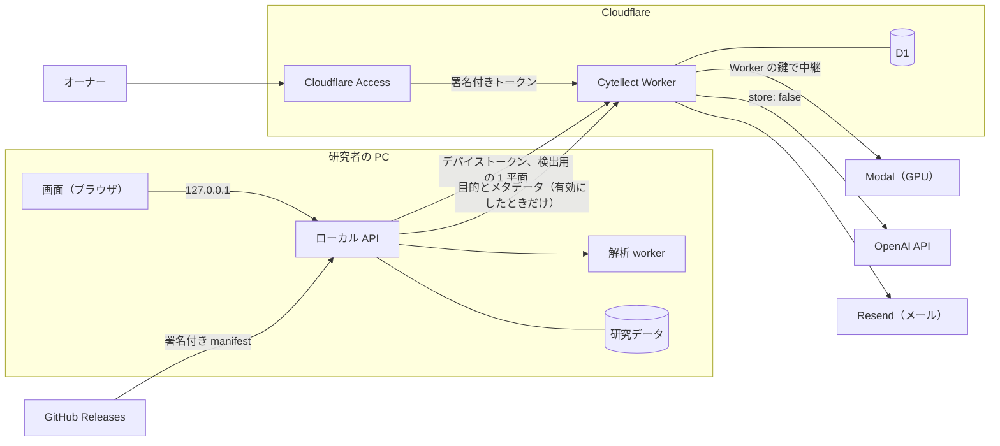

# セキュリティ

Cytellect は、研究者の PC で顕微鏡画像を解析する。クラウドの GPU や解析提案を使うときも、外に出るのは処理に必要な最小限のデータだけで、外部サービスの鍵は PC に置かない。アプリ内の更新は、オーナーの鍵で署名されたものしか実行しない。

脆弱性は [SECURITY.md](../SECURITY.md) の非公開のフォームから報告できる。

## 構成と信頼境界

Windows 版は、1 人の OS の利用者のためのアプリとして動く。ローカル API は `127.0.0.1` だけで待ち受け、画面からの要求ごとに Host、Origin、`Sec-Fetch-Site`、CSRF のヘッダーを照合する。ほかのサイトのページや DNS リバインディングからは操作できない（`tests/test_local.py`）。セッションは HttpOnly、SameSite=Strict の cookie で持ち、トークンを URL やブラウザの保存領域に置かない。読み出しのたびにセッションとワークスペースの所有者を照合し、他人のワークスペースは存在も分からない（`tests/test_api_worker.py`）。応答は `no-store` で、画面と API は `frame-ancestors 'none'` を含む CSP、`nosniff`、`no-referrer` を返す。

Docker 版と研究室のサーバーでは、解析 worker を `network_mode: none`、UID 10001、読み取り専用のルートファイルシステム、Linux の権限なしのコンテナで動かす。CI は実際のイメージでこの条件を再現し、外向きのソケットが拒否されることを確かめてから、固定した Fiji の検出器を動かす。

Cytellect Worker は、PC とクラウドの外部サービスの間に立つ。PC からの要求をデバイストークンで認証し、利用者の状態と月の上限を確かめてから、Worker だけが持つ鍵を付けて Modal や OpenAI へ中継する。

## 研究データ

画像、マスク、測定表、図は PC の非公開のディレクトリに置き、外へ送るのは次の場合だけである。

| 機能 | 送るもの | 送らないもの |
|---|---|---|
| クラウドの Cellpose | 検出に使う 1 平面、核小体のプロトコルでは採用した核のラベル、検出の条件 | ファイル名、ワークスペース名、実験条件、パス、他のチャネル |
| 解析提案（既定で無効） | 研究の目的と、チャネル名・型・寸法・視野と群の数などのメタデータ。縮小したプレビュー（6 枚まで）は、画像の送信を別に有効にしたときだけ | 絶対パス、不要なファイル名、文書、マスク、測定表 |
| ログイン | メールアドレス（コードの送信のため Resend に渡る） | — |
| 更新の確認 | なし（GitHub には PC の IP アドレスと固定の User-Agent が見える） | 研究データ、ワークスペースの識別子、アカウントの情報 |

Worker は推論の本文を読まず、保存も記録もせずに流す。Modal の Server も本文を保存しない。解析提案は `store: false` で OpenAI API を呼ぶが、OpenAI は API のデータ方針にもとづき、不正利用の監視のために要求を保持することがある。

核への結び付け、補正、測定、統計は PC で行う。測定値と統計は、API と解析パッケージの共通の実装だけが作り、原画像の画素値は変えない。

作業データは、利用者が最後に操作してから 24 時間で失効し、削除される。失効や削除の後は、その時点で読めなくなる。研究者自身の PC では、手動での保持も選べる。研究データのバックアップは取らない。

## 認証

**研究者。** クラウドの機能には、メールに届く 6 桁のコードでログインする。コードが届くのは、オーナーが許可したアドレスだけで、それ以外のアドレスはアクセスの要求としてオーナーに届く。ログインすると PC はデバイストークンを 1 つ受け取り、OS の利用者だけが読める設定ファイルに保存する。トークンは発行元の URL にだけ送り、リダイレクトは追わない（`tests/test_cloud_account.py`）。90 日使わなければ失効し、オーナーがアドレスを失効させると、そのアドレスのすべての端末が次の要求から拒否される。

コードは 10 分で失効し、5 回間違えると無効になる。間違いはアドレス単位で数え、1 日に 20 回で 24 時間ロックするので、IP アドレスを変えても試せる回数は増えない。1 つのアドレスを 1 日で当てられる確率は 5 万分の 1 である。送信は 60 秒に 1 回、1 時間に 6 回、1 日に 10 回までに抑える。

**オーナー。** 管理画面には Cloudflare Access の Google ログインで入る。Worker は Access が手前にあることを前提にせず、`Cf-Access-Jwt-Assertion` の RS256 の署名、発行者、対象、有効期限、オーナーのアドレスを自分で検証する。`none` や HMAC を名乗るトークンは拒否し、管理の経路は決められた origin でしか答えない。`workers.dev` のような別の入口からは、正しいトークンを持っていても入れない（`access.test.ts`）。

承認のメールのリンクは、HMAC で署名した 1 回限りのもので、7 日で失効する。開くとボタンだけが表示され、押したときに承認されるので、リンクを自動で開くメールのスキャナーでは承認されない。

**保存の形式。** トークンは 32 バイトの暗号論的乱数で作り、SHA-256 のハッシュだけを保存する。ログインコードは `ADMIN_SIGNING_KEY` を鍵とする HMAC-SHA256 で保存するので、データベースが漏れても 6 桁を総当たりできない。回数の制限にはアドレスと IP の鍵付きハッシュを使い、IP アドレスそのものは保存しない。

## 更新と配布物

アプリ内の更新は、オーナーの Ed25519 鍵で署名された manifest を信頼の起点にする。manifest には版、インストーラーのファイル名、SHA-256、サイズ、ソースのコミットが入り、OpenSSH の署名（名前空間 `cytellect-update`）が付く。PC は組み込まれた公開鍵で署名を検証し、インストーラーの SHA-256 とサイズが manifest と一致したときだけ実行する。署名がない、鍵が違う、版が違う、インストーラーが違う、のどれでも、何も実行せずに止まる（`tests/test_update_signature.py`、`tests/test_app_update.py`）。

GitHub のリリースに置いた `.sha256` や資産の digest は信頼の根拠にしない。秘密鍵はオーナーの PC と、オーナーの承認なしには動かない GitHub の `release` 環境にだけあるので、リポジトリへの書き込み権限だけでは、更新を通して利用者の PC でコードを実行できない。

アプリ内の更新は、公開鍵を組み込んだ版から使える。インストーラーにはまだコード署名がない。最初の導入では、署名付きの manifest と `main` にある公開鍵を使い、Windows の `ssh-keygen` でダウンロードしたファイルを確かめられる（[ダウンロードと確認](install-windows.ja.md#2-ダウンロードと確認)）。

インストーラーは実行に必要なものをすべて同梱し、導入後に何もダウンロードしない。外部サービスの鍵は入っておらず、ビルドと CI は認証情報のパターンがないことを確かめる。同梱した GPL などの部品は、同じ版のソースを固定した SHA-256 で照合してからリリースに添付する。

## 開発

`main` への変更はすべて PR を通す。ルールセットが直接の push と force push を拒み、必須のチェック、最新の `main` の取り込み、会話の解決を求める。オーナー以外の PR には別のメンバーの承認が要り、PR ごとにコードとセキュリティの自動レビューが走る。

依存は `uv.lock` と `pnpm-lock.yaml` で固定し、Fiji と Cellpose の成果物は SHA-256 で固定する。Python の依存は `pip-audit` で監査し、CycloneDX の SBOM を出力する。GitHub の Dependabot alerts も既知の脆弱性を知らせる。

秘密の走査には、版とアーカイブの SHA-256 を固定した gitleaks を使い、ハッシュを照合してから Git の全履歴を調べる。検出ツール自身も、サプライチェーンの一部として扱っている。走査の記録に残すのは件数と規則 ID だけである。

CI のトークンは、既定で `contents: read` に限り、書き込みはリリースの作成など必要なジョブにだけ与える。PR の CI には秘密を渡さない。研究者の未発表のデータは、コード、ログ、Issue、PR、CI、開発用の AI に入れない（[チーム開発ルール §6](team-development.md#6-研究データの扱い)）。他の人が使う開発環境は、登録済みの公開画像しか受け付けない。

## 前提と範囲

- 同じ OS アカウントで動くプロセスは信頼の内側にある。Windows 版は LAN や公開のサーバーとしては動かさない。
- Windows 版の外向きの通信は OS のファイアウォールでは制限しない。実行中に何もダウンロードしない作りと、導入した成果物のハッシュで守る。
- ログインの画面は、入力したアドレスが許可済み、承認待ち、失効のどれかを示す。知っているアドレスの状態は誰でも確かめられるが、IP ごとに 1 時間 20 件までに制限している。逆に、他人のアドレスを総当たりで最長 1 日ロックすることもできる。
- 研究室のサーバーの OS、物理的な保護、研究データのバックアップは研究室が管理する。
- GitHub、Cloudflare、Modal、OpenAI、Resend、Vercel の基盤そのものの安全性は、各社の管理策による。

## 脆弱性の報告と対応

脆弱性は GitHub の非公開の報告機能で受け付け、合理的な報告には 3 日以内に返信する（[SECURITY.md](../SECURITY.md)）。修正は GitHub Security Advisory の非公開のフォークで進め、通常と同じ検証を経て配布する。公開サイトは `main` へのマージで、Worker はオーナーのデプロイで、Windows 版は署名した更新で届く。配布の後に Security Advisory で公表し、必要に応じて CVE を取得する。報告者が望めば名前を記して謝意を表す。

資格情報の漏えいが疑われるときは、まず無効にして再発行する。Worker では、利用者の失効、`ADMIN_SIGNING_KEY` の交換（未使用のコード、承認リンク、ロックがすべて消える）、GPU の中継の停止をすぐに行える。更新の署名鍵の失効と交換は[リリースの署名](release-signing.md#6-鍵が漏れたまたは失ったとき失効)の手順による。

## 運用者向けの設定

### 解析提案

解析提案は既定で無効にしている（[設計](workspace-redesign.md#analysis-proposal-service-llm)）。利用者が有効にすると、ローカル API は研究の目的と正規化したメタデータ（チャネル名、型、寸法、視野と群の数、既知の対応）を Cytellect の解析提案サービスに送り、サービスは `store: false` で OpenAI API を呼ぶ。要求ごとに `transmission_confirmed: true` が要り、ない要求は拒否する。縮小した代表的なプレビュー（6 枚まで）は、利用者が画像の送信を別に有効にしたときだけ送る。絶対パス、不要なファイル名、文書、マスク、測定表は送らない。

サービスが保存するのは、利用の権利と利用量だけである。招待とデバイストークンのハッシュに加え、メールでのログインでは、アドレス、ログインコードとトークンのハッシュ、要求・承認・失効の時刻、回数の制限に使う鍵付きハッシュ、利用者ごとの月の GPU の秒数と解析提案の費用を保存する（[クラウドへのアクセス](proposal-service.md#cloud-access-e-mail-login-approval-and-gpu-gateway)、[ログインの制限](proposal-service.md#login-limits)）。プロンプトの本文、画像、コード、トークンは記録しない。運用者の鍵はサービスの secret にだけ置く。

### クラウド GPU での推論

運用者は、Cytellect にリモートの GPU 推論サービスを指定できる。Windows では `settings/cellpose-remote.json` に置き、クライアントは `CYTELLECT_CELLPOSE_REMOTE_URL` と `CYTELLECT_CELLPOSE_REMOTE_TOKEN` を読む（[クラウド GPU](cloud-gpu.ja.md)）。Docker 版の worker は `network_mode: none` のままにし、ネットワークを使う worker の構成を審査してからリモートの推論を使う。`CYTELLECT_CELLPOSE_REMOTE_*` を明示した設定は、ログインしたサービスより優先する。

クラウドにログインした Windows 版は、デバイストークンを `settings/cloud-account.json` に 1 つ保存する。研究の `data` ディレクトリの外にあり、OS の利用者だけが読める。ローカル API はトークンを画面に返さず、記録しない。ログアウトすると削除する。

Modal の Server（`infra/modal_cellpose.py`）は、要求と応答をコンテナに中継するだけで保存しない。Volume とメモリのスナップショットを使わず、proxy-auth のトークンを必須にし、単一 GPU のコンテナを最大 1 つ動かす（L4 を優先し、空きがなければ A10）。デプロイは `main` からだけ行い、ワークスペースの支出上限は Modal の管理画面で設定してデプロイでは変えられないようにしている。Modal のアカウントは GitHub のログインと 2 要素認証で守り、他のメンバーはいない。

メールでのログインを使う PC は Modal のトークンを持たず、デバイストークンを付けて Cytellect Worker（`/v1/cellpose/*`）に送る。検出の平面、ラベル、条件は途中で Cloudflare を通る。Worker は Workers の observability を無効にし、記録するのは利用者のアドレス、処理中の要求の開始時刻、経過秒数だけである。

URL は https に限り（テストではループバックの http も使える）、認証情報、クエリ、フラグメントを含めない。アクセストークンは Authorization ヘッダーで送り、エラーには出さない。推論サービス（`engines/cellpose/server.py`）は要求の内容を処理の間だけメモリに置き、ファイルを書かず、要求の内容、パス、クライアントのアドレスを記録しない。Hugging Face Inference Endpoints では、提供元は本文を保存せず、自社のログを 30 日間保持する。クライアントは、サービスが報告するランナー、モデル、パッケージのロックのハッシュがリリースと一致したときだけ結果を受け取り、一致しなければ `cellpose_remote_version_mismatch` で止まる。

### 導入と招待

ローカルで開発するときは、`CYTELLECT_DATA_DIR` を checkout の外の非公開のディレクトリにし、`CYTELLECT_APP_ORIGIN=http://localhost:3000` と `CYTELLECT_SECURE_COOKIES=false` を設定する。`uv run cytellect serve`、`uv run cytellect-worker`、`pnpm dev` は別々の端末で動かす。

Linux のコンテナでは、UID 10001 が所有するモード 0700 の専用ディレクトリを作り、その絶対パスを `CYTELLECT_RUNTIME_DIR` に設定してから `docker compose up --build -d` を実行する。worker は非公開のローカルのボリュームだけを共有する。SQLite はネットワーク共有に置かない。Fiji とモデルはビルドのときに取得し、処理の途中では取得しない。

招待は、運用者が自分だけの端末で `uv run cytellect invite --hours 24`（または `docker compose exec api cytellect invite --hours 24`）を実行して発行する。CLI は 1 回限りの招待を 1 度だけ表示するので、共有のログには流さない。トークンはハッシュで保存し、ログアウトするとセッションを失効させる。

### 共有の開発環境

他の人が使う開発環境では `CYTELLECT_UPLOAD_ALLOWLIST=fixtures/public/uploads.json` を設定する。API はアップロードされた画像や表のハッシュを計算し、SHA-256 が登録済みの公開ファイルの一覧になければ削除して `403 unregistered_upload` を返す（`tests/test_public_uploads.py`）。一覧が空か壊れていれば起動時にエラーにし、すべてを許可することはない。研究者が導入した Cytellect では、この変数を設定しない。CI の `fiji-browser` ジョブは、用意した公開の入力が一覧とバイト単位で一致することを確かめる（`scripts/check_public_uploads.py`）。

### Windows 版

1 人の利用者を前提にした信頼境界と、PC の電源が切れている間の削除の扱いは[ローカル配布](local.md)にある。

更新の有無は、ワークスペースが更新の状態を求めたとき（6 時間に 1 回まで）、`genellect/cytellect` の公開リリースの一覧に問い合わせる。利用者が更新を選ぶと、その版の manifest と署名を GitHub のリリースから取得して検証し、manifest に書かれたインストーラーだけを取得して実行する。公開鍵を組み込んでいない版はアプリ内で更新せず、新しいインストーラーの導入を案内する。鍵の作成、登録、失効、交換は[リリースの署名](release-signing.md)にある。

保存される認証情報は、ログインで受け取るデバイストークンと、管理者が入力したクラウド GPU のアクセスキー（`settings/cellpose-remote.json`）だけである。

### 公開ホスト

API のホスト名は、Vercel の画面と同じ登録可能ドメインの下に置く。`CYTELLECT_APP_ORIGIN` を正確に設定し、HTTPS と `CYTELLECT_SECURE_COOKIES=true` を使う。cookie は厳格な same-site なので、無関係な別のドメインに置いた API は使えない。

`docker compose -f compose.yaml -f infra/compose.tls.yaml up -d` で Caddy の TLS プロキシを加え、`CYTELLECT_API_HOST` を設定する。インターネットに面するのはプロキシだけにし、ホストのファイアウォール、容量の警告、OS の更新を設定する。Compose のメモリの上限が worker 全体を、supervisor が子プロセスを制限する。Caddy は上限を超える本文を multipart の解析の前に拒否し、一時的なアップロードは `/data/tmp` に置く。

非公開の研究データを受け入れる前に、実際のホストで、ブラウザの Origin と cookie の挙動、全種類の成果物でのセッションをまたいだ読み出しの拒否、取消、再起動、削除、容量の扱い、worker の外部通信の拒否を確かめる。

### 保持と復旧

ワークスペースは、利用者が最後に操作してから 24 時間で失効する。画面の自動更新やプレビューの読み出しでは延びない。処理中の作業はプロセスツリーが止まるまで物理的な削除から守り、その後に入力、配列、マスク、図、書き出し、試行のディレクトリを削除する。

ワークスペースが失効すると、親のハートビート、独立した子の watchdog、最終結果の公開も無効になり、処理中のタスクがリースを更新して期限を越えて動き続けることはない。親と子は、どちらも有効なリースを持つ間だけ動く。データベースや監視でエラーが起きると、supervisor は科学計算のプロセスツリーを止め、結果を公開せず、非公開の起動記述を削除する。子の watchdog も、データベースや親の同一性を確かめられなければ計算を止める（`tests/test_supervision.py`）。Linux の試行は専用のプロセスグループで動くので、直接の子が先に終わっても Fiji の子孫まで止められる。サブプロセスの生の出力は残さない。

worker が止まっていた場合は、`cytellect cleanup` を手動で実行する。中断した処理は永続的なリースで回復し、自動の再試行は 2 回まで、古い worker は結果を確定できない。再試行は新しい試行として始め、前の結果を上書きしない。

Alembic の移行は、起動時に SQLite の書き込みロックの下で実行する。コードとスキーマの変更は、API と worker を同時に止めてからデプロイする。自動のダウングレードや、使用中の WAL ファイルのコピーはしない。スキーマの復旧の前には、オフラインで非公開の、短期間だけ保持するメタデータのスナップショットを取る。

### 公開ページの計測

`https://cytellect.app` の LP（`/`）、公開デモ（`/demo`、[公開デモ](showcase.md)）、解析計画の手引き（`/plan`）は、COMPASS 公式の GA4 の送信先 `G-EHKJ8B8N0Y` で計測する。どのページも研究画像を受け付けない。Google のタグは別の文書 `/lp-metrics.html` にだけ置き、この文書は親のパスを決まった一覧と照合し、ページを離れると破棄される。主文書の CSP は Google を許可しない。研究者が導入した Cytellect のワークスペース、`/legacy`、API を有効にしたビルド、ローカルの導入、プレビュー、開発のホストはタグを読み込まない。公開のビルドの `/workspace` は `/demo` へ、`/product` は `/` へ転送する。

送るのは、固定の URL とタイトル（`/` は Cytellect、`/demo` は Cytellect — Example analysis、`/plan` は Cytellect — Analysis planning）、参照元の HTTPS の origin、決めた操作の名前だけで、URL のクエリ、入力した文字、ファイル名、研究のメタデータ、画像、測定値、アプリの状態は送らない。iframe で分けているのは読み込みと破棄の時期で、権限ではない。広告の同意は拒否し、Google シグナルとパーソナライズは無効にしている。Do Not Track か Global Privacy Control を有効にしたブラウザには、タグを読み込まない。セッションの記録はしない。

イベントは `page_view`、`download_click`（Windows 版のパッケージへのリンク）、`download_section_click`、`example_click`、`planning_click`、`launch_help_click`、`workspace_click`（LP から解析の画面へのリンク）、`demo_step_click`（`content_id` は demo_experiment、demo_image、demo_statistics、demo_figure）、`demo_download_click`、`demo_guide_click`、`guide_click`（`content_id` は guide、quickstart、methods、setup、figures）で、ほかに GA4 の通常のセッションとエンゲージメントのイベントが記録される。COMPASS の結果と分けるにはホスト名を `cytellect.app` で絞り込み、独自ドメインに移した 2026-10-29 より前を含む期間では `cytellect.vercel.app` も含める。

自動のブラウザの確認では Google のスクリプトを差し止めるので、本番のレポートには入らない。本番では、実際のタグと収集の要求が出ることと、ページを離れた後にタグが消えることを確かめ、イベントの処理は GA4 のリアルタイムか DebugView で確かめる。

### Docker Desktop の所有者のアクセス

Desktop 用の設定は、ループバックに公開した API（127.0.0.1:8001）と画面（127.0.0.1:3087）で `CYTELLECT_DESKTOP_OWNER` を有効にする。非公開のボリュームに `local-owner` という識別子を保存し、再起動やセッションの失効をまたいで同じ所有者として扱う。画面は招待なしに 7 日間有効なセッションを得る。

この入口は、Origin と Host が違うか欠けている要求、CSRF のヘッダー、Fetch Metadata、転送のヘッダーが合わない要求を拒否する（`tests/test_desktop_owner.py`）。Docker のポートをループバックにだけ公開していることも境界の一部なので、公開のプロキシの後ろで有効にしたり、公開先を 0.0.0.0 に変えたりしない。研究室のサーバーの招待による認証は変わらず、この入口は既定では無効である。非公開のボリュームを削除すると、ローカルの所有者も消える。

### 手動の保持

研究者が自分で導入した Cytellect では、ワークスペースを手動で保持する方式を選べる。Docker Desktop では `CYTELLECT_WORKSPACE_RETENTION_MODE=manual` を設定し、Windows のランチャーではセットアップでの選択を `settings/retention.json` に保存する。アプリの origin がループバックのときだけ選べるので、研究室のサーバーやホスト型のサービスは必ず 24 時間で失効させる。変わるのは 24 時間の失効だけで、セッションと招待の失効、所有者の確認、リース、取消、削除はそのまま働く。

データベースは方式を記録し（`retention_policy`、移行 0010）、非公開のボリュームに置いた目印のファイルも同じ方式を示す。どちらかが手動の保持を示していれば、24 時間の失効の方式では起動できない。失効の処理はトランザクションのたびに記録された方式を確かめ直すので、目印を失っても、古いプロセスが保持中の作業を失効させることはない。初めて手動の保持を有効にしたとき、すでに期限を過ぎていたワークスペースは削除する。方式を変える前には、書き込むプロセスをすべて止める。データベース、目印、成果物はまとめて保存し、バックアップ、容量の監視、手動の削除は研究室が担う。
